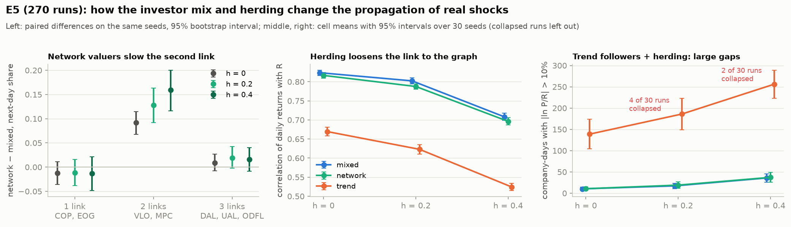
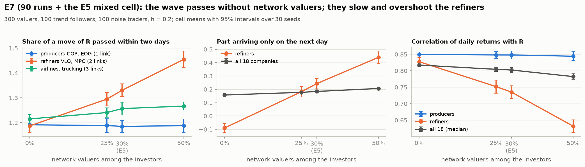

# F7: эксперименты

Здесь собираются ответы на вопросы исследования по экспериментам F7. Как запускать эксперименты (runner, продолжение, шарды) — `docs/guides/f6_full_network.md`.

## P5 на полном E5 (`notebooks/07_e5_propagation.ipynb`)

**Вопрос P5:** как стратегии инвесторов и стадность меняют распространение шоков по графу зависимостей.

**Эксперимент E5** (`configs/f6_e5.yaml`): рынок 18 компаний на графе `real_v1` с реальными рядами сырья и S&P 500 за 2024–2025, 502 сессии; состав инвесторов {`mixed`, `network`, `trend`} × стадность $h$ {0; 0,2; 0,4} × 30 seeds (3001–3030) = 270 прогонов. Доли 500 инвесторов (близорукие оценщики / сетевые оценщики / трендовые / шумовые): `mixed` 30/30/20/20, `network` 15/45/20/20, `trend` 35/15/30/20; плюс 25 фондов-ребалансировщиков. E4 (`notebooks/05_chain_wave.ipynb`) отвечал на тот же вопрос на цепочке из трёх компаний с синтетическим скачком нефти; здесь шоки — реальные движения за два года.

### Метрики (одно значение на прогон, после 10 сессий разогрева; R — эталон, записанный в логе прогона)

| Группа | Метрика | Смысл |
|---|---|---|
| скорость | день 0, день 1 | объединённая регрессия дневной доходности каждой компании на изменение своего R в тот же день и накануне; у рынка, который сразу учитывает граф, 1 и 0 |
| скорость | день 1 по звеньям | то же для компаний в 1, 2 и 3 звеньях от нефти (COP, EOG / VLO, MPC / DAL, UAL, ODFL) |
| скорость | задержка (D1) | `marketsim.metrics.wave_metrics`: сдвиг с максимальной кросс-корреляцией Δ ln R и Δ ln P на сетке 0,25 сессии (до 3 сессий), среднее по 18 компаниям |
| размер | усиление волатильности (D1) | `wave_metrics`: σ(Δ ln P) / σ(Δ ln R) по сессиям, медиана по компаниям; > 1 — рынок усиливает движения R |
| точность | корреляция с R | корреляция дневных доходностей P и R, медиана по компаниям |
| точность | дни с отклонением | акцие-дни с $\lvert\ln(P/R)\rvert$ > 10% (из ~8900 за прогон) |
| инерция | автокорреляция | автокорреляция дневных доходностей с лагом 1, среднее по компаниям (реальные акции: −0,05) |
| устойчивость | обвал | цена закрытия какой-то компании хоть раз ушла ниже половины своего R (или выше двух R) |

### Статистика

Единица — прогон. Контрасты **парные по seed**: разность метрики между двумя ячейками на одном и том же seed (в каждой ячейке seeds 3001–3030), её среднее и 95%-й интервал из бутстрэпа по seeds (5000 повторов). Пара выбрасывается, если обвалился хотя бы один из двух прогонов; обвалы — отдельный результат, с интервалами Уилсона. На каждую метрику 12 контрастов (состав: network − mixed и trend − mixed при каждом $h$; стадность: $h$ = 0,2 − 0 и 0,4 − 0 в каждом составе), поэтому отмечено и то, что выдерживает поправку Бонферрони (уровень 1 − 0,05/12). Ниже «ясно» означает, что выдерживает, если не сказано иное. Таблицы: `runs/f6/v1/e5/p5_metrics.csv` (метрики прогонов) и `p5_contrasts.csv` (контрасты).

### Средние по ячейкам (без обвалов)

| Состав, $h$ | День 0 | День 1 | День 1: 1 / 2 / 3 звена | Задержка, сессий | Усиление волатильности | Корреляция с R | Дней с отклонением | Автокорреляция | Обвалов |
|---|---|---|---|---|---|---|---|---|---|
| mixed, 0 | 1,04 | 0,19 | −0,03 / 0,24 / 0,16 | 0,57 | 1,34 | 0,82 | 10 | −0,01 | 0 из 30 |
| mixed, 0,2 | 1,04 | 0,18 | −0,08 / 0,24 / 0,14 | 0,65 | 1,40 | 0,80 | 17 | −0,05 | 0 из 30 |
| mixed, 0,4 | 0,96 | 0,25 | −0,03 / 0,37 / 0,21 | 0,72 | 1,46 | 0,71 | 36 | −0,08 | 0 из 30 |
| network, 0 | 1,03 | 0,20 | −0,04 / 0,33 / 0,17 | 0,60 | 1,34 | 0,82 | 11 | −0,01 | 0 из 30 |
| network, 0,2 | 1,03 | 0,20 | −0,09 / 0,37 / 0,16 | 0,66 | 1,41 | 0,79 | 19 | −0,05 | 0 из 30 |
| network, 0,4 | 0,95 | 0,26 | −0,04 / 0,53 / 0,23 | 0,73 | 1,49 | 0,70 | 37 | −0,08 | 0 из 30 |
| trend, 0 | 0,93 | 0,38 | 0,20 / 0,43 / 0,39 | 0,64 | 1,53 | 0,67 | 139 | +0,18 | 0 из 30 |
| trend, 0,2 | 0,92 | 0,39 | 0,18 / 0,48 / 0,40 | 0,70 | 1,62 | 0,62 | 186 | +0,16 | 4 из 30 |
| trend, 0,4 | 0,83 | 0,44 | 0,28 / 0,55 / 0,45 | 0,78 | 1,73 | 0,52 | 256 | +0,15 | 2 из 30 |

Стандартные ошибки средних по seeds: 0,003–0,009 для дней 0 и 1, корреляции и задержки; 0,004–0,014 для усиления волатильности; 0,01–0,03 для дня 1 по звеньям; 2–6 дней с отклонением в mixed и network и 17–19 в trend.



### Состав инвесторов

- **Сетевые оценщики замедляют второе звено и больше ничего.** По сравнению с `mixed` доля движения НПЗ (VLO, MPC — два звена от нефти), приходящая на следующий день, больше на 0,09 [0,07; 0,11], 0,13 [0,09; 0,16] и 0,16 [0,12; 0,20] при $h$ = 0; 0,2; 0,4. У добытчиков (COP, EOG — одно звено), авиакомпаний и грузоперевозок (три звена) разницы нет, а рыночные метрики сдвигаются не больше чем на 0,01–0,03 (корреляция с R, усиление волатильности, день 1). Это результат E4 на цепочке, повторённый на реальном графе с реальными шоками: сетевой оценщик считает цену VLO по цене COP на бирже, которая сама ещё движется, а близорукий — прямо по нефти.
- **Трендовые меняют всё.** По сравнению с `mixed`: доля движения в тот же день меньше на 0,11–0,14, на следующий день больше на 0,19–0,21, задержка (D1) длиннее на 0,05–0,06 сессии, усиление волатильности больше на 0,20–0,26, корреляция с R ниже на 0,15–0,18, дней с отклонением больше на 129–220 за прогон, автокорреляция доходностей становится положительной (+0,19…+0,23 — инерция, которой у реальных акций нет).

### Стадность

- **В любом составе стадность делает рынок медленнее, шумнее и дальше от графа,** и эффект растёт с $h$. При $h$ = 0,4 против $h$ = 0: задержка +0,13…+0,15 сессии, усиление волатильности +0,13…+0,19, корреляция с R −0,12…−0,14, доля следующего дня +0,05…+0,06, доля того же дня −0,07…−0,10, дней с отклонением +26 в `mixed` и `network` и +118 в `trend`. Уже при $h$ = 0,2 заметно растут задержка (+0,06…+0,08), усиление волатильности (+0,06…+0,08) и падает корреляция (−0,02…−0,05), а доля следующего дня почти не меняется.
- Стадность снижает автокорреляцию доходностей (−0,04…−0,07 в `mixed` и `network`): подражание перелетает, и на следующий день цена возвращается.
- **От состава зависит, насколько стадность вредит** (разность разностей при $h$ = 0,4): в `trend` стадность добавляет на 93 [72; 115] дня с отклонением больше, на 0,064 больше усиления волатильности и на 0,028 сильнее снижает корреляцию, чем в `mixed`; в `network` взаимодействие мало (усиление волатильности +0,026).

### Обвалы

6 из 60 прогонов `trend` с $h$ ≥ 0,2 (95%-й интервал 4,7–20%) против 0 из остальных 210 (0–1,8%); односторонний точный тест Фишера $p \approx 10^{-4}$. Все шесть — апрель 2025; механизм (каскад стоп-лоссов, разогнанный сдвигом котировок мейкеров) — в `docs/guides/f6_full_network.md`.

### Ответ на P5

На реальном графе и реальных шоках 2024–2025 шок всегда проходит всю цепочку; инвесторы меняют то, **как быстро и насколько чисто** он проходит. Сетевые оценщики задерживают второе звено примерно на десятую долю движения в день; трендовые и стадность замедляют и усиливают каждое звено, и только их сочетание ломает рынок. Оговорка о калибровке из `notebooks/06_real_checks.ipynb` остаётся: уровни метрик — результат калибровки, а находка — различия между ячейками на одних и тех же seeds.

## P7 на E7 (`notebooks/08_e7_network_share.ipynb`)

**Вопрос P7:** какая доля инвесторов должна знать зависимости между компаниями, чтобы волна проходила, и создают ли они перелёт.

**Эксперимент E7** (`configs/f7_e7_network0.yaml`, `…25.yaml`, `…50.yaml`; три файла, потому что сетка — декартово произведение, а два числа должны меняться вместе): рынок E5 (`real_v1`, реальные сигналы 2024–2025, 502 сессии, $h$ = 0,2) с 500 инвесторами — 300 оценщиков, 100 трендовых, 100 шумовых. Меняется только состав оценщиков: **0, 125 или 250 сетевых** (0%, 25%, 50% инвесторов), остальные близорукие; 30 seeds (3001–3030, как в E5) = 90 прогонов, около часа на 10 процессах, 9,5 ГБ (`runs/f7/e7`). Смешанная ячейка E5 при $h$ = 0,2 — тот же рынок со 150 сетевыми (30%), она показана четвёртой точкой.

```bash
for s in 0 25 50; do python -m marketsim.experiments.run configs/f7_e7_network$s.yaml --out runs/f7/e7/network$s --workers 10; done
```

**Что знают оценщики.** Сетевой использует полные веса `real_v1`, в том числе от компаний-родителей (VLO ← COP, EOG), и читает их цены на бирже. Близорукий использует **прямые** веса — регрессию компании только на её внешних родителей. На реальном графе прямые веса уже содержат почти весь косвенный путь: у VLO прямые веса — нефть 0,43 и S&P 500 0,60, а полный граф через COP и EOG даёт 0,42 и 0,61. Поэтому, в отличие от синтетической цепочки F5 (где у близоруких оценщиков второго звена не было веса нефти и без сетевых волна останавливалась), здесь близорукие могут нести волну сами.

**Метрики** — как для P5, плюс доля движения R, прошедшая за два дня (день 0 + день 1), и корреляция с R отдельно для звеньев и для GOOGL и META (их родители-компании NVDA и AMD известны только сетевым). Контрасты — парные по seed, бутстрэп 95%, поправка Бонферрони на 3 контраста.

| Сетевых оценщиков | НПЗ: прошло за 2 дня | НПЗ: доля следующего дня | НПЗ: корреляция с R | Добытчики: прошло за 2 дня | Авиа: прошло за 2 дня | Задержка (D1) | Корреляция с R (все) | Дней с отклонением |
|---|---|---|---|---|---|---|---|---|
| 0% | 1,19 | −0,09 | 0,83 | 1,19 | 1,22 | 0,61 | 0,82 | 16 |
| 25% | 1,30 | 0,18 | 0,75 | 1,19 | 1,24 | 0,63 | 0,80 | 21 |
| 30% (E5) | 1,33 | 0,24 | 0,74 | 1,19 | 1,26 | 0,65 | 0,80 | 17 |
| 50% | 1,46 | 0,44 | 0,63 | 1,19 | 1,27 | 0,67 | 0,78 | 21 |



- **Все 120 прогонов без обвалов.**
- **Чтобы волна прошла, сетевые оценщики не нужны вовсе.** Без них НПЗ (два звена от нефти) за два дня проходят 1,19 движения R — ровно столько же, сколько добытчики (одно звено), и их доходности теснее всего связаны с R (0,83).
- **Сетевые оценщики приносят задержку и перелёт на том звене, которое знают.** У НПЗ при 25% и 50% сетевых против 0%: доля следующего дня +0,27 [0,23; 0,32] и +0,53 [0,48; 0,58], прошло за два дня +0,11 [0,08; 0,13] и +0,27 [0,24; 0,30] (второе звено перелетает сильнее), корреляция с R −0,08 и −0,20. Ячейка E5 (30%) ложится на ту же линию.
- **Остальной рынок почти не меняется.** У добытчиков разницы нет; авиакомпании и грузоперевозки проходят чуть больше (+0,03 и +0,05); GOOGL и META (веса NVDA и AMD меньше 0,1) не отличаются. По всему рынку при 50% против 0%: задержка +0,05 сессии, усиление волатильности +0,02, корреляция с R −0,035; число дней с отклонением заметно не меняется.

**Ответ на P7.** На реальном графе волна проходит и совсем без сетевых оценщиков; каждый дополнительный сетевой оценщик делает НПЗ — единственное звено, где у графа сильные рёбра от компаний, — медленнее и сильнее перелетающими, примерно пропорционально их доле. Это расходится с синтетической цепочкой F5, где без сетевых волна останавливалась: нужно ли «знать граф», зависит от того, содержит ли простая модель уже косвенную зависимость.

**Чего E7 не показывает.** В симуляции нет новостей компаний: R движется только пятью внешними рядами. Сетевой оценщик может выиграть у близорукого, только когда компания-родитель движется по своей причине (новость о COP). Поэтому E7 измеряет только цену знания графа (чтение шумных биржевых цен родителей); его пользу покажет E6 с шоком одной компании.
