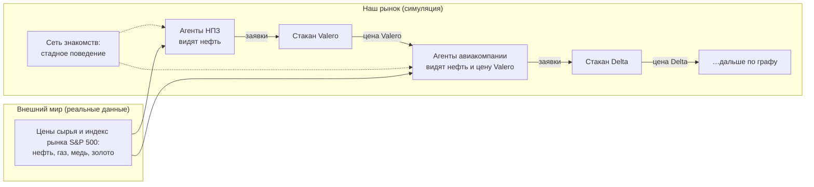

# Ресерч: scope проекта, данные и план работ

**Дата:** 28 октября 2026 г. (версия 3)
**Основа:** исходная пропозиция команды, статья Скшинского (PP-RAI 2025, с. 335–341), его репозиторий [MASfSES-JADE](https://github.com/j-skrzynski/MASfSES-JADE) и обсуждение scope в команде.

Объяснение простыми словами, с примерами на числах: [explainer.md](explainer.md). Контракты между частями: [contracts.md](contracts.md). План и фазы: [../plans/overall_plan.md](../plans/overall_plan.md).

> **Что изменилось по сравнению с версией 2.** В версии 2 граф зависимостей был «формулой мира»: из цены нефти мы сами вычисляли стоимость каждой компании, а агенты её только догоняли. Агенты тогда почти ничего не решали. В версии 3 **граф — это знание агентов**: агент сам пересчитывает свою оценку компании, когда видит, что изменилась цена того, от чего она зависит. Волна идёт от акции к акции **через сделки агентов**, и её никто не вычисляет заранее. Убраны: ценовая модель Леонтьева, маржи, коэффициенты ρ, L, κ, проверка по индексам цен производителей, данные Dallas Fed.

Документ читается сверху вниз: **как устроен проект** (разделы 1–4), **данные** (5), **вопросы и проверка** (6–7), **эксперименты** (8), **визуализация и scope** (9–10), **план** (11).

---

## 0. Коротко

1. **Мы строим рынок, на котором агенты сами принимают решения:** каждый независимо или с оглядкой на других. Их решения волной расходятся по рынку. Цены акций никто не задаёт: они возникают из сделок.
2. **Есть две сети, по которым идут волны:**
   - **граф зависимостей активов** — что от чего зависит: «НПЗ зависит от нефти», «авиакомпания зависит от НПЗ». Агенты используют его, чтобы пересчитывать свои оценки;
   - **сеть знакомств агентов** — кто на кого смотрит. По ней идёт стадное поведение (herding).
3. **Реальные данные входят в трёх местах:**
   - реальные цены сырья (нефть, газ, металлы) и индекс всего рынка S&P 500 — внешние сигналы, которые видят агенты;
   - веса графа — насколько акции исторически реагировали на сырьё и друг на друга (регрессия по ценам 2021–2023, структура связей из таблиц BEA);
   - реальные цены акций — стартовые цены и сравнение результата с реальностью (2024–2025).
4. **Главный вопрос:** как стратегии агентов и стадность меняют распространение шока по графу. Доходит ли волна от нефти до дальних звеньев цепочки, усиливается или затухает, с какой задержкой, и появляются ли связи между акциями, которых в графе нет?
5. **Реальные числа уже посчитаны (2021–2023):** нефть +1% → акция ConocoPhillips +0,52%; ConocoPhillips +1% → Valero (НПЗ) +0,70%; Valero +1% → Delta +0,22%. Опережения на следующий день в реальных данных **нет**: волна проходит внутри дня. Это важная проверка для симуляции.

---

## 1. Как устроен проект

**Цепочка причин и следствий:**
1. Реальная нефть изменилась (данные).
2. Агенты, которые торгуют компаниями, зависящими от нефти, **сами** пересчитывают оценку и торгуют.
3. Цены этих акций меняются: **из сделок**, с задержками, перелётами и паникой.
4. Агенты следующих по графу компаний видят **эти** цены (вместе со всеми ошибками рынка), пересчитывают **свои** оценки и торгуют.
5. И так далее по графу. Параллельно агенты копируют соседей по сети знакомств.

### Что программируем и что возникает

| Программируем явно | Возникает из взаимодействия (то, что изучаем) |
|---|---|
| правила биржи (стакан, сопоставление заявок) | цена каждой акции |
| правила решений агентов: как пересчитывать оценку, когда покупать и продавать | **волна по графу**: как далеко она доходит, с какой задержкой, усиливается или затухает |
| веса графа (из данных) | ошибки рынка, передающиеся по цепочке: перелёт на одной акции становится сигналом для следующей |
| сеть знакомств и силу стадности $h$ | каскады продаж, обвалы, исчезновение ликвидности |
| ресурсы агентов (деньги, акции) | связи между акциями, которых нет в графе; перераспределение богатства |

Единственный «расчёт без агентов» в проекте — **эталонная траектория** (раздел 4.6). Это линейка для измерений: «что было бы, если бы все мгновенно и точно применили веса графа». Агенты её не видят.

### Где реальные данные нужны, а где нет

| Компонент | Реальные данные? | Откуда |
|---|---|---|
| Биржа, стакан, сопоставление заявок | нет | правила GPW/NASDAQ, тесты |
| Правила агентов (типы стратегий) | нет, структура из литературы | Lux–Marchesi, Chiarella–Iori |
| Цены сырья и индекс рынка | **да** | FRED, Yahoo, World Bank (5.1) |
| Структура графа (какие связи есть) | **да** | таблицы BEA «кто у кого покупает» (5.2) |
| Веса графа (насколько сильно) | **да** | регрессия по реальным ценам акций 2021–2023 (5.2, 5.4) |
| Стартовые цены акций | **да** | Yahoo, первый день периода |
| Проверка результата | **да** | реальные цены акций 2024–2025, отраслевые портфели (5.4) |
| Параметры микроструктуры (спред, размеры заявок) | желательно | LOBSTER / Binance / Tardis (5.5) |

---

## 2. Что сделал Скшинский и чем мы отличаемся

В рабочем коде Скшинского есть биржа с правилами GPW, брокер, два простых инвестора и «воображаемый инвестор» с бесконечными ресурсами, который тянет цену к историческим дневным ценам AAPL (около 460 точек в `Main.java`). Фундаментальная, трендовая и случайная стратегии **закомментированы**. В статье один эксперимент с одним агентом, без повторов и метрик.

| | Скшинский | Мы |
|---|---|---|
| Роль реальных данных | **диктуют цену** акции | **сигнал для агентов** (сырьё) и **их знание о связях** (веса графа); цена возникает |
| Активы | 1 (AAPL) | ~18–20 компаний + ~5 сырьевых рядов |
| Связи между активами | нет | граф зависимостей; шок идёт по нему через сделки агентов |
| Агенты | 1–2 | ~1000, несколько типов и стратегий, стадность |
| Методика | один прогон | сетки параметров × 30 seeds, ablation, проверка на отложенном периоде |

---

## 3. Граф зависимостей

### 3.1 Узлы

| Тип узла | Сколько | Пример | Как ведёт себя в симуляции |
|---|---|---|---|
| **Сырьё** (экзогенно = берётся из данных) | 4 | нефть WTI, газ Henry Hub, медь, золото (Brent и платина собираются для сверки, в граф не входят) | реальный ряд цен, «проигрывается» день за днём; им не торгуют |
| **Индекс рынка** (экзогенно) | 1 | S&P 500 | реальный ряд; стрелка от него идёт к **каждой** компании: «как идёт весь рынок» (ставки, настроения, кризисы); им не торгуют |
| **Компании** (торгуются) | ~18–20 | COP, VLO, DAL, NEE, NVDA, GOOGL, … | у каждой свой стакан; цена возникает из торговли агентов |

Отрасли здесь — не узлы, а **подсказка**, какие связи между компаниями вообще имеют экономический смысл (3.3).

### 3.2 Ребро и его вес

Ребро $j \to i$ с весом $w_{ij}$ означает:

> «Если цена $j$ изменилась на 1%, справедливая оценка $i$ меняется на $w_{ij}$%».

$j$ может быть сырьём или другой компанией. Вес может быть отрицательным (дорогое топливо плохо для авиакомпании).

Граф — это **знание агентов о мире**, а не формула, по которой мы считаем цены. Агенты используют его, чтобы пересчитывать свои оценки (раздел 4.2).

### 3.3 Откуда берём граф (данные, задача D2)

**Шаг 1. Какие рёбра есть (структура) — из экономики.** По таблице BEA «затраты–выпуск» (кто у кого покупает) оставляем рёбра «поставщик → покупатель», если покупатель тратит на продукцию поставщика заметную долю выпуска (порог, например, ≥ 2%). Плюс рёбра «сырьё → компании, которые его добывают или потребляют» и «индекс → каждая компания». Каждое ребро сопровождается письменным обоснованием. Связи между компаниями без экономического смысла **не добавляем**, даже если цены коррелируют: иначе граф будет описывать случайные совпадения.

Примеры из таблицы BEA 2023: нефтепереработка тратит **50,8%** выпуска на сырую нефть и газ; авиаперевозки — **12,9%** на нефтепродукты; энергетика — 2,7% на нефть и газ; обработка данных — 1,0% на электричество.

**Шаг 2. Насколько сильно (веса) — из цен акций.** Для каждой компании $i$ — регрессия её дневных доходностей на доходности её «родителей» в графе, включая индекс рынка (S&P 500), период 2021–2023:

$$
r_{i,t} = \alpha_i + \sum_{j \in \text{parents}(i)} w_{ij}\, r_{j,t} + \beta^{\text{mkt}}_i\, r^{\text{mkt}}_t + u_{i,t}
$$

где $r_{i,t} = \ln P_{i,t} - \ln P_{i,t-1}$ — дневная доходность, $\beta^{\text{mkt}}_i$ — вес стрелки «индекс → компания». Индекс в регрессии обязателен: иначе веса между компаниями будут завышены, потому что почти все акции в один день растут или падают вместе с рынком.

**Реальные результаты** (посчитаны 28.10.2026, 752 торговых дня 2021–2023; в скобках t-статистика: |t| > 2 означает, что связь вряд ли случайна):

| Ребро | Вес $w$ | Комментарий |
|---|---|---|
| нефть → COP (добыча) | **+0,52** (t = 20) | сильная прямая связь |
| нефть → EOG (добыча) | **+0,55** (t = 19) | |
| нефть → VLO (НПЗ) | +0,43 (t = 14) | НПЗ в 2021–2023 росли вместе с нефтью |
| COP → VLO | **+0,70** (t = 20) | если учесть COP, прямой вес нефти на VLO падает до +0,07 |
| нефть → DAL (авиа), только нефть | −0,04 (t = −1,5) | **напрямую почти не видно** |
| VLO → DAL, вместе с нефтью | **+0,22** (t = 6,5) | с учётом VLO вес нефти на DAL становится **−0,14** (t = −4,4) |
| NVDA → GOOGL | +0,09 (t = 4,2) | AI-железо → AI-сервисы |
| NEE → GOOGL | −0,10 (t = −3,2) | скорее общий фактор процентных ставок, чем электричество: **пример, почему структуру берём из экономики, а не из корреляций** |
| индекс → DUK / JPM / GOOGL / NVDA | 0,39 / 0,86 / 1,36 / 2,18 (t от 11 до 31) | энергетика двигается с рынком слабо, NVDA — вдвое сильнее рынка |

**Опережение на следующий день в реальных данных отсутствует:** вчерашнее движение VLO не предсказывает сегодняшнее движение DAL (вес +0,025, t = 0,8), вчерашняя нефть — тоже (t = 0,9). На реальном рынке волна по графу проходит **внутри одного дня**. Это используем как проверку (7.3).

**Две версии весов.** Веса зависят от того, каких родителей включили в регрессию (см. DAL выше). Поэтому D2 оценивает два набора:
- **прямые:** сырьё и индекс → компания. Ими пользуются «близорукие» агенты;
- **полные:** сырьё + компании-родители. Ими пользуются «сетевые» агенты.

**Шаг 3. Проверка устойчивости.** Если в графе есть циклы (A зависит от B, B от A), оценки могут раскачивать друг друга. Требование: спектральный радиус матрицы весов между компаниями < 1. Простыми словами, при проходе по любому циклу эффект ослабевает. Проверяется одной строкой при загрузке графа.

### 3.4 Ограничения графа (пишем в отчёт)

- Веса — это **средняя историческая реакция**, а не точный экономический механизм. Они описывают, как «опытный трейдер» представляет себе связи, и это ровно то, что нужно для агентов.
- Веса из реальных цен уже содержат часть поведения реального рынка. Поэтому мы не утверждаем, что граф — «правда об экономике». Он **убеждения агентов**, откалиброванные на истории.
- Связи считаются постоянными на всём периоде.
- Таблицы BEA описывают США, поэтому компании американские.
- Привязка компании к одной отрасли упрощает реальность (например, у ConocoPhillips SIC-код в EDGAR устарел, раздел 5.3).
- В S&P 500 входят и наши компании (у NVDA, GOOGL, META заметные доли), то есть индекс частично содержит реальные цены наших акций. Упрощение, пишем в ограничения.

---

## 4. Агенты и рынок

Правила биржи и шлюза (заявки, сопоставление, резервирование) — в `../plans/phases/F3_exchange_engine.md`, раздел 2. Планировщик событий и базовые агенты — в `../plans/phases/F4_single_asset_market.md`. Ниже — то, что относится к графу и мультиактивности.

### 4.1 Типы агентов

| Тип | Как решает | Роль |
|---|---|---|
| **Оценщик** (фундаменталист) | держит свою оценку $V$ каждой акции, за которой следит, и пересчитывает её по графу (4.2); покупает, если цена ниже оценки, продаёт, если выше | переносит шоки по графу |
| — «близорукий» | знает только связи от сырья и индекса (прямые веса) | |
| — «сетевой» | знает и связи «компания → компания» (полные веса) и смотрит на **рыночные цены** соседей по графу | именно через них волна идёт от акции к акции |
| **Трендовый** | смотрит на прошлую цену своей акции: росла — покупает | усиливает движения |
| **Шумовой** | случайные решения | ликвидность, случайность |
| **Маркет-мейкер** | выставляет заявки с двух сторон, ограниченные ресурсы | ликвидность |
| **Фонд-ребалансировщик** | держит целевые доли в портфеле | связывает акции через портфель |
| **Риск-лимит (stop-loss)** | при большой просадке портфеля продаёт всё | вынужденные распродажи |

**Стадность** (herding, сила $h$) накладывается на всех, кроме маркет-мейкеров: агент смешивает свой сигнал с сигналами соседей по сети знакомств: $s_i = (1 - h)\, b_i + h\, \bar d_{N_i}$.

### 4.2 Как оценщик пересчитывает оценку

Агент $a$ держит оценку $V_{a,i}$ акции $i$. Когда он в очередной раз принимает решение (момент $t$, прошлое решение было в $t'$), он смотрит, **как изменились цены родителей** $i$ в графе, и сдвигает оценку:

$$
\ln V_{a,i}(t) = \ln V_{a,i}(t') + \sum_{j \in N_a(i)} \hat w_{a,ij}\,\Big[\ln P^{\text{obs}}_{a,j}(t) - \ln P^{\text{obs}}_{a,j}(t')\Big] + J_i(t', t]
$$

- $N_a(i)$ — родители $i$, о которых агент знает: у близорукого сырьё и индекс, у сетевого ещё и компании;
- $P^{\text{obs}}_{a,j}(t) = P_j(t - d_a)$ — цена родителя, **которую агент видит с опозданием** $d_a$. Для сырья и индекса это реальная цена, для компании — **цена на нашей бирже**, со всеми ошибками нашего рынка;
- $\hat w_{a,ij} = w_{ij}\,(1 + \eta_{a,ij})$ — вес графа, каким его **представляет себе агент**: у каждого своя небольшая ошибка $\eta$;
- $J_i$ — публичные новости компании (редкие случайные скачки, одинаковые для всех агентов); по желанию;
- старт: $V_{a,i}(0) = P_i(0)\,(1 + e_a)$ — реальная цена на дату начала с индивидуальным оптимизмом или пессимизмом $e_a$.

**Сигнал** из оценки: $b_{a,i} = \operatorname{clip}\!\big((V_{a,i} - P_i) / (\gamma P_i),\, -1,\, 1\big)$. Акция на $\gamma$ (например 5%) дешевле оценки → максимальное желание купить. Дальше — стадность, размер заявки, отправка на биржу (`../plans/phases/F4_single_asset_market.md`, раздел 3).

**Почему это важно.** Сетевой оценщик авиакомпании реагирует на **рыночную цену** Valero, а не на «правильную». Если на Valero случилась паника и цена упала слишком сильно, оценщики Delta воспримут это как реальную новость и передадут ошибку дальше. Распространение ошибок рынка по графу — главный эмерджентный эффект, который мы изучаем.

### 4.3 Мультиактивность

| Элемент | Решение |
|---|---|
| Стаканы | по одному на компанию, один и тот же matching engine |
| Кошелёк | **один на агента** по всем акциям: потери на одной акции уменьшают деньги на другие |
| Внимание | каждый агент торгует 3–5 акциями, но **видит цены всех** (рыночные данные публичны) |
| Маркет-мейкеры | хотя бы один на каждую акцию |
| Размер популяции | ориентир ~1000 агентов на 20 акций; точнее — по пилоту |

### 4.4 Время

1 торговая сессия = 1 торговый день, около 250 сессий в году. Реальные цены сырья и индекс обновляются в начале сессии. Внутри сессии агенты действуют в случайные моменты (события DES), поэтому волна по графу идёт **внутри сессии**, в «минутах» симуляции. Это соответствует реальности (3.3: опережения на следующий день нет). В режиме воспроизведения волна видна, если замедлить время внутри сессии.

### 4.5 Пример волны (нефть +20%)

**Реальные веса** из 3.3: нефть → COP +0,52; COP → VLO +0,70 и нефть → VLO +0,07; VLO → DAL +0,22 и нефть → DAL −0,14 (полные веса). Пусть индекс рынка в этот день не изменился.

**Что произошло бы при идеальной реакции** (эталон, 4.6):
- COP: $0{,}52 \times 20\% \approx +10{,}4\%$;
- VLO: $0{,}70 \times 10{,}4\% + 0{,}07 \times 20\% \approx +8{,}7\%$;
- DAL: $0{,}22 \times 8{,}7\% - 0{,}14 \times 20\% \approx -0{,}9\%$.

**Что может произойти на нашем рынке** (числа условные, это иллюстрация, а не результат):

| Время в сессии | Событие |
|---|---|
| 0 мин | нефть открылась на +20% |
| 1–10 мин | оценщики COP заметили (у каждого своя задержка), подняли оценки на ~10%, покупают |
| 10–40 мин | цена COP растёт; трендовые подхватывают; COP доходит до **+13%** (перелёт) |
| 20–60 мин | сетевые оценщики VLO видят **+13%** у COP (а не «правильные» +10,4%), поднимают оценку на ~10%, покупают |
| 40–90 мин | сетевые оценщики DAL видят рост VLO и нефть, близорукие — только нефть; реакция DAL зависит от того, кого больше и что сделали соседи по стадной сети |
| позже | фундаменталисты COP продают переоценённое, COP возвращается к +10%; а VLO и DAL уже **получили ошибку**, и она гасится с опозданием |

Эталон для DAL — −0,9%, а на рынке DAL может уйти и в плюс, и в заметный минус, в зависимости от состава агентов. **Насколько и почему** — это и есть вопрос P5.

### 4.6 Эталонная траектория (линейка для измерений)

Чтобы измерить, ошибся ли рынок, нужно с чем-то сравнивать. Эталон $R_i(t)$ — «что было бы, если бы все мгновенно и точно применили полные веса графа»:

$$
\ln R_i(t) - \ln R_i(0) = \sum_{j \in \text{parents}(i)} w_{ij}\,\big[\ln R_j(t) - \ln R_j(0)\big],
\qquad R_k(t) = X_k(t) \ \text{для сырья и индекса}
$$

Считается в порядке от внешних сигналов к дальним компаниям (или решением линейной системы). **Агенты эталон не видят**: он нужен только для метрик (раздел 8). В одноактивных экспериментах (E1–E3) эталон — константа (оценки агентов постоянны).

---

## 5. Данные: что, откуда, как скачать

Подробная инструкция (ссылки, код, ожидаемые числа, подвохи): [F1](../plans/phases/F1_data_collection.md) и [F2](../plans/phases/F2_dependency_graph.md). Статус «✅» — скачано и проверено 27–28.10.2026; «⚠️» — не проверено или с ограничениями.

### 5.1 Внешние сигналы: сырьё и индекс рынка

| Ряд | Источник | Частота | Статус |
|---|---|---|---|
| Нефть WTI | FRED [`DCOILWTICO`](https://fred.stlouisfed.org/series/DCOILWTICO) | дневная, 1986 → | ✅ |
| Нефть Brent | FRED [`DCOILBRENTEU`](https://fred.stlouisfed.org/series/DCOILBRENTEU) | дневная | ✅ |
| Газ Henry Hub | FRED [`DHHNGSP`](https://fred.stlouisfed.org/series/DHHNGSP) | дневная | ✅ |
| Золото, платина, медь | Yahoo `GC=F`, `PL=F`, `HG=F` через [`yfinance`](https://github.com/ranaroussi/yfinance) | дневная | ✅ (на FRED золота больше нет) |
| Те же металлы (резерв, сверка) | World Bank Pink Sheet, [страница](https://www.worldbank.org/en/research/commodity-markets) | месячная | ✅ |
| **Индекс S&P 500** | FRED [`SP500`](https://fred.stlouisfed.org/series/SP500) (FRED отдаёт последние 10 лет — для 2021–2025 хватает); резерв — фактор рынка Fama–French (5.4) | дневная | ✅ |

### 5.2 Структура графа

| Что | Источник | Статус |
|---|---|---|
| Таблицы «затраты–выпуск» США, 71 отрасль, 1997–2023 | BEA: [страница](https://www.bea.gov/industry/input-output-accounts-data), архив [AllTablesIO.zip](https://apps.bea.gov/industry/iTables%20Static%20Files/AllTablesIO.zip) | ✅ разобран, доли из 3.3 посчитаны по нему |
| Привязка компаний к отраслям (SIC-код) | SEC EDGAR API ([описание](https://www.sec.gov/search-filings/edgar-application-programming-interfaces)) | ✅ (нужен `User-Agent` с контактом) |
| SIC → NAICS → BEA | [census.gov/naics](https://www.census.gov/naics/) + описание кодов в архиве BEA | ⚠️ ручная работа на ~20 компаний |

### 5.3 Подвох привязки

SIC-коды в EDGAR бывают устаревшими: у ConocoPhillips стоит 2911 «нефтепереработка», хотя с 2012 года это чистая добыча. Поэтому привязку проверяют вручную по годовому отчёту (10-K), с обоснованием в `companies.csv`.

### 5.4 Цены акций и рынка (веса графа, старт, проверка)

| Что | Источник | Статус |
|---|---|---|
| Дневные цены ~18–20 компаний | Yahoo через `yfinance` | ✅ |
| Индекс рынка S&P 500 (внешний сигнал и родитель в регрессии) | FRED [`SP500`](https://fred.stlouisfed.org/series/SP500) (последние 10 лет) или фактор рынка Fama–French ([F-F_Research_Data_Factors_daily](https://mba.tuck.dartmouth.edu/pages/faculty/ken.french/ftp/F-F_Research_Data_Factors_daily_CSV.zip)) | ✅ оба |
| 49 отраслевых портфелей, дневные | [Kenneth French Data Library](https://mba.tuck.dartmouth.edu/pages/faculty/ken.french/data_library.html) | ✅ |

**Компании** (список зафиксирован 28.10.2026, `data/mapping/companies.csv`; у всех полные данные 2021–2025):

| Отрасль BEA | Компании | Связи в графе |
|---|---|---|
| 211 добыча нефти и газа | COP, EOG | ← нефть, газ |
| 324 нефтепереработка | VLO, MPC | ← добыча |
| 22 энергетика | NEE, DUK | ← газ (вес ≈ 0) |
| 481 авиаперевозки | DAL, UAL | ← нефтепереработка, нефть |
| 484 автоперевозки | ODFL | ← нефтепереработка |
| 212 горнодобыча | FCX, NEM | ← медь, золото |
| 331 металлургия | NUE, AA | ← медь, энергетика |
| 334 полупроводники | NVDA, AMD | только индекс (связи с медью нет) |
| 514 обработка данных / AI-сервисы | GOOGL, META | ← полупроводники (ручное ребро) |
| 521CI банки | JPM | без связей в графе: контроль для «ложных связей» |

### 5.5 Микроструктура (по желанию)

| Источник | Что | Статус |
|---|---|---|
| [LOBSTER](https://lobsterdata.com/) | бесплатные sample-файлы стакана NASDAQ | ⚠️ не проверено |
| [Binance Public Data](https://github.com/binance/binance-public-data) | сделки, глубина стакана | ✅ |
| [Tardis.dev](https://docs.tardis.dev/downloadable-csv-files) | полный стакан, первый день месяца бесплатно | ✅ |

Не критично: размеры заявок и спред можно задать из разумных диапазонов и проверить чувствительность к ним.

### 5.6 Разбиение по времени

| Период | Для чего |
|---|---|
| **2021-01 – 2023-12** | оценка весов графа (регрессии) |
| **2024-01 – 2025-12** | симуляция на реальном сырье и сравнение с реальными ценами акций |

2020 год (COVID, отрицательная нефть) исключаем.

---

## 6. Исследовательские вопросы

| Код | Вопрос | Уровень |
|---|---|---|
| P1 | Как стадность влияет на просадки и ликвидность? (исходный вопрос команды) | ядро, 1 актив |
| P2 | Как концентрация капитала в фондах влияет на стабильность? (исходный вопрос команды) | ядро, 1 актив |
| P3–P4 | Взаимодействие стадности и концентрации; какие правила усиливают или гасят движения | дополнительно |
| **P5** | **Как стратегии агентов и стадность меняют распространение шока по графу: доходит ли волна до дальних звеньев, усиливается или затухает по сравнению с эталоном, с какой задержкой?** | **главный** |
| **P6** | **Появляются ли связи между акциями, которых нет в графе (например, банк начинает двигаться вместе с нефтянкой), и какой канал за них отвечает: общий кошелёк, ребалансировка, stop-loss, стадность?** | **главный** |
| P7 | Сколько агентов должны «знать граф» (доля сетевых оценщиков), чтобы волна проходила, и создают ли они перелёты? | дополнительно, дешёвый |

---

## 7. Проверка модели

### 7.1 Термины

- **Верификация:** код делает то, что задумано (тесты биржи, инварианты денег и акций).
- **Калибровка:** откуда параметры. Веса графа — регрессия 2021–2023; параметры поведения агентов (доли стратегий, $h$, размеры заявок) — **факторы эксперимента**, их не подгоняем.
- **Валидация:** похож ли наш рынок на настоящий по поведению.

### 7.2 Проверка рынка (2024–2025)

- **Stylized facts** [Cont 2001]: тяжёлые хвосты доходностей, отсутствие автокорреляции доходностей, кластеризация волатильности, связь объёма и волатильности.
- **Отсутствие опережения на следующий день.** В реальных данных вчерашнее движение соседа по графу не предсказывает сегодняшнее (3.3). Если в симуляции предсказывает, значит, наши агенты передают волну медленнее реального рынка.
- **Восстановление графа.** Повторить регрессию 3.3 на **симулированных** ценах. Видит ли рынок тот граф, который мы заложили, и какие рёбра теряет или добавляет?
- **Полосы.** 50–100 прогонов на реальном сырье 2024–2025: для какой доли компаний реальная траектория попадает в 90%-ю полосу симулированных?
- **Знак реакции:** после крупных движений нефти совпадает ли направление реакции акций с реальным?
- **Матрицы корреляций:** симулированная против реальной.

**Индекс рынка.** Реальные акции сильно двигаются вместе со всем рынком (вес S&P 500 у наших акций от 0,4 до 2,2). Поэтому индекс включён в модель как внешний сигнал (3.1), и уровень корреляций в симуляции можно сравнивать с реальным. Две оговорки:
- часть «тяжёлых хвостов» и «кластеров волатильности» может прийти в симуляцию **из реальных** индекса и сырья, а не возникнуть у агентов. Поэтому stylized facts проверяем и на прогонах **без внешних сигналов** (только агенты);
- метрики ложных связей (раздел 8) считаются относительно эталона, в котором индекс уже учтён, так что общий рынок за «ложную связь» не принимается.

Мы **не** утверждаем, что прогнозируем цены: собственных событий компаний модель не знает.

---

## 8. Эксперименты и метрики

| Код | Что | Факторы | Прогонов |
|---|---|---|---|
| E0 | Пилот: корректность, скорость, прогрев, наполненность стаканов | — | по необходимости |
| E1 | 1 актив, эталон постоянный (исходный вопрос команды) | $h$ {0; 0,3; 0,6} × $C$ {0,2; 0,5; 0,8} × 30 seeds | 270 |
| E2–E3 | Ablation и чувствительность (исходный вопрос команды) | — | ~100–200 |
| **E4** | **Цепочка из 3 компаний** (нефть → COP → VLO → DAL), синтетический скачок нефти +20% | состав стратегий (3) × $h$ (3) × 30 | 270 |
| **E5** | **Полная сеть ~18–20 компаний, реальное сырьё 2024–2025** | состав стратегий (3) × $h$ (3) × 30 | 270 |
| **E6** | **Ложные связи:** синтетический шок одной компании; смотрим на банк без связей с ней | кошелёк {общий, раздельный} × $h$ {0; 0,6} × 30 | 120 |
| E7 | Доля сетевых оценщиков | {0; 25%; 50%} × 30 | 90 |

Все эксперименты с сетью идут с индексом рынка. Для разбора причин (ablation) есть дополнительные варианты без индекса и без сырья, чтобы отделить эффекты агентов от реальных внешних сигналов.

**Метрики** (относительно эталона $R$ из 4.6):
- **полнота передачи** по каждому звену: $\Delta P_i / \Delta R_i$; > 1 — рынок усиливает, < 1 — гасит;
- **усиление по цепочке:** как меняется полнота от первого звена к третьему;
- **задержка:** сдвиг $k$ (внутри сессии), при котором кросс-корреляция $\Delta \ln R_i$ и $\Delta \ln P_i$ максимальна;
- **перелёт** и **полупериод** ошибки $\lvert P_i - R_i \rvert / R_i$;
- **усиление волатильности:** $\sigma(r^P_i) / \sigma(r^R_i)$;
- **excess comovement:** $\operatorname{corr}(r^P_i, r^P_j) - \operatorname{corr}(r^R_i, r^R_j)$; эталоны тоже коррелируют через индекс, поэтому сравниваем с эталоном, а не с нулём;
- **ложные рёбра:** пары, скоррелированные по ценам значимо сильнее, чем по эталонам, и без пути в графе (кроме общего индекса);
- метрики ядра для каждой акции: просадка, время с пустой стороной стакана, спред, глубина.

---

## 9. Визуализация

Два режима, оба читают один и тот же лог прогона.
- **Живой** (10–20 акций): кнопки «нефть ±30%», «обвал компании X», ползунок стадности $h$. Изменения записываются как события (требование `notes.md`).
- **Воспроизведение:** записанный прогон со скоростью ×1…×100, с замедлением внутри сессии, чтобы была видна волна.

| Панель | Содержание |
|---|---|
| Сырьё | реальные ряды с курсором времени |
| Граф | узлы — компании и сырьё, толщина ребра — вес, цвет узла — изменение цены. Видно, как волна идёт по графу |
| Сетка мини-графиков | цена (линия) и эталон (пунктир) каждой компании |
| Агенты | доли покупателей и продавцов по каждой акции, стадные «вспышки» в сети знакомств |
| Детали | свечи, стакан, лог событий выбранной акции |
| Сравнение экспериментов | heatmaps, box plots, граф «заложенный против восстановленного» |

---

## 10. Scope по уровням и риски

| Уровень | Содержание | Статус |
|---|---|---|
| **Ядро** | биржа, DES, агенты, стадность, $C$; 1 актив; E1–E3; базовый дашборд | обязательно |
| **Р1: сеть** | данные, граф (структура + веса), индекс рынка, оценщики по графу, ~18–20 компаний, E4–E6, проверка | обязательно (главное отличие) |
| **Р2** | E7, новости компаний, живой режим с кнопками | если останется время |

**Вне scope:** шорты, кредит, деривативы, дивиденды и эмиссии, RL-агенты, прогноз цен, торговля сырьём.

| Риск | Признак | Что делаем |
|---|---|---|
| Пустые стаканы на 20 акциях | долго пустая сторона стакана | больше агентов на акцию, маркет-мейкер на каждую, 10 акций вместо 20 |
| Оценки раскачивают друг друга по циклам | цены уходят в бесконечность | проверка спектрального радиуса (3.3), ограничение ошибок весов $\eta$ |
| Индекс доминирует: акции просто повторяют реальный рынок | корреляции акций почти как у индекса | метрики считаются относительно эталона с индексом; ablation без индекса |
| Слабые веса (0,1–0,2) — волна не видна | эталон почти не двигается | честный результат; для демонстрации механизма — цепочка E4 с сильными весами (0,5–0,7) |
| Медленно | прогон > нескольких минут | профилирование, параллельные прогоны, векторизация, пакетные вызовы в C++ |
| C++ не готов | Ф4 стоит | агенты работают на Python-эталоне `PyExchange` |
| Yahoo перестал отвечать | ошибки `yfinance` | данные уже в `data/raw` |
| Scope растёт | новые идеи посреди проекта | всё новое уходит в Р2 |

---

## 11. План

План вынесен в отдельные документы:
- [../plans/overall_plan.md](../plans/overall_plan.md) — фазы, расписание по неделям, вехи, что нужно к пятнице, что режем при нехватке времени;
- [../plans/phases/](../plans/phases/) — каждая фаза F0–F10 подробно: цель, интерфейсы, шаги, проверка;
- [../plans/roles/](../plans/roles/) — что делать каждому;
- [contracts.md](contracts.md) — контракты между частями и как их менять;
- структура репозитория — в [README](../../README.md).

---

## Источники

**Модели агентов и рынка**
1. Skrzyński, J. (2025). *Multi-Agent Simulation of Financial Markets: Micro and Macro Approach*. PP-RAI 6, с. 335–341. [BaDAP](https://badap.agh.edu.pl/publikacja/165799), [полный текст](https://monograph.us.edu.pl/index.php/wydawnictwo/catalog/view/PN.4331/558/369), [код](https://github.com/j-skrzynski/MASfSES-JADE).
2. Lux, T., Marchesi, M. (1999). *Scaling and criticality in a stochastic multi-agent model of a financial market*. Nature 397, 498–500. [DOI](https://doi.org/10.1038/17290) — фундаменталисты, трендовые, эмерджентные свойства цен.
3. Chiarella, C., Iori, G. (2002). *A simulation analysis of the microstructure of double auction markets*. Quantitative Finance 2(5), 346–353 — агенты с разными стратегиями на стакане заявок.
4. Byrd, D., Hybinette, M., Balch, T. (2019). *ABIDES: Towards High-Fidelity Market Simulation for AI Research*. [arXiv:1904.12066](https://arxiv.org/abs/1904.12066) — архитектура «биржа + агенты + события».
5. Westerhoff, F. (2004). *Multiasset market dynamics*. Macroeconomic Dynamics 8(5), 596–616 — агенты на нескольких связанных рынках.
6. Chiarella, C., Dieci, R., He, X.-Z. (2007). *Heterogeneous expectations and speculative behavior in a dynamic multi-asset framework*. JEBO 62(3), 408–427.

**Связи между активами и заражение**
7. Kyle, A. S., Xiong, W. (2001). *Contagion as a Wealth Effect*. Journal of Finance 56(4), 1401–1440 — связь через общий кошелёк.
8. Barberis, N., Shleifer, A., Wurgler, J. (2005). *Comovement*. Journal of Financial Economics 75(2), 283–317 — совместное движение сверх фундаментальных причин.
9. Acemoglu, D., Carvalho, V. M., Ozdaglar, A., Tahbaz-Salehi, A. (2012). *The Network Origins of Aggregate Fluctuations*. Econometrica 80(5), 1977–2016 — шоки распространяются по сети отраслей.
10. Miller, R. E., Blair, P. D. *Input-Output Analysis: Foundations and Extensions*. Cambridge UP — как читать таблицы «затраты–выпуск» (для структуры графа).

**Статистика и проверка**
11. Sharpe, W. F. (1963). *A Simplified Model for Portfolio Analysis*. Management Science 9(2), 277–293 — регрессия доходности акции на фактор (основа оценки весов).
12. Cont, R. (2001). *Empirical properties of asset returns: stylized facts and statistical issues*. Quantitative Finance 1(2), 223–236.

**Данные:** [FRED](https://fred.stlouisfed.org/) · [BEA Input-Output](https://www.bea.gov/industry/input-output-accounts-data) · [Kenneth French Data Library](https://mba.tuck.dartmouth.edu/pages/faculty/ken.french/data_library.html) · [yfinance](https://github.com/ranaroussi/yfinance) · [SEC EDGAR APIs](https://www.sec.gov/search-filings/edgar-application-programming-interfaces) · [World Bank Pink Sheet](https://www.worldbank.org/en/research/commodity-markets) · [Binance Public Data](https://github.com/binance/binance-public-data) · [Tardis.dev](https://docs.tardis.dev/downloadable-csv-files) · [LOBSTER](https://lobsterdata.com/).
