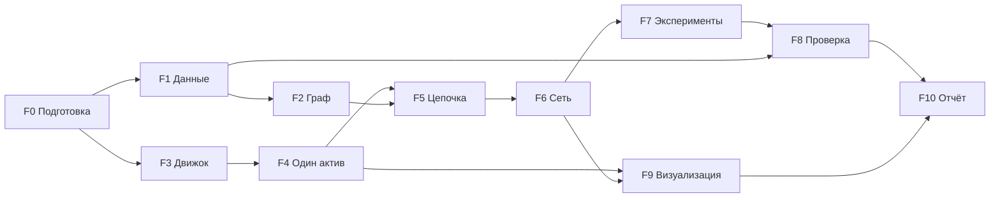

# Общий план проекта

**Дата:** 28 октября 2026 г.
**Как читать:** этот файл — карта. Что именно делать в каждой фазе — в `phases/`. Что делать конкретно тебе — в `roles/`.

---

## 1. Фазы

| Фаза | Что | Владелец | Недели | Зависит от | Описание |
|---|---|---|---|---|---|
| **F0** | подготовка: контракты, репозиторий, тема | все | 1 | — | [F0_specification.md](phases/F0_specification.md) |
| **F1** | сбор данных | D1, D2 | 1–2 | — | [F1_data_collection.md](phases/F1_data_collection.md) |
| **F2** | граф зависимостей | D2 | 1 (черновик), 3–5 | F1 | [F2_dependency_graph.md](phases/F2_dependency_graph.md) |
| **F3** | движок биржи (C++) и шлюз | O | 1–4 | — | [F3_exchange_engine.md](phases/F3_exchange_engine.md) |
| **F4** | рынок одного актива, эксперименты E1–E3 | S (+D1 метрики) | 1–4 | F3 (эталон) | [F4_single_asset_market.md](phases/F4_single_asset_market.md) |
| **F5** | оценщики по графу на цепочке, E4 | S + D2 | 5 | F2, F4 | [F5_graph_valuers.md](phases/F5_graph_valuers.md) |
| **F6** | полная сеть на реальных данных | S + D2 + O | 6 | F5, F2 | [F6_full_network.md](phases/F6_full_network.md) |
| **F7** | эксперименты E5–E7 | все | 7–8 | F6 | [F7_experiments.md](phases/F7_experiments.md) |
| **F8** | проверка на реальных данных | D1 | 5, 8–9 | F1, F7 | [F8_validation.md](phases/F8_validation.md) |
| **F9** | визуализация и живой режим | D1 + O | 4–9 | K3 | [F9_visualization.md](phases/F9_visualization.md) |
| **F10** | отчёт и защита | все | 10 | всё | [F10_report_and_defense.md](phases/F10_report_and_defense.md) |

## 2. Как работаем параллельно

Части проекта связаны только через **контракты** — неизменяемые интерфейсы (подробно: [docs/model/contracts.md](../model/contracts.md)). У каждого потребителя с первой недели есть заглушка, поэтому никто никого не ждёт:

| Контракт | Владелец → потребитель | Заглушка до готовой реализации |
|---|---|---|
| K1 биржа и шлюз | O → S | Python-эталон `PyExchange` (конец недели 1) |
| Данные (схемы, загрузчики) | D1, D2 → все | тестовые данные в `data/fixtures/` |
| K2 граф и внешние сигналы | D2 → S, D1 | `data/fixtures/graph_chain/`, `external_oil_shock.csv` (уже есть) |
| K3 лог прогона | S → D1, O | пример лога короткого прогона (S, неделя 2) |
| K4 конфигурация | S → все | `configs/pilot.yaml` (уже есть) |

## 3. Расписание

| Неделя | O (движок) | D1 (ряды, проверка) | D2 (граф) | S (симуляция) |
|---|---|---|---|---|
| **1** | F0: репозиторий, CI; K1 с S (день 3); `PyExchange` + `Gateway` | **F1 этап A: доступ ко всем данным (к пятнице)** | **F1 этап A + F2 этап A: черновой граф (к пятнице)** | F0: K1 с O; планировщик событий, каркас агентов |
| **2** | C++: каркас → стакан одного актива | F1 этап B: `fetch.py`, `clean.py` | F1 этап B: BEA и EDGAR в коде | агенты, маркет-мейкер, лог K3; первый прогон |
| **3** | C++: полное сопоставление, дифференциальные тесты → **M1** | метрики по логу K3 | F2: структура + веса (код) | стадность, $C$, пилот E0 → **M1** |
| **4** | C++ в симуляции, бенчмарк, профиль → **M2** | анализ E1–E3 | F2: эталон, сценарии внешних сигналов | E1–E3 → **M2** |
| **5** | батчи, оптимизация, помощь S | F8: каркас проверки на синтетике | F2: финальный граф `real_v1`; F5 вместе с S | F5: оценщики по графу, цепочка, E4 |
| **6** | 18 активов, маркет-мейкеры, скорость | F9: дашборд сети | F6 вместе с S | F6: полная сеть → **M3** |
| **7** | параллельный runner, бэкенд живого режима | F9: панели | чувствительность к весам, ablation | F7: протокол, E5–E6 |
| **8** | стабильность под нагрузкой | анализ экспериментов | анализ, восстановление графа | F7: E5–E7 |
| **9** | живой режим для защиты | F8 полностью | раздел отчёта о данных и графе | разбор механизмов (ablation) → **M4** |
| **10** | F10 | F10 | F10 | F10 |

Если до сдачи меньше 10 недель — сокращаем по разделу 6, а не сжимаем всё подряд.

## 4. Вехи

| Веха | Неделя | Проверяется демонстрацией |
|---|---|---|
| **M0** | 1 | контракты согласованы; `PyExchange` и `Gateway` проходят тесты; доступ к данным подтверждён; черновой граф |
| **M1** | 3 | один актив: прогон → лог → метрики; C++ совпадает с эталоном; данные F1 по контракту |
| **M2** | 4 | E1–E3 посчитаны (исходная пропозиция выполнена); C++ в симуляции |
| **M3** | 6 | сеть на реальных сигналах 2024–2025, волна по графу видна |
| **M4** | 9 | E5–E7, проверка, дашборд, живой режим |

На каждой вехе — встреча 30–45 минут: демонстрация, что сдвинулось, что режем.

## 5. До пятницы 30.10.2026

| Кто | Цель | Где описано |
|---|---|---|
| D1 | все ряды цен скачаны, числа совпали с ожидаемыми, notebook `01_data_access_check` | F1, раздел 10.1 |
| D2 | BEA разобрана, контрольные значения совпали; (по желанию) SIC из EDGAR совпали с уже готовым `companies.csv`; **черновой граф**, веса цепочки совпали с эталоном | F1 10.1, F2 раздел 8 (этап A) |
| O | репозиторий на GitHub с CI; черновик K1 обсуждён с S | F0, F3 шаг 1 |
| S | K1 обсуждён; каркас планировщика | F0, F4 |
| все | пропозиция вычитана и отнесена преподавателю | F0 |

## 6. Что режем, если не успеваем

Сверху вниз; ядро не трогаем:
1. E7 (доля сетевых оценщиков).
2. Живой режим (остаётся воспроизведение).
3. 18 → 10 акций.
4. Проверка упрощается до stylized facts и корреляций, без полос.
5. C++ (симуляция на `PyExchange`; C++ остаётся отдельным результатом с бенчмарком).

**Не режем никогда:** M2 (исходное исследование), корректность биржи, честное описание ограничений.

## 7. Кто кому помогает

| Когда | Кто освобождается | Кому | Чем |
|---|---|---|---|
| неделя 3 → | D1 | S | метрики по логу, чтобы S занимался агентами |
| неделя 4 → | O | S | профиль, векторизация, батчи |
| неделя 5 → | D2 | S | оценщики по графу, ребалансировщики |
| неделя 7 → | O | S | параллельный runner |

Критический путь — S: агенты нужны во всех вехах. Всё, что не агенты, с S снимаем.

## 8. Как синхронизируемся

- Раз в день — сообщение в чат: «сделал / делаю / жду».
- Раз в неделю — встреча 30 минут; на вехах — демонстрация.
- Заблокирован дольше полудня — сразу пишешь в чат и переходишь на заглушку.
- Все изменения — через PR (правила — `AGENTS.md`).

## 9. Журнал решений

| Дата | Решение | Кто решил |
|---|---|---|
| 28.10.2026 | Граф — знание агентов (волна идёт через сделки), а не формула фундаментальной стоимости | команда |
| 28.10.2026 | Индекс S&P 500 — внешний сигнал модели | команда |
| 28.10.2026 | Движок биржи на C++, Python — контроллер (шлюз) | O |
| 28.10.2026 | Список компаний зафиксирован: 18 компаний в `data/mapping/companies.csv` (полные данные 2021–2025 проверены) | команда |
| 28.10.2026 | README-файлы и весь код (комментарии, docstrings) — на английском; документы в `docs/` — на русском | O |
| | порог BEA, слабые веса, число компаний (F0, раздел 2) | |
