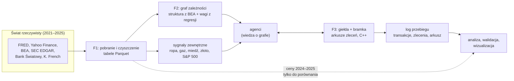
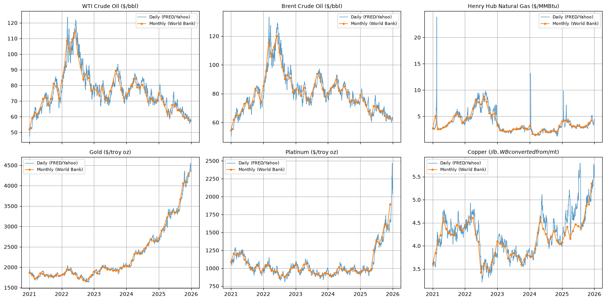
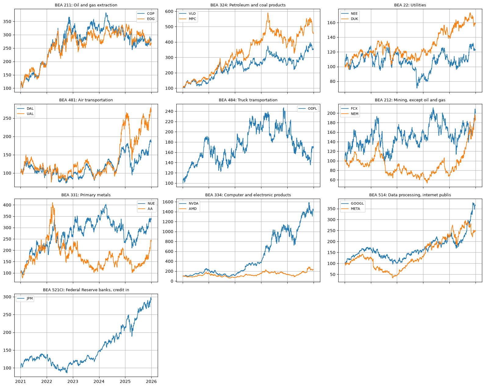
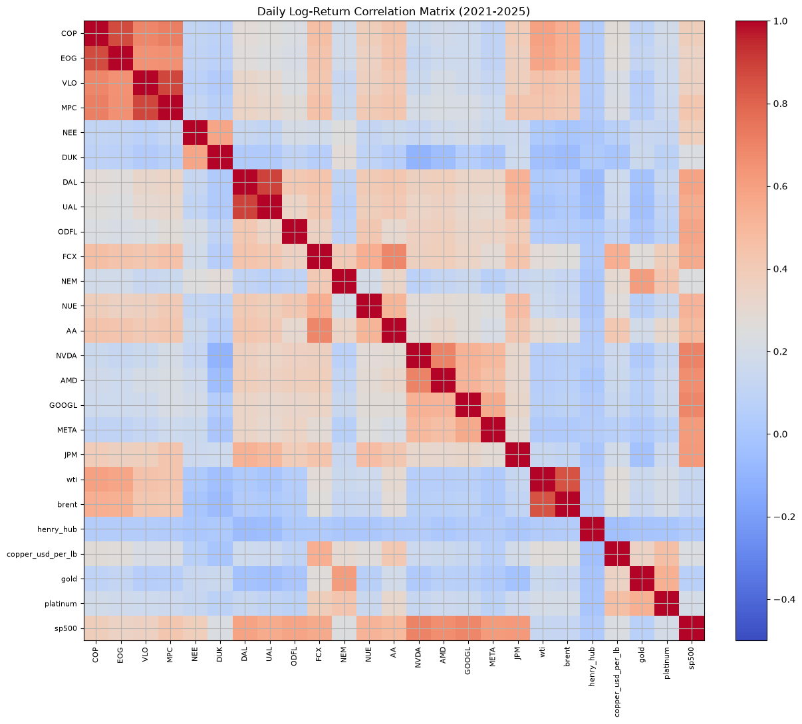
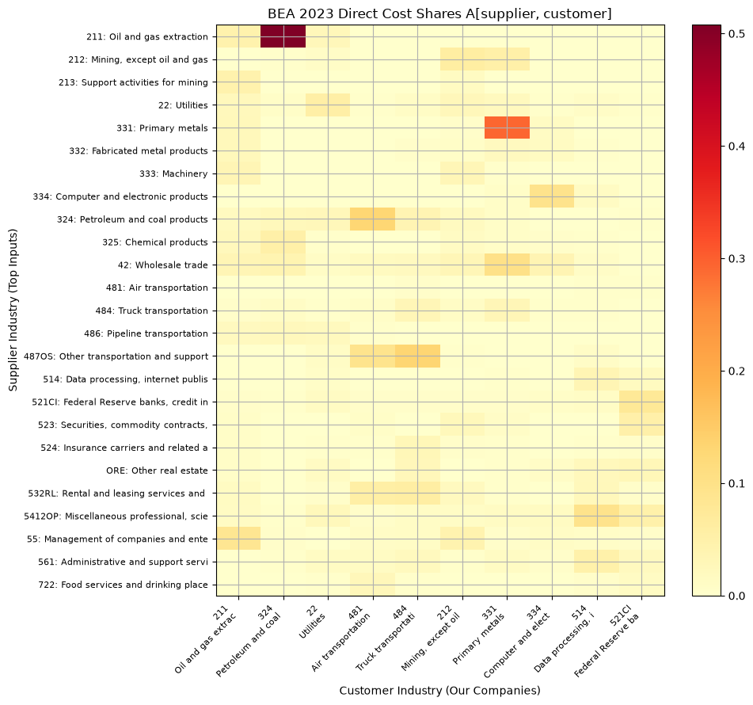
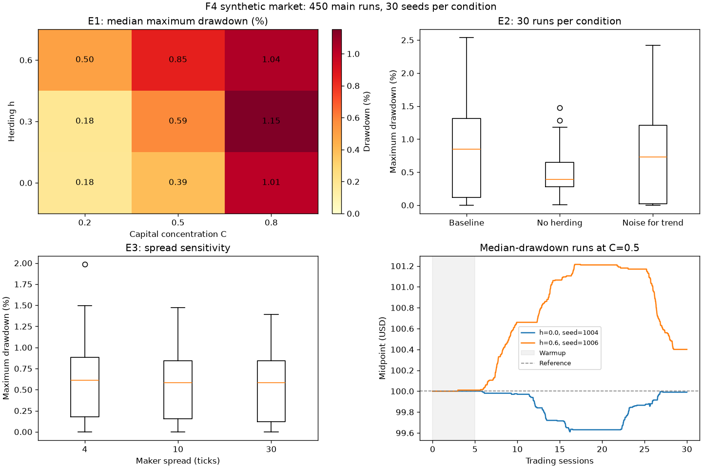

# Przegląd projektu i stan prac

**Projekt:** Propagacja szoków surowcowych w agentowym rynku giełdowym z grafem zależności aktywów
**Przedmiot:** Symulacja systemów dyskretnych, AGH
**Stan na:** 30 października 2026 r. (koniec 1. tygodnia prac)

Dokument ma dwie części. Pierwsza (rozdziały 1–3) wyjaśnia, o co chodzi w projekcie i jak jest zbudowany. Druga (rozdziały 4–6) opisuje, co już zrobiliśmy, wraz z omówieniem wykresów i linkami do kodu oraz notatników, w których można zajrzeć głębiej. Pełny opis naukowy (literatura, hipotezy, metodyka) znajduje się w [propozycji projektu](research_proposal.md).

---

## Spis treści

1. [Idea projektu w pięciu minutach](#1-idea-projektu-w-pięciu-minutach)
2. [Jak działa model](#2-jak-działa-model)
3. [Plan prac i stan faz](#3-plan-prac-i-stan-faz)
4. [Co zrobiliśmy](#4-co-zrobiliśmy)
   - [4.1 F1 — dane](#41-f1--dane)
   - [4.2 F2 — graf zależności (część pierwsza)](#42-f2--graf-zależności-część-pierwsza)
   - [4.3 F3 — silnik giełdowy](#43-f3--silnik-giełdowy)
   - [4.4 F4 — rynek jednego aktywa i pierwsze eksperymenty](#44-f4--rynek-jednego-aktywa-i-pierwsze-eksperymenty)
5. [Co dalej](#5-co-dalej)
6. [Gdzie zajrzeć głębiej](#6-gdzie-zajrzeć-głębiej)
7. [Słowniczek](#7-słowniczek)

---

## 1. Idea projektu w pięciu minutach

### Problem

Gdy drożeje ropa, nie drożeje tylko ropa. Rafinerie płacą więcej za surowiec, linie lotnicze więcej za paliwo, a inwestorzy próbują przewidzieć, kto na tym zyska, a kto straci. Na giełdzie taki szok **rozchodzi się po łańcuchu zależności między spółkami**. Rozchodzi się jednak nieidealnie: inwestorzy reagują z opóźnieniem, mają niepełne informacje, naśladują innych. Reakcja cen może więc być niepełna, spóźniona albo przesadzona, a czasem szok „przeskakuje” na spółki, które z ropą nie mają nic wspólnego.

Chcemy zbadać ten mechanizm na symulacji: **jak cechy uczestników rynku (strategie, zachowania stadne, koncentracja kapitału) wpływają na to, jak szok surowcowy przechodzi przez sieć spółek.**

### Pomysł w jednym zdaniu

Budujemy symulowaną giełdę, na której około tysiąca agentów handluje akcjami 18 prawdziwych spółek amerykańskich. Ceny **nie są wczytywane z danych**, lecz powstają z transakcji agentów. Z prawdziwego świata pochodzą tylko ceny surowców i indeksu S&P 500 („wiadomości” dla agentów) oraz wiedza agentów o tym, która spółka od czego zależy (graf zależności).

### Czym różnimy się od pracy, od której zaczynamy

Punktem wyjścia jest praca Skrzyńskiego (2025, PP-RAI). Tam specjalny „wyimaginowany inwestor” o nieograniczonych zasobach składa zlecenia wokół historycznej ceny, więc cena w symulacji podąża za ceną rzeczywistą, a pozostali agenci mają na nią niewielki wpływ.

U nas jest odwrotnie:

| | Skrzyński (2025) | Nasz projekt |
|---|---|---|
| Skąd bierze się cena | wymuszona przez dane historyczne | **powstaje z transakcji agentów** |
| Liczba aktywów | 1 | 18 spółek + 4 surowce + indeks |
| Zależności między aktywami | brak | **graf zależności** (struktura z gospodarki, wagi z danych) |
| Agenci | 1–2 | ~1000, kilka strategii, zachowania stadne |
| Metodyka | pojedynczy przebieg | siatki parametrów × 30 ziaren losowych, przedziały ufności |

### Przykład: jak fala przechodzi przez rynek

Weźmy łańcuch, na którym wszystko testujemy: **ropa → ConocoPhillips (COP, wydobycie ropy i gazu) → Valero (VLO, rafineria: przerabia ropę na paliwa) → Delta (DAL, linia lotnicza: kupuje paliwo).** Logika jest prosta: drożejąca ropa to większe zyski wydobywcy, wyższe koszty rafinerii (ale też droższe paliwo, które sprzedaje) i wyższe koszty paliwa dla linii lotniczej.

1. Cena ropy rośnie o 10% (to jest prawdziwy sygnał zewnętrzny z danych).
2. Agenci wyceniający COP (wydobycie ropy) wiedzą z grafu, że waga „ropa → COP” wynosi 0,52. Podnoszą swoją wycenę COP o ok. 5,2% i zaczynają kupować. **Cena COP na naszej giełdzie rośnie**, ale tylko w takim stopniu, w jakim faktycznie dojdzie do transakcji.
3. Agenci wyceniający VLO (rafineria) obserwują **cenę COP na naszej giełdzie** (nie prawdziwą!). Waga „COP → VLO” wynosi 0,70, więc podnoszą wycenę VLO.
4. Agenci wyceniający DAL (linia lotnicza) obserwują VLO (waga 0,22) i tak dalej.

Najważniejsze: każde ogniwo reaguje na to, co **naprawdę stało się na symulowanym rynku**. Jeśli COP (wydobycie) przereagował (zbyt duży wzrost, bo wszyscy kupowali naraz), ten błąd przechodzi dalej do VLO (rafineria) i DAL (linia lotnicza). Jeśli COP zareagował za słabo (brakowało kupujących), fala słabnie. Propagacja szoku jest więc **zjawiskiem emergentnym**, a nie formułą zapisaną w kodzie.

Pełna lista 18 spółek z branżami: [rozdz. 4.1](#18-spółek). W całym dokumencie przy symbolu giełdowym (np. COP) podajemy w nawiasie branżę.

### Jak mierzymy „dobrą” reakcję

Dla porównania liczymy **trajektorię referencyjną** $R$: ceny, jakie byłyby, gdyby wszyscy natychmiast i dokładnie zastosowali wagi grafu. Agenci jej nie znają; służy tylko do pomiaru. Porównując rzeczywistą cenę z symulacji z $R$, mierzymy:

- **kompletność** — jaka część szoku dotarła do spółki;
- **opóźnienie** — po jakim czasie;
- **przestrzelenie** (*overshoot*) — o ile cena wyskoczyła ponad poziom referencyjny.

### Pytania badawcze (skrót)

| Kod | Pytanie | Gdzie badamy |
|---|---|---|
| P1 | Jak zachowania stadne wpływają na obsunięcia cen i płynność? | 1 aktywo (F4) — **pierwsze wyniki już są** |
| P2 | Jak koncentracja kapitału w funduszach wpływa na stabilność? | 1 aktywo (F4) — **pierwsze wyniki już są** |
| **P5** | **Jak strategie i zachowania stadne zmieniają propagację szoku w grafie?** | łańcuch i pełna sieć (F5–F7) |
| **P6** | **Czy powstaje współruch spółek niepowiązanych w grafie i dlaczego?** | pełna sieć (F6–F7) |
| P7 | Ilu agentów „znających graf” potrzeba, by fala przechodziła? | eksploracyjnie (F7) |

Hipotezy H1–H5 i pełna metodyka: [propozycja, rozdz. 4 i 7](research_proposal.md#4-cel-pytania-badawcze-i-hipotezy).

---

## 2. Jak działa model

### Przepływ danych i moduły



**Rola prawdziwych cen akcji** jest ściśle ograniczona:

- **2021–2023** — tylko do oszacowania wag grafu (czego agenci „nauczyli się” o rynku);
- **2 stycznia 2024** — cena startowa w symulacji;
- **2024–2025** — tylko do porównania z wynikiem symulacji (walidacja). Agenci tych cen nie widzą.

### Elementy modelu

- **Czas.** Symulacja zdarzeń dyskretnych: kolejka zdarzeń uporządkowana według czasu (decyzje agentów, wygasanie zleceń, migawki arkusza). Jedna sesja = jeden dzień danych; agenci budzą się w losowych momentach w ciągu sesji. Wszystkie losowania pochodzą z generatorów inicjalizowanych ziarnem: **ta sama konfiguracja i ziarno dają identyczny przebieg**.
- **Giełda.** Każda spółka ma własny arkusz zleceń z regułą *price-time priority* (najpierw lepsza cena, przy równej cenie — kto pierwszy). Ceny w tickach (liczby całkowite), pieniądze w centach — żadnych błędów zaokrągleń.
- **Bramka (*gateway*).** Pośrednik między agentami a giełdą: blokuje pieniądze lub akcje przed wysłaniem zlecenia i rozlicza transakcje. Łączna ilość pieniędzy i akcji w systemie jest stała — sprawdzamy to w każdym przebiegu.
- **Agenci.**

| Typ | Co robi |
|---|---|
| Wyceniający krótkowzroczny | wycenia spółkę tylko na podstawie surowców i indeksu (wagi „bezpośrednie”) |
| Wyceniający sieciowy | uwzględnia też ceny spółek-rodziców **na naszej giełdzie** (wagi „pełne”) |
| Trendowy | kupuje, gdy cena rosła, sprzedaje, gdy spadała |
| Szumowy | decyzje losowe (tło rynku) |
| Animator rynku (*market maker*) | stale wystawia zlecenia kupna i sprzedaży, ma ograniczone zasoby |
| Fundusz | grupa inwestorów, którym przydzielono większą część kapitału (parametr $C$) |

- **Zachowania stadne.** Każdy agent ma kilku „znajomych”. Jego ostateczny sygnał to mieszanka własnej opinii i tego, co ostatnio zrobili znajomi: $s = (1-h)\cdot\text{własny} + h\cdot\text{średnia znajomych}$. Parametr $h \in [0, 1]$ to siła zachowań stadnych.

### Kontrakty, czyli jak czterech ludzi pracuje równolegle

Projekt jest podzielony na moduły połączone **zamrożonymi interfejsami** (kontraktami): giełda ↔ symulacja (K1), graf ↔ agenci (K2), format logu przebiegu (K3), format konfiguracji eksperymentu (K4) oraz schematy tabel danych. Każdy kontrakt ma testy, które go sprawdzają. Dzięki temu np. symulacja mogła powstać, zanim gotowy był silnik C++ (działała na wersji w Pythonie), a dane są sprawdzane automatycznie poleceniem `python -m marketsim.data.check`.

Szczegóły: [kontrakty](model/contracts.md) (po rosyjsku), [opis modelu](model/model_description.md).


## 4. Co zrobiliśmy

### 4.1 F1 — dane

**Cel:** zebrać wszystkie dane, wyczyścić je według jednolitych zasad i sprawdzić, że są poprawne, zanim ktokolwiek zacznie na nich liczyć.

#### Źródła

| Dane | Źródło | Do czego |
|---|---|---|
| Ropa WTI i Brent, gaz Henry Hub, S&P 500 (dzienne) | [FRED](https://fred.stlouisfed.org/) | sygnały zewnętrzne, zmienna kontrolna w regresji |
| Miedź, złoto, platyna (kontrakty terminowe, dzienne) | Yahoo Finance | sygnały zewnętrzne |
| Ceny i wolumeny 18 spółek | Yahoo Finance | wagi grafu, ceny startowe, walidacja |
| Miesięczne ceny surowców | [Bank Światowy (Pink Sheet)](https://www.worldbank.org/en/research/commodity-markets) | niezależna kontrola danych dziennych |
| Tabele przepływów międzygałęziowych (71 branż) | [BEA](https://www.bea.gov/industry/input-output-accounts-data) | struktura grafu |
| Kody branżowe SIC spółek | [SEC EDGAR](https://www.sec.gov/search-filings/edgar-application-programming-interfaces) | przypisanie spółek do branż |
| 49 portfeli branżowych, czynnik rynkowy | [Kenneth French Data Library](https://mba.tuck.dartmouth.edu/pages/faculty/ken.french/data_library.html) | walidacja na poziomie branż |

**Okres:** 2021–2025, czyli 1255 dni sesyjnych NYSE. Rok 2020 pomijamy celowo (pandemia, ujemna cena ropy 20.04.2020).

#### 18 spółek

| Branża (kod BEA) | Spółki | Dlaczego |
|---|---|---|
| Wydobycie ropy i gazu (211) | ConocoPhillips (COP), EOG Resources (EOG) | pierwsze ogniwo po ropie |
| Rafinacja (324) | Valero (VLO), Marathon Petroleum (MPC) | kupują ropę (50,8% kosztów) |
| Energetyka (22) | NextEra (NEE), Duke Energy (DUK) | odbiorcy gazu |
| Transport lotniczy (481) | Delta (DAL), United (UAL) | kupują paliwo (12,9% kosztów) |
| Transport drogowy (484) | Old Dominion (ODFL) | paliwo, metale |
| Górnictwo metali (212) | Freeport-McMoRan (FCX), Newmont (NEM) | miedź, złoto |
| Hutnictwo (331) | Nucor (NUE), Alcoa (AA) | metale, energia |
| Półprzewodniki (334) | NVIDIA (NVDA), AMD (AMD) | łańcuch technologiczny |
| Usługi internetowe (514) | Alphabet (GOOGL), Meta (META) | odbiorcy półprzewodników |
| Bankowość (521CI) | JPMorgan (JPM) | sektor finansowy, kanał indeksu |

Lista jest zamrożona w [`data/mapping/companies.csv`](../data/mapping/companies.csv). Każda spółka ma pełne notowania z całego okresu (bez luk) i kod SIC z EDGAR.

#### Co robi kod

- [`fetch.py`](../src/marketsim/data/fetch.py) pobiera wszystkie pliki **dokładnie w takiej postaci, w jakiej przyszły z serwera**, i zapisuje dla każdego adres, datę, rozmiar i sumę kontrolną SHA-256 (`manifest.json`). Dzięki temu wiemy, z jakich wersji danych powstały wyniki.
- [`clean.py`](../src/marketsim/data/clean.py) buduje 14 tabel według schematów z [`schemas.py`](../src/marketsim/data/schemas.py):
  - wspólny **kalendarz** = dni, w których handlowano akcjami (1255 dni). Bez tego szeregi z różnych źródeł „rozjeżdżają się” o święta;
  - luki w danych surowcowych (np. dzień po Święcie Dziękczynienia, gdy FRED nie publikuje) uzupełniane **ostatnią znaną wartością, najwyżej przez 3 dni**, i zawsze oznaczane flagą `*_filled`. Takich dni było: ropa WTI 7, Brent 24, gaz 7; luk dłuższych niż 3 dni nie ma;
  - dzienne **logarytmiczne stopy zwrotu** $r_t = \ln(P_t / P_{t-1})$ — na nich liczymy wagi grafu;
  - macierz kosztów BEA dla lat 2022 i 2023.
- [`check.py`](../src/marketsim/data/check.py) sprawdza wszystkie tabele względem schematów. Wynik: **14/14 OK**.
- [`tests/data/test_data_quality.py`](../tests/data/test_data_quality.py) porównuje źródła między sobą (np. złoto z Yahoo z danymi Banku Światowego, WTI z FRED z kontraktem CL=F).

**Wszystkie liczby kontrolne z planu zgadzają się** (sprawdziliśmy to niezależnie, pobierając dane od zera): 1255 dni, `A["324","481"] = 0,1292`, produkcja transportu lotniczego 311 313 mln USD, wagi łańcucha co do trzeciego miejsca po przecinku.

Pełny opis plików, jednostek i decyzji: [`data/README.md`](../data/README.md).

#### Notatniki

- [`01_data_access_check.ipynb`](../notebooks/01_data_access_check.ipynb) — tabela „źródło → pobrane → liczby się zgadzają” i odtworzenie wag łańcucha.
- [`01_data_overview.ipynb`](../notebooks/01_data_overview.ipynb) — przegląd danych; to z niego pochodzą wykresy poniżej.

#### Wykres 1. Surowce: dane dzienne a oficjalne dane miesięczne



**Co przedstawia.** Sześć surowców. Niebieska linia to dane dzienne, których używamy w symulacji (FRED lub kontrakty z Yahoo). Pomarańczowe kropki to oficjalne średnie miesięczne Banku Światowego — niezależne źródło.

**Po co.** To test, czy nasze dane dzienne są wiarygodne. Gdyby linie się rozjeżdżały, oznaczałoby to błąd w danych lub w jednostkach.

**Co widać.**
- Linie pokrywają się prawie idealnie: korelacja średnich miesięcznych dla złota 0,9999, platyny 0,999. **Dane są poprawne.**
- Ropa: szczyt ok. 120 USD/baryłkę w 2022 r. (inwazja Rosji na Ukrainę), potem spadek do ok. 60 USD. To jest główny „szok”, który będziemy przepuszczać przez graf.
- Gaz (Henry Hub): ostre szpilki, np. luty 2021 (zima stulecia w Teksasie, burza Uri — cena skoczyła ponad 20 USD) i styczeń 2024. Ceny spot gazu są bardzo nerwowe.
- Złoto i platyna: silny wzrost w latach 2024–2025.
- Miedź: w 2025 r. dane dzienne (giełda amerykańska COMEX) idą wyżej niż miesięczne. To nie błąd: amerykańskie cła na miedź spowodowały, że cena w USA oderwała się od ceny światowej. Dlatego korelacja dla miedzi jest niższa (0,94). Fakt zapisany w dokumentacji danych.

#### Wykres 2. 18 spółek znormalizowanych do 100



**Co przedstawia.** Ceny akcji wszystkich spółek, pogrupowane według branż. Każda cena jest przeskalowana tak, by 4 stycznia 2021 r. wynosiła 100. Wartość 300 oznacza, że akcja potroiła wartość; 80 — że straciła 20%.

**Po co.** Kontrola poprawności (brak dziur, skoków po podziale akcji itp.) i pierwsze spojrzenie, czy spółki z jednej branży zachowują się podobnie.

**Co widać.**
- Spółki z tej samej branży poruszają się razem: COP i EOG (obie: wydobycie ropy i gazu), DAL i UAL (obie: linie lotnicze), VLO i MPC (obie: rafinerie). To potwierdza sens grupowania według branż.
- Wyraźne różnice skali: NVDA (NVIDIA, chipy do sztucznej inteligencji) wzrosła ok. 14-krotnie, a NEE i DUK (energetyka) ledwie się zmieniły.
- DAL i UAL (linie lotnicze): silny spadek wiosną 2025 r. (ogłoszenie ceł), potem odbicie.
- Ten wykres pokazuje też, **dlaczego wagi liczymy na stopach zwrotu, a nie na poziomach cen**: poziomy prawie wszystkich spółek rosną w czasie, więc ich korelacja byłaby wysoka nawet bez żadnego związku.

#### Wykres 3. Macierz korelacji dziennych stóp zwrotu



**Co przedstawia.** Każda kratka to korelacja dziennych stóp zwrotu dwóch szeregów w latach 2021–2025. Czerwony = poruszają się razem (blisko 1), biały/jasnoniebieski = brak związku (ok. 0), niebieski = w przeciwnych kierunkach. Przekątna to zawsze 1 (szereg z samym sobą).

**Jak czytać.** Szukamy „czerwonych bloków” — grup, które poruszają się wspólnie.

**Co widać.**
- **Blok naftowy** (lewy górny róg): COP i EOG (wydobycie ropy i gazu) oraz VLO i MPC (rafinerie) są silnie skorelowane między sobą i z ceną ropy (wiersze `wti`, `brent`). Korelacja z ropą WTI: COP (wydobycie) 0,59, EOG (wydobycie) 0,57, VLO (rafineria) 0,45, MPC (rafineria) 0,43. Wydobywcy są związani z ropą najsilniej, bo ich przychód to wprost cena ropy; rafinerie trochę słabiej, bo ropa jest dla nich i kosztem, i podstawą ceny paliw. To jest podstawa łańcucha ropa → COP → VLO.
- **Metale:** FCX (Freeport-McMoRan, kopalnie miedzi) i AA (Alcoa, hutnictwo aluminium) z ceną miedzi (0,54 i 0,41), NEM (Newmont, kopalnie złota) z ceną złota (0,61). Kopalnia sprzedaje dany metal, więc jej akcje idą za jego ceną.
- **Linie lotnicze:** DAL (Delta, linia lotnicza) i UAL (United, linia lotnicza) bardzo silnie ze sobą, ale prawie zero bezpośrednio z ropą (0,02). Wpływ ropy na linie lotnicze jest więc pośredni i słaby — dlatego potrzebujemy grafu i dwóch zestawów wag (patrz F2).
- **Technologia i finanse:** NVDA i AMD (chipy), GOOGL (Alphabet: wyszukiwarka i reklama) i META (media społecznościowe) oraz JPM (JPMorgan, bank) są silnie skorelowane z S&P 500 (0,62–0,71); to duże spółki, które same mają duży udział w indeksie. Wszystkie spółki są w jakimś stopniu skorelowane z indeksem — to „wspólny czynnik rynkowy”. Dlatego w regresji wag zawsze uwzględniamy S&P 500 jako zmienną kontrolną: bez niej każda para spółek wyglądałaby na powiązaną.
- **Energetyka:** NEE (NextEra) i DUK (Duke Energy) są skorelowane głównie ze sobą; z ropą prawie wcale (0,02 i −0,03).
- **Gaz (Henry Hub):** prawie zero ze wszystkim. Krawędzie od gazu w grafie będą miały wagi bliskie zeru — to wynik, a nie błąd (opisany w dokumentacji danych).

**Ważne:** korelacja to jeszcze nie zależność. Dlatego **strukturę grafu bierzemy z gospodarki (BEA), a nie z korelacji**; korelacje (a dokładniej regresja) służą tylko do oszacowania siły istniejących powiązań.

#### Wykres 4. Macierz kosztów BEA (kto od kogo kupuje)



**Co przedstawia.** Fragment tabeli przepływów międzygałęziowych BEA za 2023 r. Kolumny to branże naszych spółek (odbiorcy), wiersze to branże-dostawcy. Kratka $A[\text{dostawca}, \text{odbiorca}]$ mówi, **jaką część wartości swojej produkcji odbiorca wydaje na produkty dostawcy**. Im ciemniej, tym silniejsze powiązanie.

**Co widać.**
- Najciemniejsza kratka: **wydobycie ropy (211) → rafinacja (324) = 0,508**. Rafinerie wydają ponad połowę wartości produkcji na ropę i gaz.
- **Hutnictwo (331) → hutnictwo (331) = 0,293**: huty kupują półprodukty od innych hut.
- **Produkty naftowe (324) → transport lotniczy (481) = 0,129**: linie lotnicze wydają 12,9% na paliwo.
- Wiersze bez naszych spółek (handel hurtowy, wynajem, usługi) też są ważnymi dostawcami, ale nie mamy w nich spółek, więc nie tworzą krawędzi między spółkami.

**Jak z tego powstaje graf.** Krawędź „spółka A → spółka B” dopuszczamy, jeśli branża B wydaje na produkty branży A **co najmniej 2%** swojej produkcji. Dla 18 spółek daje to 54 krawędzie-kandydatów (w kolejnym kroku F2 każdą przejrzymy: zostawić, usunąć, do decyzji). Promień spektralny całej macierzy wynosi 0,463 < 1, czyli powiązania nie „rozkręcają się” w nieskończoność.

#### Wartości odstające

Znaleźliśmy **80 dni**, w których któryś szereg zmienił się o ponad 15% w ciągu jednego dnia. **Żadnego nie usuwamy** — to prawdziwe zdarzenia rynkowe, np.:

| Data | Szereg | Zmiana | Przyczyna |
|---|---|---|---|
| 2022-02-03 | META (media społecznościowe) | −26% | słabe wyniki kwartalne |
| 2025-01-27 | NVDA (chipy do AI) | −17% | premiera chińskiego modelu DeepSeek R1: obawa, że AI będzie potrzebować mniej chipów |
| 2025-04-09 | UAL, DAL (linie lotnicze), AMD, NVDA (chipy) | +18…+26% | zawieszenie ceł na 90 dni |
| 2025-07-31 | miedź | −22% | zmiana decyzji o cłach na miedź |
| luty 2021 | gaz | wielokrotnie | burza zimowa Uri w Teksasie |

61 z 80 dni ma przyczynę potwierdzoną źródłem (link w [`data/mapping/outlier_explanations.csv`](../data/mapping/outlier_explanations.csv)). Pozostałe 19 to wahania ceny spot gazu, których pojedynczych przyczyn nie udało się jednoznacznie ustalić — są uczciwie oznaczone jako `unexplained`.

---

### 4.2 F2 — graf zależności (część pierwsza)

**Cel:** dla każdej pary „rodzic → dziecko” ustalić, czy krawędź istnieje, i jak silna jest zależność.

**Struktura** (czy krawędź w ogóle istnieje) pochodzi z tabel BEA (rozdz. 4.1, wykres 4). **Wagi** (jak silna jest krawędź) szacujemy z historii cen. Poniżej krok po kroku, jak.

#### Krok 1. Stopa zwrotu — o ile procent zmieniła się cena

Nie porównujemy samych cen (COP po 110 USD, VLO po 130 USD — te liczby nic o sobie nie mówią), tylko to, **o ile procent zmieniła się cena z dnia na dzień**. To jest **dzienna stopa zwrotu**:

$$
\text{prosta stopa zwrotu} = \frac{P_t - P_{t-1}}{P_{t-1}}, \qquad \text{logarytmiczna stopa zwrotu } r_t = \ln\frac{P_t}{P_{t-1}}
$$

gdzie $P_t$ to cena zamknięcia w dniu $t$, a $P_{t-1}$ — dzień wcześniej. Przykład: akcja kosztowała wczoraj 100 USD, dziś 102 USD → prosta stopa zwrotu $= +2\%$, logarytmiczna $= \ln(1{,}02) = +1{,}98\%$. Dla codziennych zmian obie są prawie równe, więc $r_t$ można czytać po prostu jako „zmianę ceny w procentach”.

Używamy wersji logarytmicznej, bo dobrze się sumuje. Przykład: cena 100 → 110 → 100. Proste stopy zwrotu: $+10\%$, potem $-9{,}09\%$ — suma nie wynosi zero, choć cena wróciła do punktu wyjścia. Logarytmiczne: $+9{,}53\%$, potem $-9{,}53\%$ — suma wynosi dokładnie zero. Dzięki temu zmiana ceny na przestrzeni wielu dni to po prostu suma dziennych stóp zwrotu. Z tego korzystają też agenci, aktualizując wyceny.

Dlaczego stopy zwrotu, a nie ceny: ceny prawie wszystkich spółek rosną w długim okresie, więc wykresy cen „wyglądają podobnie” nawet bez żadnego związku między spółkami (wykres 2). Stopy zwrotu odpowiadają na właściwe pytanie: **czy w dniu, w którym ropa podrożała, COP (wydobycie) też podrożał, i o ile?**

#### Krok 2. Równanie, które dopasowujemy

Dla każdej spółki $i$ zapisujemy, że jej dzienna stopa zwrotu składa się z kilku części:

$$
r_{i,t} = \alpha_i + \sum_{j \in \text{rodzice}(i)} w_{ij}\, r_{j,t} + \beta_i\, r^{\text{S\&P500}}_t + u_{i,t}
$$

| Symbol | Co oznacza | Przykład dla VLO (rafineria) |
|---|---|---|
| $i$ | spółka, którą wyjaśniamy („dziecko”) | VLO |
| $t$ | dzień; bierzemy 752 dni sesyjne z lat 2021–2023 | np. 17.03.2022 |
| $r_{i,t}$ | stopa zwrotu spółki $i$ w dniu $t$ — to chcemy wyjaśnić | o ile % zmienił się VLO tego dnia |
| $\text{rodzice}(i)$ | węzły, z których w grafie prowadzą krawędzie do $i$: spółki-dostawcy (z BEA) i surowce | COP (wydobycie) i ropa WTI |
| $r_{j,t}$ | stopa zwrotu rodzica $j$ **tego samego dnia** | o ile % zmienił się COP i ropa |
| $w_{ij}$ | **waga krawędzi — to, czego szukamy.** O ile % średnio zmienia się $i$, gdy rodzic $j$ zmieni się o 1%, a pozostałe składniki stoją w miejscu | $w_{\text{COP} \to \text{VLO}} = 0{,}701$ |
| $r^{\text{S\&P500}}_t$ | stopa zwrotu całego rynku (indeksu S&P 500) tego dnia | — |
| $\beta_i$ | wrażliwość spółki na ogólny nastrój rynku | 0,169 |
| $\alpha_i$ | stała: średnia dzienna zmiana, której nic nie wyjaśnia; zwykle prawie zero | 0,008% dziennie |
| $u_{i,t}$ | **reszta**: wszystko, czego model nie wyjaśnia — wiadomości o samej spółce, wyniki kwartalne, przypadek | różni się każdego dnia |

**Po co składnik z S&P 500.** W dobre dni rośnie prawie cała giełda: COP, VLO i wszystko inne. Bez tego składnika regresja mogłaby uznać, że VLO rośnie „przez COP”, podczas gdy oba rosną po prostu z całym rynkiem. Indeks zbiera ten wspólny ruch, a waga $w_{ij}$ mierzy już tylko związek ponad nim. To dlatego mówimy o „zmiennej kontrolnej”.

#### Krok 3. Skąd biorą się liczby

Parametry $\alpha_i$, $w_{ij}$, $\beta_i$ dobiera **metoda najmniejszych kwadratów** (regresja liniowa, OLS): spośród wszystkich możliwych wartości wybiera te, przy których reszty $u_{i,t}$ są łącznie najmniejsze, czyli suma $u_{i,t}^2$ po wszystkich 752 dniach jest minimalna. Intuicja: przy jednym rodzicu to dopasowanie prostej do chmury 752 punktów (oś X — zmiana COP, oś Y — zmiana VLO), a waga to nachylenie tej prostej. Przy kilku rodzicach zasada jest ta sama, tylko wymiarów jest więcej.

Wynik dla VLO (rafineria):

$$
r_{\text{VLO},t} = 0{,}00008 + 0{,}701 \cdot r_{\text{COP},t} + 0{,}069 \cdot r_{\text{WTI},t} + 0{,}169 \cdot r^{\text{S\&P500}}_t + u_t
$$

**Sprawdzenie na prawdziwym dniu — 17 marca 2022 r.:** ropa WTI $+8{,}21\%$, COP (wydobycie) $+4{,}14\%$, S&P 500 $+1{,}23\%$. Równanie przewiduje dla VLO (rafineria): $0{,}701 \cdot 4{,}14 + 0{,}069 \cdot 8{,}21 + 0{,}169 \cdot 1{,}23 \approx 2{,}90 + 0{,}57 + 0{,}21 = +3{,}68\%$. Faktycznie VLO zmienił się o $+4{,}77\%$, więc reszta $u = +1{,}09\%$ to część ruchu, której zależności nie wyjaśniają.

**Jak pewne są te liczby.**
- **Statystyka $t$** = waga podzielona przez jej niepewność. Dla COP → VLO $t = 19{,}6$: waga jest wyznaczona bardzo pewnie. Przyjmuje się, że $|t| > 2$ oznacza wagę istotnie różną od zera. Dla ropy → DAL (linia lotnicza) $t = -1{,}5$, więc tej wagi nie odróżniamy od zera.
- **$R^2$** — jaka część dziennych wahań spółki jest wyjaśniona. Dla VLO $R^2 = 0{,}53$: połowę ruchów VLO wyjaśniają COP, ropa i rynek, druga połowa to sprawy samej spółki.

#### Krok 4. Jak agenci używają wag

Waga przekłada się wprost na zachowanie agenta. Jeśli na naszej giełdzie COP (wydobycie) zdrożał o 3%, agent wyceniający VLO (rafineria) podnosi swoją wycenę VLO o $0{,}701 \cdot 3\% \approx 2{,}1\%$. Jeśli VLO kosztuje mniej niż nowa wycena, agent kupuje. Pełny wzór aktualizacji wyceny: [propozycja, rozdz. 5.4](research_proposal.md#54-agenci).

**Zastrzeżenie.** Wagi to statystyczne związki z lat 2021–2023, a nie „prawa gospodarki”. Traktujemy je jako **przekonania agentów** o tym, jak spółki od siebie zależą. Każdy agent dostaje wagę z małym indywidualnym błędem, bo w rzeczywistości inwestorzy też nie znają tych zależności dokładnie.

**Dlaczego dwa zestawy wag.** Wynik zależy od tego, co wstawimy do regresji:

| Krawędź | Wagi bezpośrednie (tylko surowce + indeks) | Wagi pełne (także spółki-rodzice) |
|---|---|---|
| ropa → COP (wydobycie) | 0,516 (t = 20,4) | 0,516 |
| ropa → VLO (rafineria) | 0,430 (t = 14,1) | 0,069 |
| **COP (wydobycie) → VLO (rafineria)** | — | **0,701** (t = 19,6) |
| ropa → DAL (linia lotnicza) | −0,043 (nieistotne) | −0,139 |
| **VLO (rafineria) → DAL (linia lotnicza)** | — | **0,222** (t = 6,5) |

Skąd ta różnica: COP (wydobycie) i ropa poruszają się razem (korelacja 0,59). Jeśli w równaniu jest tylko ropa, „przypisuje” ona sobie także ten wpływ, który w rzeczywistości przechodzi przez COP. Gdy dodamy COP, regresja rozdziela te dwie drogi.

Widać tu sens całego projektu. Patrząc tylko na ropę, VLO (rafineria) zależy od niej mocno (0,43), ale gdy dodamy COP (wydobycie), prawie cały wpływ ropy idzie **przez COP** (0,70), a bezpośrednio zostaje tylko 0,07. Dla DAL (linia lotnicza) bezpośredni wpływ ropy jest nieistotny, ale istnieje wyraźna ścieżka przez rafinerię. Dlatego:

- **wyceniający krótkowzroczni** używają wag bezpośrednich (patrzą tylko na surowce),
- **wyceniający sieciowi** używają wag pełnych (patrzą na ceny rodziców na naszej giełdzie).

**Co jest gotowe.** Funkcje [`candidate_company_edges`](../src/marketsim/graph/structure.py) (krawędzie z BEA) i [`estimate_weights`](../src/marketsim/graph/weights.py) (wagi), z testami na danych syntetycznych o znanych wagach. Na prawdziwych danych odtwarzają powyższą tabelę co do trzeciego miejsca po przecinku.

**Czego jeszcze nie ma.** Gotowego grafu dla wszystkich 18 spółek (`data/graph/real_v1/`), przeglądu 54 krawędzi-kandydatów, trajektorii referencyjnej i scenariuszy sygnałów zewnętrznych (np. szok ropy −20%). Szczegóły: [plan F2](plans/phases/F2_dependency_graph.md).

---

### 4.3 F3 — silnik giełdowy

**Cel:** szybka i na pewno poprawna giełda, bo każdy późniejszy wynik od niej zależy.

**Co robi.** Dla każdej spółki prowadzi arkusz zleceń (*limit order book*):
- zlecenia z limitem ceny: GTC (ważne do odwołania), IOC (wykonaj natychmiast, resztę anuluj), GTD (ważne do określonej chwili);
- dopasowanie według ceny, potem według kolejności; transakcja po cenie zlecenia oczekującego;
- zlecenie, które dopasowałoby się z własnym zleceniem tego samego agenta, jest odrzucane (*self-trade prevention*);
- ceny w tickach, pieniądze w centach — tylko liczby całkowite.

**Dwie implementacje.**
- [`PyExchange`](../src/marketsim/market/) w Pythonie — wersja wzorcowa, prosta do sprawdzenia;
- [`lob_core`](../cpp/) w C++20 — wersja szybka, dostępna z Pythona przez nanobind. Wyniki przekazywane są jako bloki pamięci bez kopiowania (tablice NumPy).

**Skąd wiemy, że jest poprawny.**
- Te same **testy kontraktowe** przechodzą obie implementacje.
- **Test różnicowy** ([`test_differential.py`](../tests/market/test_differential.py)): biblioteka hypothesis generuje setki losowych sekwencji zleceń i anulowań, w tym błędnych; po każdym kroku obie implementacje muszą dać identyczny stan arkusza i identyczne transakcje.
- Testy C++ (Catch2) uruchamiane z sanitizerami pamięci (ASan/UBSan).

**Wydajność** (200 000 zleceń, 18 aktywów, [`benchmarks/bench_exchange.py`](../benchmarks/bench_exchange.py)):

| Wariant | Zleceń na sekundę |
|---|---|
| Python, jedno zlecenie na wywołanie | 99 tys. |
| C++, jedno zlecenie na wywołanie | 153 tys. |
| C++, paczki po 100 | **2,4 mln** |
| C++, paczki po 1000 | **3,0 mln** |

Czyli przy przesyłaniu paczkami C++ jest ok. 25–30 razy szybszy niż Python. Przy ~1000 agentów i 450+ przebiegach na eksperyment ma to praktyczne znaczenie.

---

### 4.4 F4 — rynek jednego aktywa i pierwsze eksperymenty

#### Po co ten etap

Docelowo symulacja ma 18 spółek, graf i prawdziwe ceny surowców. Zanim to połączymy, trzeba sprawdzić, że sama „maszyneria” działa: agenci podejmują sensowne decyzje, giełda poprawnie łączy zlecenia, pieniądze się nie gubią, a wyniki da się zmierzyć i powtórzyć. Robimy to na **najprostszym możliwym rynku: jedna akcja, bez grafu, bez surowców.** Przy okazji odpowiadamy na dwa pierwsze pytania badawcze:

- **P1:** czy naśladowanie innych (zachowania stadne) destabilizuje rynek?
- **P2:** czy skupienie kapitału w kilku dużych funduszach destabilizuje rynek?

#### Jak wygląda ten rynek

- Jedna fikcyjna akcja („SYNTH”), cena startowa **100 USD**.
- **30 sesji** handlowych (sesja = „dzień”). Pierwsze 5 sesji to **rozgrzewka**: arkusz zleceń dopiero się zapełnia, więc tego okresu nie mierzymy.
- **80 inwestorów** i **1 animator rynku** (*market maker*).
- Inwestorzy mają razem **800 000 USD gotówki i 8 000 akcji** (warte kolejne 800 000 USD). Animator ma osobno 200 000 USD i 2 000 akcji.
- Każdy inwestor „budzi się” w losowych momentach, średnio **2 razy na sesję**, i wtedy podejmuje decyzję. W 25 mierzonych sesjach daje to ok. 4 000 decyzji na przebieg.
- Nie ma żadnych wiadomości z zewnątrz. Rynek nie ma powodu, by się ruszać, więc **każdy ruch ceny bierze się z samych interakcji agentów**. To właśnie chcemy zmierzyć.

#### Kim są agenci i jak decydują

Każda decyzja przebiega tak samo: agent anuluje swoje stare zlecenia, liczy **sygnał** od −1 (mocno sprzedaj) do +1 (mocno kupuj) i zamienia go na zlecenie. Różnią się tylko sposobem liczenia sygnału.

| Typ (ilu) | Jak liczy sygnał | Przykład |
|---|---|---|
| **Wyceniający** (40) | Ma własną, stałą opinię o „uczciwej cenie” $V$, losowaną wokół 100 USD (większość między 96 a 104). Kupuje, gdy cena jest poniżej jego wyceny, sprzedaje, gdy powyżej: sygnał $= (V - P)/(0{,}05 \cdot P)$, obcięty do $[-1, 1]$. | $V = 102$, cena 100 → sygnał 0,4 (kupuj, średnio mocno) |
| **Trendowy** (20) | Patrzy, jak zmieniła się cena w ciągu ostatniej sesji: rosła → kupuje, spadała → sprzedaje. Sygnał $=$ zmiana ceny / 2%. | cena wzrosła o 1% → sygnał 0,5 |
| **Szumowy** (20) | Losuje sygnał z przedziału $[-1, 1]$. Reprezentuje inwestorów działających z powodów, których model nie opisuje. | — |
| **Animator rynku** (1) | Nie ma sygnału. Ok. 20 razy na sesję wystawia ofertę kupna 20 akcji o 5 centów poniżej ceny i ofertę sprzedaży 20 akcji o 5 centów powyżej. Dzięki niemu w arkuszu prawie zawsze ktoś kupuje i ktoś sprzedaje. | cena 100,00 → kupi po 99,95, sprzeda po 100,05 |

**Od sygnału do zlecenia:**
- jeśli sygnał jest bardzo słaby (|sygnał| ≤ 0,05), agent nic nie robi;
- **wielkość zlecenia** = 2% majątku agenta × siła sygnału, zaokrąglone **w dół** do pełnych akcji. Bogaty agent składa więc większe zlecenia, a bardzo biedny może nie złożyć żadnego (to okaże się ważne);
- z prawdopodobieństwem 50% zlecenie jest **agresywne**: „kup teraz po najlepszej dostępnej cenie, ale nie drożej niż 1% powyżej obecnej” (zlecenie IOC — niewykonana reszta przepada);
- w przeciwnym razie jest **pasywne**: agent ustawia się w kolejce po najlepszej cenie kupna lub sprzedaży i czeka pół sesji, aż ktoś przyjdzie.

#### Zachowania stadne (parametr $h$)

Każdy inwestor ma **5 losowo wybranych „znajomych”**. Gdy ktoś złoży zlecenie, jego znajomi widzą tylko kierunek: kupił (+1), sprzedał (−1) albo nic nie zrobił (0). Informacja jest „świeża” przez pół sesji. Ostateczny sygnał agenta to mieszanka:

$$
\text{sygnał} = (1 - h)\cdot \text{własny sygnał} + h \cdot \text{średnia kierunków znajomych}
$$

- $h = 0$: każdy decyduje sam.
- $h = 0{,}6$: 60% decyzji to naśladowanie znajomych.

**Przykład** przy $h = 0{,}6$: cena wynosi 101,2 USD, a wyceniający uważa, że akcja jest warta 100 USD. Sam z siebie powinien sprzedawać: własny sygnał $= (100 - 101{,}2)/5{,}06 = -0{,}24$. Ale 3 z 5 jego znajomych właśnie kupiło, więc średnia znajomych $= 0{,}6$. Sygnał końcowy: $0{,}4 \cdot (-0{,}24) + 0{,}6 \cdot 0{,}6 = +0{,}26$. **Agent kupuje akcję, którą sam uważa za przewartościowaną**, bo robią to inni. Tak stado może utrzymać cenę z dala od wycen.

#### Koncentracja kapitału (parametr $C$)

8 z 80 inwestorów to **fundusze** (proporcjonalnie: 4 wyceniających, 2 trendowych, 2 szumowych). Parametr $C$ mówi, jaka część całego kapitału inwestorów należy do tych 8 funduszy. Reszta jest dzielona po równo między 72 inwestorów indywidualnych. Łączny kapitał jest zawsze ten sam; zmienia się tylko jego podział:

| $C$ | Majątek 1 funduszu | Majątek 1 inwestora indywidualnego | Fundusz bogatszy o | Maks. zlecenie funduszu | Maks. zlecenie inwestora indywidualnego |
|---|---|---|---|---|---|
| 0,2 | 40 000 USD | 17 800 USD | 2,25× | 8 akcji | 3 akcje |
| 0,5 | 100 000 USD | 11 100 USD | 9× | 20 akcji | 2 akcje |
| 0,8 | 160 000 USD | 4 400 USD | 36× | 32 akcje | **0 akcji** |

Ostatnia kolumna jest kluczowa: przy $C = 0{,}8$ inwestor indywidualny ma tak mało, że 2% jego majątku to mniej niż jedna akcja. **72 z 80 inwestorów praktycznie nie może handlować** — na rynku zostaje 8 funduszy i animator.

#### Co mierzymy

- **Maksymalne obsunięcie (*maximum drawdown*)** — główna miara. Śledzimy cenę (środek między najlepszą ofertą kupna i sprzedaży) po rozgrzewce i szukamy największego spadku od dotychczasowego szczytu. Przykład: cena wzrosła do 101,20 USD, potem spadła do 100,40 USD → obsunięcie $= 0{,}80 / 101{,}20 = 0{,}79\%$. Im większe, tym bardziej rynek „rzuca” ceną bez żadnego powodu zewnętrznego.
- **Udział czasu z pustą stroną arkusza** — jaki procent czasu nie było nikogo, kto chce kupić, albo nikogo, kto chce sprzedać. Mierzy płynność.

**Dlaczego 30 przebiegów, a nie jeden.** Wyniki zależą od losowania (wyceny, znajomi, momenty decyzji). Jeden przebieg może przypadkiem wyjść spokojny albo burzliwy. Dlatego każde ustawienie uruchamiamy 30 razy z różnymi **ziarnami** losowania i patrzymy na **medianę** (wynik środkowy) oraz rozrzut.

**Porównanie w parach.** Ustawienia $h = 0$ i $h = 0{,}6$ uruchamiamy z tymi samymi 30 ziarnami, więc różnią się tylko wartością $h$. Dla każdego ziarna liczymy różnicę wyników, a potem metodą **bootstrap** (wielokrotne losowanie ze zwracaniem z tych 30 różnic) wyznaczamy **przedział ufności 95%**. Jeśli przedział nie zawiera zera, efekt uznajemy za rzeczywisty, a nie przypadkowy.

#### Trzy eksperymenty

| Kod | Pytanie | Co zmieniamy | Przebiegi |
|---|---|---|---|
| **E1** | Jak $h$ i $C$ wpływają na stabilność? (P1, P2) | każda kombinacja $h \in \{0;\ 0{,}3;\ 0{,}6\}$ i $C \in \{0{,}2;\ 0{,}5;\ 0{,}8\}$ — 9 ustawień × 30 ziaren | 270 |
| **E2** | Co jest przyczyną niestabilności? | przy $h = 0{,}6$, $C = 0{,}5$ wyłączamy po jednym elemencie: zachowania stadne ($h = 0$) albo strategię trendową (trendowi decydują losowo) | 90 |
| **E3** | Czy liczy się animator rynku? | odległość między ofertami animatora: 4, 10 lub 30 centów | 90 |

Razem 450 przebiegów głównych i 3 pilotażowe. **Zasady pomiaru zapisaliśmy przed uruchomieniem przebiegów głównych**, a przebiegi główne używają innych ziaren niż pilotaż — żeby nie dopasowywać metody pod wynik. We wszystkich 453 przebiegach suma pieniędzy i akcji na końcu jest równa początkowej, a silnik w Pythonie i w C++ daje identyczne logi.

Notatnik: [`03_experiments.ipynb`](../notebooks/03_experiments.ipynb), opis techniczny: [przewodnik F4](guides/f4_simulation.md) (po rosyjsku).

#### Wykres 5. Wyniki — panel po panelu



**Lewy górny panel — E1: mapa obsunięć.**

*Jak czytać:* to tabela 3 × 3. Wiersze to siła zachowań stadnych $h$ (od dołu: 0, 0,3, 0,6), kolumny to koncentracja kapitału $C$ (od lewej: 0,2, 0,5, 0,8). Liczba w kratce to mediana maksymalnego obsunięcia z 30 przebiegów, w procentach. Kolor: jasny = spokojny rynek, ciemnoczerwony = niespokojny.

*Co widać:*
- **Idąc w prawo (więcej kapitału w funduszach), obsunięcia rosną w każdym wierszu**, np. przy $h = 0$: 0,18% → 0,39% → 1,01%, czyli ponad pięciokrotnie.
- **Idąc w górę (silniejsze naśladowanie), obsunięcia rosną w dwóch lewych kolumnach**: przy $C = 0{,}5$: 0,39% → 0,59% → 0,85%.
- **W prawej kolumnie ($C = 0{,}8$) naśladowanie nic nie zmienia**: 1,01%, 1,15%, 1,04% — bez wyraźnego kierunku.

Test w parach ($h = 0{,}6$ minus $h = 0$, te same ziarna):

| $C$ | Średnia różnica obsunięcia | Przedział 95% | Wniosek |
|---|---|---|---|
| 0,2 | +0,28 p.p. | [0,18; 0,38] | naśladowanie zwiększa obsunięcia |
| 0,5 | +0,36 p.p. | [0,12; 0,60] | naśladowanie zwiększa obsunięcia |
| 0,8 | −0,25 p.p. | [−0,65; 0,11] | przedział zawiera 0 — efektu nie stwierdzono |

**Prawy górny panel — E2: co jest przyczyną.**

*Jak czytać:* wykres pudełkowy. Każde „pudełko” to 30 przebiegów jednego wariantu: pudełko obejmuje środkowe 50% wyników, pomarańczowa kreska to mediana, „wąsy” sięgają do najmniejszego i największego typowego wyniku, kółka to pojedyncze nietypowe przebiegi.

*Co widać:*
- **Wariant bazowy** ($h = 0{,}6$, $C = 0{,}5$): mediana 0,85%, bardzo duży rozrzut (od 0 do 2,5%).
- **Bez naśladowania:** mediana spada do 0,39%, rozrzut się kurczy. **Wyłączenie zachowań stadnych usuwa ponad połowę niestabilności.**
- **Trendowi zamienieni na losowych:** mediana 0,73%, prawie bez zmian. Strategia „kupuj, gdy rośnie” nie jest tu głównym źródłem problemu.

**Lewy dolny panel — E3: animator rynku.**

Odległość między ofertami animatora 4, 10 lub 30 centów daje prawie te same mediany (0,61%, 0,59%, 0,59%). Prawdopodobne wyjaśnienie: animator wystawia tylko 20 akcji z każdej strony, a większość ofert w arkuszu pochodzi od inwestorów ustawiających się w kolejce pasywnie, więc szerokość kwotowań animatora rzadko o czymś decyduje. Przy 18 spółkach i mniejszej liczbie inwestorów na spółkę może się to zmienić.

**Prawy dolny panel — jak wygląda pojedynczy przebieg.**

*Jak czytać:* cena w czasie (30 sesji) w dwóch przebiegach przy $C = 0{,}5$. Szary pas to rozgrzewka, przerywana linia to cena startowa 100 USD. Przebiegi nie są wybrane „na oko”: to te, których obsunięcie jest najbliższe medianie swojej grupy, czyli przebiegi typowe.

*Co widać:*
- **Niebieski ($h = 0$, każdy decyduje sam):** cena lekko spada do 99,6 USD i wraca do 100. Wyceniający kupują, gdy jest tanio, i cena wraca do ich średniej wyceny.
- **Pomarańczowy ($h = 0{,}6$, silne naśladowanie):** cena rośnie do 101,2 USD i **przez kilka sesji stoi wyżej, mimo że nikt nie ma powodu uważać, że akcja jest warta więcej**. To dokładnie sytuacja z przykładu powyżej: agenci kupują, bo kupują znajomi. Potem stado się odwraca i cena gwałtownie spada.

#### Dlaczego tak wychodzi: zajrzeliśmy do środka przebiegów

Mediany pokazują *co* się dzieje, ale nie *dlaczego*. Dlatego policzyliśmy, kto faktycznie składa zlecenia (średnio z 3 przebiegów na ustawienie, po rozgrzewce):

| $C$ | $h$ | Zlecenia inwestorów indywidualnych (72 osoby) | Zlecenia funduszy (8) | Transakcje |
|---|---|---|---|---|
| 0,2 | 0 | 1 416 | 216 | 1 026 |
| 0,2 | 0,3 | 1 136 | 199 | 771 |
| 0,2 | 0,6 | 437 | 151 | 294 |
| 0,5 | 0 | 1 009 | 255 | 757 |
| 0,5 | 0,3 | 489 | 279 | 448 |
| 0,5 | 0,6 | **8** | 198 | 114 |
| 0,8 | 0 | **0** | 276 | 166 |
| 0,8 | 0,3 | **0** | 235 | 137 |
| 0,8 | 0,6 | **0** | 190 | 108 |

Z tej tabeli wynikają trzy rzeczy.

1. **Koncentracja ($C$) zmniejsza liczbę faktycznych uczestników rynku.** Przy $C = 0{,}8$ inwestorzy indywidualni nie złożyli ani jednego zlecenia (ich majątek nie wystarcza na jedną akcję). Handluje 8 funduszy, każdy dużymi porcjami. Rynek z ośmioma graczami jest naturalnie bardziej „szarpany” — stąd duże obsunięcia w prawej kolumnie.
2. **Naśladowanie ($h$) działa na dwa sposoby jednocześnie.**
   - *Efekt stadny* (zamierzony): agenci kupują, bo kupują inni — widać to na pomarańczowej linii.
   - *Efekt „rozcieńczenia”* (niezamierzony): gdy znajomi nic nie robią (kierunek 0), wzór miesza własny sygnał z zerem. Przy $h = 0{,}6$ sygnał najwyżej $0{,}4$, a mniejszy sygnał to mniejsze zlecenie. Dla inwestora indywidualnego, który i tak mógł kupić najwyżej 2 akcje, zaokrąglenie w dół daje 0. Dlatego przy $C = 0{,}5$ i $h = 0{,}6$ inwestorzy indywidualni prawie znikają z rynku (8 zleceń zamiast 1 009), a liczba transakcji spada z 757 do 114.

   Obecne wyniki pokazują łączny efekt obu mechanizmów; **nie umiemy jeszcze powiedzieć, jaka część wzrostu obsunięć to „prawdziwe” zachowania stadne, a jaka to przerzedzenie rynku.**
3. **Dlaczego przy $C = 0{,}8$ naśladowanie nic nie zmienia.** Inwestorzy indywidualni już i tak nie handlują, więc „rozcieńczenie” nie ma kogo wyeliminować. A znajomi funduszy to w większości inwestorzy indywidualni, którzy zawsze publikują 0 — więc fundusze nie mają kogo naśladować.

**Wynik niezgodny z hipotezą.** Zakładaliśmy (hipoteza H1), że przy silnym naśladowaniu arkusz będzie częściej jednostronny. Jest odwrotnie: udział czasu z pustą stroną arkusza przy $h = 0{,}6$ jest **niższy** (przy $C = 0{,}8$ o 3,8 p.p.). Tabela podpowiada prawdopodobne wyjaśnienie: przy silnym naśladowaniu jest znacznie mniej transakcji, więc rzadziej ktoś „wyjada” całą stronę arkusza, a oferty animatora zostają na miejscu.

#### Co z tego wynika

- **Maszyneria działa:** agenci, giełda, bramka, log i miary współpracują, wyniki są powtarzalne i dają się wyjaśnić na poziomie pojedynczych decyzji.
- **Odpowiedź wstępna na P1 i P2:** zarówno naśladowanie, jak i koncentracja kapitału zwiększają obsunięcia — ale główną drogą, przez którą to robią, jest w tym modelu **zmniejszenie liczby faktycznie handlujących uczestników**.
- **Do poprawy przed fazą F5:** oddzielić efekt stadny od „rozcieńczenia” sygnału (np. przez minimalną wielkość zlecenia 1 akcja albo uwzględnianie w średniej tylko aktywnych znajomych) i powtórzyć E1–E2. To ważne, bo w fazie z grafem chcemy badać, jak naśladowanie zmienia **propagację** szoku, a nie tylko płynność.
- **Skala:** ruchy cen rzędu 1% są małe, bo rynek jest krótki (30 sesji), syntetyczny i bez wiadomości z zewnątrz. Celem F4 nie było odwzorowanie prawdziwego rynku, tylko sprawdzenie mechanizmów. Porównanie z rzeczywistością to zadanie fazy F8.

---

## 5. Co dalej

| Kolejność | Faza | Co konkretnie | Efekt |
|---|---|---|---|
| 1 | F2 (dokończenie) | przejrzeć 54 krawędzie, policzyć wagi dla 18 spółek, zapisać graf `real_v1`, trajektoria referencyjna, scenariusze sygnałów (rzeczywiste 2024–2025, szok ropy −20%, brak zmian) | graf, z którego korzystają agenci |
| 2 | F5 | wyceniający krótkowzroczni i sieciowi; łańcuch ropa → COP (wydobycie) → VLO (rafineria) → DAL (linia lotnicza); eksperyment E4 (syntetyczny szok ±20%) | **pierwsza widoczna fala w grafie** |
| 3 | F6 | wszystkie 18 spółek, animator rynku na każde aktywo, rzeczywiste sygnały 2024–2025 | kamień milowy M3 |
| 4 | F7 | eksperymenty E5–E7: propagacja (P5), współruch spółek niepowiązanych (P6), udział agentów sieciowych (P7) | odpowiedzi na pytania główne |
| 5 | F8 | walidacja: fakty stylizowane (grube ogony, grupowanie zmienności), odtworzenie grafu z cen symulowanych, porównanie z 2024–2025 | co model odtwarza, a czego nie |
| 6 | F9 | wizualizacja: odtwarzanie przebiegu (arkusz, ceny, „fala” w grafie) i tryb na żywo z przyciskiem szoku ropy i suwakiem $h$ | demonstracja na obronie |
| 7 | F10 | raport i prezentacja | — |

**Ryzyka i co robimy, jeśli zabraknie czasu** (w tej kolejności): rezygnujemy z E7, z trybu na żywo (zostaje odtwarzanie), zmniejszamy liczbę spółek z 18 do 10, upraszczamy walidację. Rdzenia (graf + propagacja + P5/P6) nie ruszamy.

---

## 6. Gdzie zajrzeć głębiej

| Temat | Plik |
|---|---|
| Propozycja projektu (pełny opis naukowy) | [`docs/research_proposal.md`](research_proposal.md) |
| Opis modelu | [`docs/model/model_description.md`](model/model_description.md), prostszy: [`docs/model/explainer.md`](model/explainer.md) |
| Plan całości i fazy F0–F10 | [`docs/plans/overall_plan.md`](plans/overall_plan.md), [`docs/plans/phases/`](plans/phases/) |
| Dane: pliki, jednostki, decyzje | [`data/README.md`](../data/README.md) |
| Notatnik: kontrola dostępu do danych | [`notebooks/01_data_access_check.ipynb`](../notebooks/01_data_access_check.ipynb) |
| Notatnik: przegląd danych (wykresy 1–4) | [`notebooks/01_data_overview.ipynb`](../notebooks/01_data_overview.ipynb) |
| Notatnik: eksperymenty F4 (wykres 5) | [`notebooks/03_experiments.ipynb`](../notebooks/03_experiments.ipynb) |
| Kod danych | [`src/marketsim/data/`](../src/marketsim/data/) |
| Kod grafu | [`src/marketsim/graph/`](../src/marketsim/graph/) |
| Silnik giełdowy C++ / Python | [`cpp/`](../cpp/), [`src/marketsim/market/`](../src/marketsim/market/) |
| Symulacja i agenci | [`src/marketsim/sim/`](../src/marketsim/sim/), [`src/marketsim/agents/`](../src/marketsim/agents/) |
| Testy | [`tests/`](../tests/) — obecnie 152 zaliczone, 13 pominiętych (części jeszcze niezaimplementowane) |

**Jak odtworzyć wyniki:**

```bash
pip install -e ".[dev,data,notebooks]"
python -m marketsim.data.fetch
python -m marketsim.data.clean
python -m marketsim.data.check --strict
python -m marketsim.experiments.run configs/f4_e1.yaml --out runs/f4/e1
```

(Pobieranie danych z SEC EDGAR wymaga ustawienia zmiennej środowiskowej `SEC_USER_AGENT` z adresem kontaktowym.)

---

## 7. Słowniczek

| Pojęcie | Znaczenie |
|---|---|
| Arkusz zleceń (*order book*) | lista wszystkich oczekujących ofert kupna i sprzedaży danej akcji |
| *Price-time priority* | najpierw wykonuje się lepsza cena, przy równej cenie — zlecenie złożone wcześniej |
| Tick | najmniejsza zmiana ceny (u nas 1 cent) |
| Spread | różnica między najlepszą ceną sprzedaży a najlepszą ceną kupna |
| Animator rynku (*market maker*) | uczestnik stale oferujący kupno i sprzedaż, zapewnia płynność |
| Logarytmiczna stopa zwrotu | $\ln(P_t / P_{t-1})$; dla małych zmian ≈ zmiana procentowa |
| Waga krawędzi $w_{ij}$ | o ile % zmienia się wycena $i$, gdy cena $j$ zmienia się o 1% |
| Promień spektralny < 1 | warunek, by sprzężenia w grafie nie wzmacniały się w nieskończoność |
| Maksymalne obsunięcie (*drawdown*) | największy spadek ceny od szczytu do późniejszego dołka |
| Mediana | wartość środkowa; połowa przebiegów ma wynik niższy, połowa wyższy |
| Bootstrap | wielokrotne losowanie ze zwracaniem z naszych 30 wyników, by oszacować niepewność średniej |
| Przedział ufności 95% | zakres, w którym z dużym prawdopodobieństwem leży prawdziwa wartość; jeśli zawiera 0 — efektu nie stwierdzono |
| Ziarno (*seed*) | liczba inicjalizująca generator losowy; to samo ziarno = ten sam przebieg |
| Trajektoria referencyjna $R$ | ceny, jakie byłyby przy natychmiastowej i dokładnej reakcji wszystkich na graf; miara „idealnej” propagacji |
