# Przegląd projektu i stan prac

**Projekt:** Propagacja szoków surowcowych w agentowym rynku giełdowym z grafem zależności aktywów
**Przedmiot:** Symulacja systemów dyskretnych, AGH
**Stan na:** 12 listopada 2026 r.

Dokument ma dwie części. Pierwsza (rozdziały 1–3) wyjaśnia, o co chodzi w projekcie, jak jest zbudowany i na jakim etapie jesteśmy. Druga (rozdziały 4–6) opisuje, co zrobiliśmy w każdej fazie, wraz z wykresami, uzasadnieniem decyzji i linkami do kodu oraz notatników. Wszystkie wykresy powstały z naszych danych i logów przebiegów; pod każdym jest opis: co przedstawia, jak go czytać i co z niego wynika. Pełny opis naukowy (literatura, hipotezy, metodyka) znajduje się w [propozycji projektu](research_proposal.md).

---

## Spis treści

0. [Najważniejsze w skrócie](#0-najważniejsze-w-skrócie)
1. [Idea projektu w pięciu minutach](#1-idea-projektu-w-pięciu-minutach)
2. [Jak działa model](#2-jak-działa-model)
3. [Plan prac i stan faz](#3-plan-prac-i-stan-faz)
4. [Co zrobiliśmy](#4-co-zrobiliśmy)
   - [4.1 F1 — dane](#41-f1--dane)
   - [4.2 F2 — graf zależności](#42-f2--graf-zależności)
   - [4.3 F3 — silnik giełdowy](#43-f3--silnik-giełdowy)
   - [4.4 F4 — rynek jednego aktywa](#44-f4--rynek-jednego-aktywa)
   - [4.5 F5 — wyceniający według grafu na łańcuchu](#45-f5--wyceniający-według-grafu-na-łańcuchu)
   - [4.6 F6 — pełna sieć na danych rzeczywistych](#46-f6--pełna-sieć-na-danych-rzeczywistych)
   - [4.7 Czy to przypomina prawdziwy rynek? Pierwsza walidacja](#47-czy-to-przypomina-prawdziwy-rynek-pierwsza-walidacja)
   - [4.8 F9 — wizualizacja przebiegu](#48-f9--wizualizacja-przebiegu)
5. [Najważniejsze decyzje i ich uzasadnienie](#5-najważniejsze-decyzje-i-ich-uzasadnienie)
6. [Co dalej](#6-co-dalej)
7. [Gdzie zajrzeć głębiej](#7-gdzie-zajrzeć-głębiej)
8. [Słowniczek](#8-słowniczek)

---

## 0. Najważniejsze w skrócie

1. **Działa cały łańcuch:** dane → graf zależności → giełda z arkuszami zleceń (C++) → ok. 500 agentów → log przebiegu → analiza i wizualizacja. Każdy przebieg jest powtarzalny (ta sama konfiguracja i ziarno dają identyczny log), a suma pieniędzy i akcji jest stała we wszystkich ponad 1 300 przebiegach.
2. **Graf zależności `real_v1` jest gotowy:** 18 spółek, 4 surowce i S&P 500, 47 krawędzi. Strukturę wzięliśmy z tabel przepływów międzygałęziowych BEA, a wagi z regresji na latach 2021–2023 (rozdz. 4.2).
3. **Fala szoku przechodzi przez graf dzięki transakcjom, a nie formule.** Po skoku ropy o ±20% producenci ropy dochodzą do swojej ceny referencyjnej w 0,85 sesji, rafinerie w 0,95 sesji (średnio dla obu kierunków szoku), linie lotnicze tanieją, a spółki niepowiązane z ropą stoją w miejscu (rozdz. 4.6, wykres 12).
4. **W sprawdzonych konfiguracjach zachowania stadne destabilizowały rynek dopiero wtedy, gdy były silne i dotyczyły większości.**
   - Na rynku jednego aktywa silne naśladowanie ($h = 0{,}6$) zwiększa maksymalne obsunięcie z 0,37% do 9,4%.
   - Na łańcuchu ze wstrząsem ropy błąd wyceny rośnie razem z $h$. W składach `mixed` i `trend` (tylko te liczyliśmy przy $h \ge 0{,}6$) rynek załamuje się w 20–30% przebiegów dopiero przy $h = 0{,}8$.
   - Na łańcuchu (skład `mixed`, stara reguła zleceń) rynek, w którym silnie naśladowała połowa inwestorów, zachował się jak przy tej samej średniej sile naśladowania (rozdz. 4.4–4.5).
5. **Znaleźliśmy i naprawiliśmy dwa błędy modelu, które zmieniały wyniki.** Pierwszy: zaokrąglanie wielkości zlecenia w dół wyłączało drobnych inwestorów z handlu (F4). Drugi: reguła „kupuj przy każdej decyzji, dopóki sygnał dodatni” dawała ceny z inercją, której nie ma na prawdziwym rynku (autokorelacja +0,59 zamiast −0,05). Teraz inwestor ma pozycję docelową. Po tej zmianie powtórzyliśmy eksperyment E4. Okazało się, że większość załamań na łańcuchu była skutkiem starej reguły, a nie samego naśladowania (rozdz. 4.4–4.6).
6. **Porównanie z rzeczywistością (2024–2025) robimy uczciwie:** symulacja nie widzi żadnej prawdziwej ceny akcji. Każdą miarę zgodności sprawdzamy też na 200 losowych grafach. Miara, którą losowy graf przechodzi równie dobrze, niczego nie dowodzi (rozdz. 4.7).
7. **Co model odtwarza:**
   - graf poza próbą przewiduje dzienne ruchy lepiej niż sama beta rynkowa i lepiej niż każdy z 200 losowych grafów;
   - wzorzec reakcji 18 spółek na duże ruchy ropy jest zgodny z rzeczywistym (korelacja 0,83 wobec 0,53–0,66 na losowym grafie);
   - odtwarza grube ogony rozkładu i brak przewidywalności stóp zwrotu.
8. **Czego nie odtwarza:** prawdziwy rynek uwzględnia ruch tego samego dnia, a u nas ok. 1/5 ruchu dochodzi dopiero następnego dnia. Zapisujemy to jako ograniczenie, a nie ukrywamy.
9. **Jest wizualizacja:** strona HTML, która odtwarza przebieg. Widać na niej, jak fala płynie po grafie, jak zmieniają się ceny, świece i płynność arkusza (rozdz. 4.8).
10. **Zostało:** pełne eksperymenty F7 (E5–E7), moduł walidacji F8, tryb „na żywo” do prezentacji i raport końcowy.

---
## 1. Idea projektu w pięciu minutach

### Problem

Gdy drożeje ropa, nie drożeje tylko ropa. Rafinerie płacą więcej za surowiec, linie lotnicze więcej za paliwo, a inwestorzy próbują przewidzieć, kto na tym zyska, a kto straci. Na giełdzie taki szok **rozchodzi się po łańcuchu zależności między spółkami**. Rozchodzi się jednak nieidealnie: inwestorzy reagują z opóźnieniem, mają niepełne informacje, naśladują innych. Reakcja cen może więc być niepełna, spóźniona albo przesadzona, a czasem szok „przeskakuje” na spółki, które z ropą nie mają nic wspólnego.

Chcemy zbadać ten mechanizm na symulacji: **jak cechy uczestników rynku (strategie, zachowania stadne, koncentracja kapitału) wpływają na to, jak szok surowcowy przechodzi przez sieć spółek.**

### Pomysł w jednym zdaniu

Budujemy symulowaną giełdę, na której ok. 500 agentów handluje akcjami 18 prawdziwych spółek amerykańskich. Ceny **nie są wczytywane z danych**, lecz powstają z transakcji agentów. Z prawdziwego świata pochodzą tylko ceny surowców i indeksu S&P 500 („wiadomości” dla agentów) oraz wiedza agentów o tym, która spółka od czego zależy (graf zależności).

### Czym różnimy się od pracy, od której zaczynamy

Punktem wyjścia jest praca Skrzyńskiego (2025, PP-RAI). Tam specjalny „wyimaginowany inwestor” o nieograniczonych zasobach składa zlecenia wokół historycznej ceny, więc cena w symulacji podąża za ceną rzeczywistą, a pozostali agenci mają na nią niewielki wpływ.

U nas jest odwrotnie:

| | Skrzyński (2025) | Nasz projekt |
|---|---|---|
| Skąd bierze się cena | wymuszona przez dane historyczne | **powstaje z transakcji agentów** |
| Liczba aktywów | 1 | 18 spółek + 4 surowce + indeks |
| Zależności między aktywami | brak | **graf zależności** (struktura z gospodarki, wagi z danych) |
| Agenci | 1–2 | ~500, kilka strategii, zachowania stadne, ograniczona wiedza |
| Metodyka | pojedynczy przebieg | siatki parametrów × 30 ziaren losowych, przedziały ufności |

### Przykład: jak fala przechodzi przez rynek

Weźmy łańcuch, na którym wszystko testujemy: **ropa → ConocoPhillips (COP, wydobycie ropy i gazu) → Valero (VLO, rafineria: przerabia ropę na paliwa) → Delta (DAL, linia lotnicza: kupuje paliwo).** Logika jest prosta: drożejąca ropa to większe zyski wydobywcy, wyższe koszty rafinerii (ale też droższe paliwo, które sprzedaje) i wyższe koszty paliwa dla linii lotniczej.

1. Cena ropy rośnie o 10% (to jest prawdziwy sygnał zewnętrzny z danych).
2. Agenci wyceniający COP (wydobycie ropy) wiedzą z grafu, że waga „ropa → COP” wynosi 0,52. Podnoszą swoją wycenę COP o ok. 5,2% i zaczynają kupować. **Cena COP na naszej giełdzie rośnie**, ale tylko w takim stopniu, w jakim faktycznie dojdzie do transakcji.
3. Agenci wyceniający VLO (rafineria) obserwują **cenę COP na naszej giełdzie** (nie prawdziwą!). Waga „COP → VLO” wynosi 0,70, więc podnoszą wycenę VLO.
4. Agenci wyceniający DAL (linia lotnicza) obserwują VLO (waga 0,22) i tak dalej.

Najważniejsze: każde ogniwo reaguje na to, co **naprawdę stało się na symulowanym rynku**. Jeśli COP (wydobycie) przereagował (zbyt duży wzrost, bo wszyscy kupowali naraz), ten błąd przechodzi dalej do VLO (rafineria) i DAL (linia lotnicza). Jeśli COP zareagował za słabo (brakowało kupujących), fala słabnie. Propagacja szoku jest więc **zjawiskiem emergentnym**, a nie formułą zapisaną w kodzie.

Pełna lista 18 spółek z branżami: [rozdz. 4.1](#18-spółek). W całym dokumencie przy symbolu giełdowym (np. COP) podajemy w nawiasie branżę.

### Jak mierzymy „dobrą” reakcję

Dla porównania liczymy **trajektorię referencyjną** $R$: ceny, jakie byłyby, gdyby wszyscy natychmiast i dokładnie zastosowali wagi grafu. Agenci jej nie znają; służy tylko do pomiaru. Porównując rzeczywistą cenę z symulacji z $R$, mierzymy:

- **kompletność** — jaka część szoku dotarła do spółki;
- **opóźnienie** — po jakim czasie;
- **przestrzelenie** (*overshoot*) — o ile cena wyskoczyła ponad poziom referencyjny.

### Pytania badawcze (skrót)

| Kod | Pytanie | Gdzie badamy | Stan |
|---|---|---|---|
| P1 | Jak zachowania stadne wpływają na obsunięcia cen i płynność? | 1 aktywo (F4) | **wyniki są** (rozdz. 4.4) |
| P2 | Jak koncentracja kapitału w funduszach wpływa na stabilność? | 1 aktywo (F4) | **wyniki są** (rozdz. 4.4) |
| **P5** | **Jak strategie i zachowania stadne zmieniają propagację szoku w grafie?** | łańcuch (F5), pełna sieć (F6–F7) | **pierwsze wyniki:** E4 na łańcuchu, skrócony E5 na pełnej sieci |
| **P6** | **Czy powstaje współruch spółek niepowiązanych w grafie i dlaczego?** | pełna sieć (F7, eksperyment E6) | mechanizmy gotowe (wspólny portfel, rebalansowanie, limity ryzyka), eksperyment przed nami |
| P7 | Ilu agentów „znających graf” potrzeba, by fala przechodziła? | eksploracyjnie (F7) | wstępnie: bez wyceniających sieciowych fala nie przechodzi dalej niż o jedno ogniwo |

Hipotezy H1–H5 i pełna metodyka: [propozycja, rozdz. 4 i 7](research_proposal.md#4-cel-pytania-badawcze-i-hipotezy).

### Jak rozumiemy porównanie z rzeczywistością

Symulacja „w próżni” niewiele mówi, dlatego wynik porównujemy z prawdziwymi cenami z lat 2024–2025. Robimy to jednak tak, by porównanie było **rzetelne**:

- **Nie prognozujemy cen konkretnych spółek.** Prawdziwa cena akcji to w ok. 60% wiadomości o samej spółce: wyniki kwartalne, decyzje zarządu, moda na sztuczną inteligencję. Tych informacji model nie ma i nie powinien mieć.
- **Nie „podpowiadamy” modelowi odpowiedzi.** Kuszące byłoby podanie agentom jako „wiadomości” różnicy między prawdziwą ceną a tym, co wyjaśnia graf. Wtedy jednak cena symulowana zgadzałaby się z prawdziwą z definicji, nawet przy zupełnie błędnym grafie. Taka zgodność niczego nie dowodzi.
- **Porównujemy wzorce, a nie pojedyncze ścieżki** (podobnie jak model klimatu nie przewiduje pogody na 12 kwietnia, ale musi odtworzyć średnią temperaturę lata). Pytamy więc:
  - czy spółki reagują na duże ruchy ropy tak jak w rzeczywistości;
  - czy szok dochodzi równie szybko;
  - czy rozkład dziennych zmian ma grube ogony.
- **Każdą miarę sprawdzamy na losowym grafie.** Jeśli graf z losowo poprzestawianymi krawędziami przechodzi test równie dobrze, test nic nie mówi o naszym modelu.

Wyniki tej walidacji: rozdz. 4.7.

---

## 2. Jak działa model

### Przepływ danych i moduły

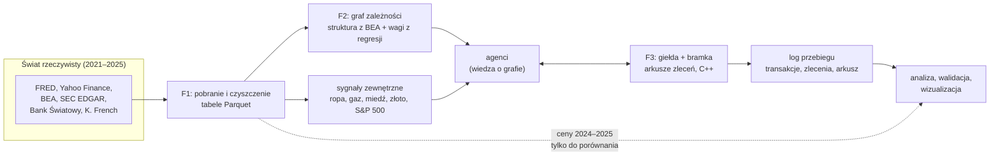

**Rola prawdziwych cen akcji** jest ściśle ograniczona:

- **2021–2023** — tylko do oszacowania wag grafu (czego agenci „nauczyli się” o rynku);
- **2 stycznia 2024** — cena startowa w symulacji;
- **2024–2025** — tylko do porównania z wynikiem symulacji (walidacja). Agenci tych cen nie widzą.

### Elementy modelu

- **Czas.** Symulacja zdarzeń dyskretnych: kolejka zdarzeń uporządkowana według czasu (decyzje agentów, wygasanie zleceń, migawki arkusza). Jedna sesja = jeden dzień danych; agenci budzą się w losowych momentach w ciągu sesji. Wszystkie losowania pochodzą z generatorów inicjalizowanych ziarnem: **ta sama konfiguracja i ziarno dają identyczny przebieg**.
- **Giełda.** Każda spółka ma własny arkusz zleceń z regułą *price-time priority* (najpierw lepsza cena, przy równej cenie — kto pierwszy). Ceny w tickach (liczby całkowite), pieniądze w centach — żadnych błędów zaokrągleń.
- **Bramka (*gateway*).** Pośrednik między agentami a giełdą: blokuje pieniądze lub akcje przed wysłaniem zlecenia i rozlicza transakcje. Łączna ilość pieniędzy i akcji w systemie jest stała — sprawdzamy to w każdym przebiegu.
- **Agenci.**

| Typ | Co robi |
|---|---|
| Wyceniający krótkowzroczny | wycenia spółkę tylko na podstawie surowców i indeksu (wagi „bezpośrednie”) |
| Wyceniający sieciowy | uwzględnia też ceny spółek-rodziców **na naszej giełdzie** (wagi „pełne”) |
| Trendowy | kupuje, gdy cena rosła w ostatnich sesjach, sprzedaje, gdy spadała |
| Szumowy | decyzje losowe (tło rynku) |
| Rebalansujący (fundusz) | utrzymuje stałe udziały wartościowe spółek w portfelu: sprzedaje to, co podrożało, dokupuje to, co staniało |
| Animator rynku (*market maker*) | stale wystawia zlecenia kupna i sprzedaży danej spółki, ma ograniczone zasoby |
| Fundusz | grupa inwestorów, którym przydzielono większą część kapitału (parametr $C$) |

- **Ograniczona wiedza agentów** (to, co odróżnia ich od idealnego rynku):
  - **uwaga:** każdy inwestor handluje tylko 4 z 18 spółek, ale widzi ceny wszystkich;
  - **opóźnienie:** ceny rodziców widzi ze średnim opóźnieniem 0,05 sesji;
  - **błąd wiedzy:** wagi grafu zna z osobistym błędem ok. 10%;
  - **krótkowzroczność:** część wyceniających w ogóle nie patrzy na spółki-rodziców.
- **Pozycja docelowa.** Inwestor nie kupuje „przy każdej okazji”, tylko chce mieć określoną liczbę akcji: tyle, ile miał na początku, powiększone lub pomniejszone zależnie od sygnału (do ±50%). Gdy ją osiągnie, przestaje kupować. Dlaczego tak: rozdz. 4.6.
- **Limit ryzyka (*stop-loss*).** Co czwarty inwestor, gdy jego portfel spadnie o ponad 20% od szczytu, sprzedaje połowę każdej pozycji i przez 5 sesji nie kupuje.
- **Zachowania stadne.** Każdy agent ma kilku „znajomych”. Jego ostateczny sygnał to mieszanka własnej opinii i tego, co ostatnio zrobili znajomi: $s = (1-h)\cdot\text{własny} + h\cdot\text{średnia znajomych}$. Parametr $h \in [0, 1]$ to siła zachowań stadnych. Od F5 może być **różna u różnych agentów**: tylko część inwestorów naśladuje innych, a każdy z nich ma własne $h$.
- **Kolejność zdarzeń.** Agent podejmuje decyzje po kolei: kolejny widzi rynek już po transakcjach poprzedniego. Zleceń kilku agentów nie łączymy w paczki, choć byłoby to kilkanaście razy szybsze. Paczka oznaczałaby, że kilku agentów decyduje na podstawie tego samego, nieaktualnego stanu rynku, a to zmienia model (rozdz. 4.3).

### Kontrakty, czyli jak czterech ludzi pracuje równolegle

Projekt jest podzielony na moduły połączone **zamrożonymi interfejsami** (kontraktami): giełda ↔ symulacja (K1), graf ↔ agenci (K2), format logu przebiegu (K3), format konfiguracji eksperymentu (K4) oraz schematy tabel danych. Każdy kontrakt ma testy, które go sprawdzają. Dzięki temu np. symulacja mogła powstać, zanim gotowy był silnik C++ (działała na wersji w Pythonie), a dane są sprawdzane automatycznie poleceniem `python -m marketsim.data.check`.

Szczegóły: [kontrakty](model/contracts.md) (po rosyjsku), [opis modelu](model/model_description.md).

---

## 3. Plan prac i stan faz

Projekt jest podzielony na fazy F0–F10. Każda ma właściciela, opis w [`docs/plans/phases/`](plans/phases/) i listę kontrolną „gotowe, gdy…”.

| Faza | Co | Stan |
|---|---|---|
| F0 | Specyfikacja, kontrakty między modułami | ✅ gotowe |
| F1 | Dane: pobranie, czyszczenie, kontrola (2021–2025) | ✅ gotowe; dodatkowo cena miedzi z LME |
| F2 | Graf zależności `real_v1`, trajektoria referencyjna, scenariusze sygnałów | ✅ gotowe |
| F3 | Giełda (Python + C++), bramka, test skali na 18 spółkach | ✅ gotowe |
| F4 | Rynek jednego aktywa, eksperymenty E1–E3 (P1, P2) | ✅ gotowe (wersja po poprawce minimalnego zlecenia) |
| F5 | Wyceniający według grafu na łańcuchu ropa → COP → VLO → DAL, eksperyment E4 | ✅ gotowe; E4 powtórzony z pozycją docelową (PR #20) |
| F6 | Pełna sieć 18 spółek na rzeczywistych sygnałach 2024–2025 (kamień milowy M3) | 🟡 zrobione, w przeglądzie (PR #15) |
| F7 | Eksperymenty E5 (propagacja), E6 (współruch), E7 (udział sieciowych) | 🟡 skrócony E5 policzony (90 przebiegów), pełne przed nami |
| F8 | Walidacja na danych 2024–2025 | 🟡 pierwsze testy w notatniku, moduł przed nami |
| F9 | Wizualizacja: odtwarzanie przebiegu, tryb na żywo | 🟡 odtwarzanie gotowe (PR #18), tryb na żywo przed nami |
| F10 | Raport końcowy i obrona | ⬜ |

Kod jest w repozytorium [`github.com/dmitrykitty/stock-exchange-simulation`](https://github.com/dmitrykitty/stock-exchange-simulation). Każda zmiana przechodzi przez *pull request* z automatycznymi testami (ponad 240 testów, w tym testy kontraktów i porównanie implementacji Python i C++).

---

## 4. Co zrobiliśmy

### 4.1 F1 — dane

**Cel:** zebrać wszystkie dane, wyczyścić je według jednolitych zasad i sprawdzić, że są poprawne, zanim ktokolwiek zacznie na nich liczyć.

#### Źródła

| Dane | Źródło | Do czego |
|---|---|---|
| Ropa WTI i Brent, gaz Henry Hub, S&P 500 (dzienne) | [FRED](https://fred.stlouisfed.org/) | sygnały zewnętrzne, zmienna kontrolna w regresji |
| Miedź, złoto, platyna (kontrakty terminowe, dzienne) | Yahoo Finance | sygnały zewnętrzne |
| Ceny i wolumeny 18 spółek | Yahoo Finance | wagi grafu, ceny startowe, walidacja |
| Miesięczne ceny surowców | [Bank Światowy (Pink Sheet)](https://www.worldbank.org/en/research/commodity-markets) | niezależna kontrola danych dziennych |
| Tabele przepływów międzygałęziowych (71 branż) | [BEA](https://www.bea.gov/industry/input-output-accounts-data) | struktura grafu |
| Kody branżowe SIC spółek | [SEC EDGAR](https://www.sec.gov/search-filings/edgar-application-programming-interfaces) | przypisanie spółek do branż |
| 49 portfeli branżowych, czynnik rynkowy | [Kenneth French Data Library](https://mba.tuck.dartmouth.edu/pages/faculty/ken.french/data_library.html) | walidacja na poziomie branż |

**Okres:** 2021–2025, czyli 1255 dni sesyjnych NYSE. Rok 2020 pomijamy celowo (pandemia, ujemna cena ropy 20.04.2020).

#### 18 spółek

| Branża (kod BEA) | Spółki | Dlaczego |
|---|---|---|
| Wydobycie ropy i gazu (211) | ConocoPhillips (COP), EOG Resources (EOG) | pierwsze ogniwo po ropie |
| Rafinacja (324) | Valero (VLO), Marathon Petroleum (MPC) | kupują ropę (50,8% kosztów) |
| Energetyka (22) | NextEra (NEE), Duke Energy (DUK) | odbiorcy gazu |
| Transport lotniczy (481) | Delta (DAL), United (UAL) | kupują paliwo (12,9% kosztów) |
| Transport drogowy (484) | Old Dominion (ODFL) | paliwo, metale |
| Górnictwo metali (212) | Freeport-McMoRan (FCX), Newmont (NEM) | miedź, złoto |
| Hutnictwo (331) | Nucor (NUE), Alcoa (AA) | metale, energia |
| Półprzewodniki (334) | NVIDIA (NVDA), AMD (AMD) | łańcuch technologiczny |
| Usługi internetowe (514) | Alphabet (GOOGL), Meta (META) | odbiorcy półprzewodników |
| Bankowość (521CI) | JPMorgan (JPM) | sektor finansowy, kanał indeksu |

Lista jest zamrożona w [`data/mapping/companies.csv`](../data/mapping/companies.csv). Każda spółka ma pełne notowania z całego okresu (bez luk) i kod SIC z EDGAR.

#### Co robi kod

- [`fetch.py`](../src/marketsim/data/fetch.py) pobiera wszystkie pliki **dokładnie w takiej postaci, w jakiej przyszły z serwera**, i zapisuje dla każdego adres, datę, rozmiar i sumę kontrolną SHA-256 (`manifest.json`). Dzięki temu wiemy, z jakich wersji danych powstały wyniki.
- [`clean.py`](../src/marketsim/data/clean.py) buduje 14 tabel według schematów z [`schemas.py`](../src/marketsim/data/schemas.py):
  - wspólny **kalendarz** = dni, w których handlowano akcjami (1255 dni). Bez tego szeregi z różnych źródeł „rozjeżdżają się” o święta;
  - luki w danych surowcowych (np. dzień po Święcie Dziękczynienia, gdy FRED nie publikuje) uzupełniane **ostatnią znaną wartością, najwyżej przez 3 dni**, i zawsze oznaczane flagą `*_filled`. Takich dni było: ropa WTI 7, Brent 24, gaz 7; luk dłuższych niż 3 dni nie ma;
  - dzienne **logarytmiczne stopy zwrotu** $r_t = \ln(P_t / P_{t-1})$ — na nich liczymy wagi grafu;
  - macierz kosztów BEA dla lat 2022 i 2023.
- [`check.py`](../src/marketsim/data/check.py) sprawdza wszystkie tabele względem schematów. Wynik: **14/14 OK**.
- [`tests/data/test_data_quality.py`](../tests/data/test_data_quality.py) porównuje źródła między sobą (np. złoto z Yahoo z danymi Banku Światowego, WTI z FRED z kontraktem CL=F).

**Wszystkie liczby kontrolne z planu zgadzają się** (sprawdziliśmy to niezależnie, pobierając dane od zera): 1255 dni, `A["324","481"] = 0,1292`, produkcja transportu lotniczego 311 313 mln USD, wagi łańcucha co do trzeciego miejsca po przecinku.

Pełny opis plików, jednostek i decyzji: [`data/README.md`](../data/README.md).

#### Notatniki

- [`01_data_access_check.ipynb`](../notebooks/01_data_access_check.ipynb) — tabela „źródło → pobrane → liczby się zgadzają” i odtworzenie wag łańcucha.
- [`01_data_overview.ipynb`](../notebooks/01_data_overview.ipynb) — przegląd danych; to z niego pochodzą wykresy poniżej.

#### Wykres 1. Surowce: dane dzienne a oficjalne dane miesięczne

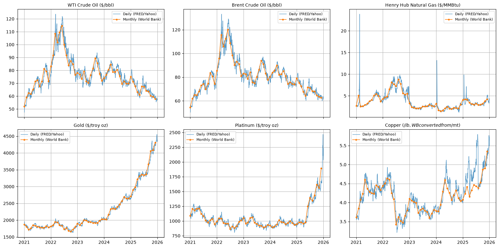

**Co przedstawia.** Sześć surowców. Niebieska linia to dane dzienne, których używamy w symulacji (FRED lub kontrakty z Yahoo). Pomarańczowe kropki to oficjalne średnie miesięczne Banku Światowego — niezależne źródło.

**Po co.** To test, czy nasze dane dzienne są wiarygodne. Gdyby linie się rozjeżdżały, oznaczałoby to błąd w danych lub w jednostkach.

**Co widać.**
- Linie pokrywają się prawie idealnie: korelacja średnich miesięcznych dla złota 0,9999, platyny 0,999. **Dane są poprawne.**
- Ropa: szczyt ok. 120 USD/baryłkę w 2022 r. (inwazja Rosji na Ukrainę), potem spadek do ok. 60 USD. To jest główny „szok”, który będziemy przepuszczać przez graf.
- Gaz (Henry Hub): ostre szpilki, np. luty 2021 (zima stulecia w Teksasie, burza Uri — cena skoczyła ponad 20 USD) i styczeń 2024. Ceny spot gazu są bardzo nerwowe.
- Złoto i platyna: silny wzrost w latach 2024–2025.
- Miedź: w 2025 r. dane dzienne (giełda amerykańska COMEX) idą wyżej niż miesięczne. To nie błąd: amerykańskie cła na miedź spowodowały, że cena w USA oderwała się od ceny światowej. Dlatego korelacja dla miedzi jest niższa (0,94). Szczegóły i nasza decyzja: wykres 5.

#### Wykres 2. 18 spółek znormalizowanych do 100

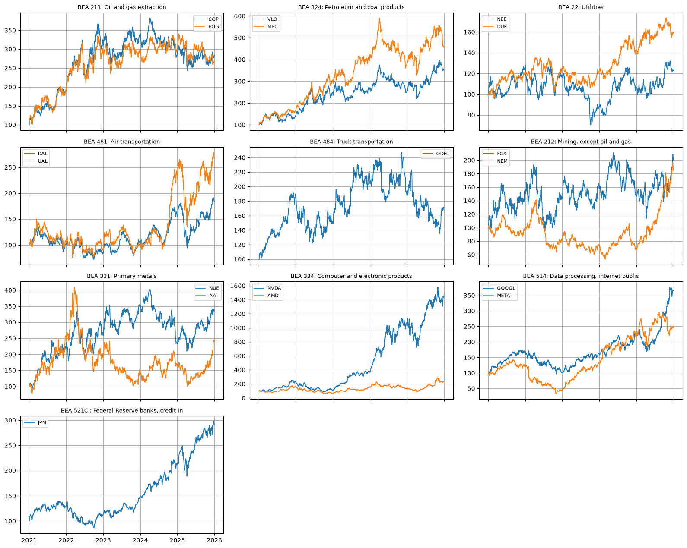

**Co przedstawia.** Ceny akcji wszystkich spółek, pogrupowane według branż. Każda cena jest przeskalowana tak, by 4 stycznia 2021 r. wynosiła 100. Wartość 300 oznacza, że akcja potroiła wartość; 80 — że straciła 20%.

**Po co.** Kontrola poprawności (brak dziur, skoków po podziale akcji itp.) i pierwsze spojrzenie, czy spółki z jednej branży zachowują się podobnie.

**Co widać.**
- Spółki z tej samej branży poruszają się razem: COP i EOG (obie: wydobycie ropy i gazu), DAL i UAL (obie: linie lotnicze), VLO i MPC (obie: rafinerie). To potwierdza sens grupowania według branż.
- Wyraźne różnice skali: NVDA (NVIDIA, chipy do sztucznej inteligencji) wzrosła ok. 14-krotnie, a NEE i DUK (energetyka) ledwie się zmieniły.
- DAL i UAL (linie lotnicze): silny spadek wiosną 2025 r. (ogłoszenie ceł), potem odbicie.
- Ten wykres pokazuje też, **dlaczego wagi liczymy na stopach zwrotu, a nie na poziomach cen**: poziomy prawie wszystkich spółek rosną w czasie, więc ich korelacja byłaby wysoka nawet bez żadnego związku.

#### Wykres 3. Macierz korelacji dziennych stóp zwrotu

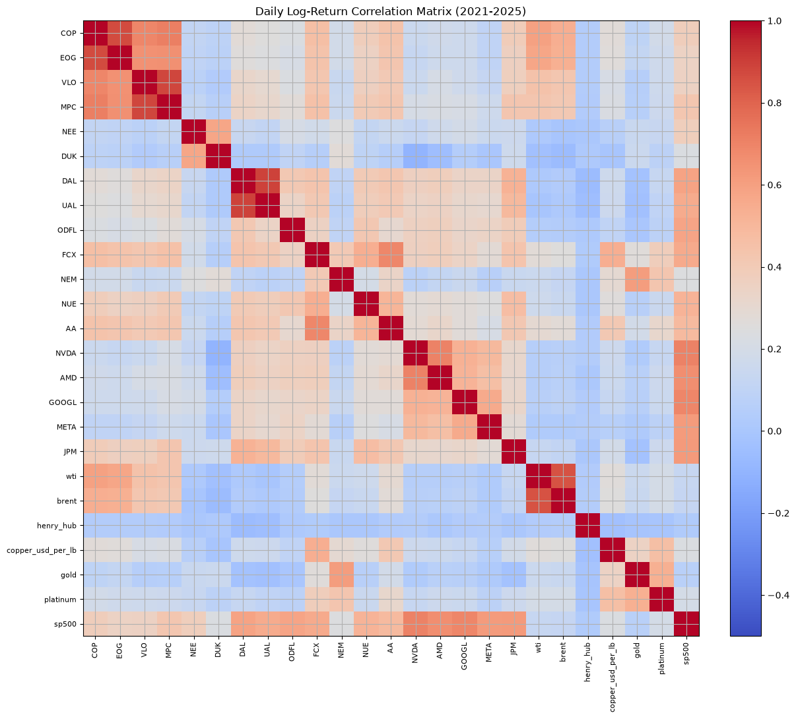

**Co przedstawia.** Każda kratka to korelacja dziennych stóp zwrotu dwóch szeregów w latach 2021–2025. Czerwony = poruszają się razem (blisko 1), biały/jasnoniebieski = brak związku (ok. 0), niebieski = w przeciwnych kierunkach. Przekątna to zawsze 1 (szereg z samym sobą).

**Jak czytać.** Szukamy „czerwonych bloków” — grup, które poruszają się wspólnie.

**Co widać.**
- **Blok naftowy** (lewy górny róg): COP i EOG (wydobycie ropy i gazu) oraz VLO i MPC (rafinerie) są silnie skorelowane między sobą i z ceną ropy (wiersze `wti`, `brent`). Korelacja z ropą WTI: COP (wydobycie) 0,59, EOG (wydobycie) 0,57, VLO (rafineria) 0,45, MPC (rafineria) 0,43. Wydobywcy są związani z ropą najsilniej, bo ich przychód to wprost cena ropy; rafinerie trochę słabiej, bo ropa jest dla nich i kosztem, i podstawą ceny paliw. To jest podstawa łańcucha ropa → COP → VLO.
- **Metale:** FCX (Freeport-McMoRan, kopalnie miedzi) i AA (Alcoa, hutnictwo aluminium) z ceną miedzi (0,54 i 0,41), NEM (Newmont, kopalnie złota) z ceną złota (0,61). Kopalnia sprzedaje dany metal, więc jej akcje idą za jego ceną.
- **Linie lotnicze:** DAL (Delta, linia lotnicza) i UAL (United, linia lotnicza) bardzo silnie ze sobą, ale prawie zero bezpośrednio z ropą (0,02). Wpływ ropy na linie lotnicze jest więc pośredni i słaby — dlatego potrzebujemy grafu i dwóch zestawów wag (patrz F2).
- **Technologia i finanse:** NVDA i AMD (chipy), GOOGL (Alphabet: wyszukiwarka i reklama) i META (media społecznościowe) oraz JPM (JPMorgan, bank) są silnie skorelowane z S&P 500 (0,62–0,71); to duże spółki, które same mają duży udział w indeksie. Wszystkie spółki są w jakimś stopniu skorelowane z indeksem — to „wspólny czynnik rynkowy”. Dlatego w regresji wag zawsze uwzględniamy S&P 500 jako zmienną kontrolną: bez niej każda para spółek wyglądałaby na powiązaną.
- **Energetyka:** NEE (NextEra) i DUK (Duke Energy) są skorelowane głównie ze sobą; z ropą prawie wcale (0,02 i −0,03).
- **Gaz (Henry Hub):** prawie zero ze wszystkim. Krawędzie od gazu w grafie będą miały wagi bliskie zeru — to wynik, a nie błąd (opisany w dokumentacji danych).

**Ważne:** korelacja to jeszcze nie zależność. Dlatego **strukturę grafu bierzemy z gospodarki (BEA), a nie z korelacji**; korelacje (a dokładniej regresja) służą tylko do oszacowania siły istniejących powiązań.

#### Wykres 4. Macierz kosztów BEA (kto od kogo kupuje)

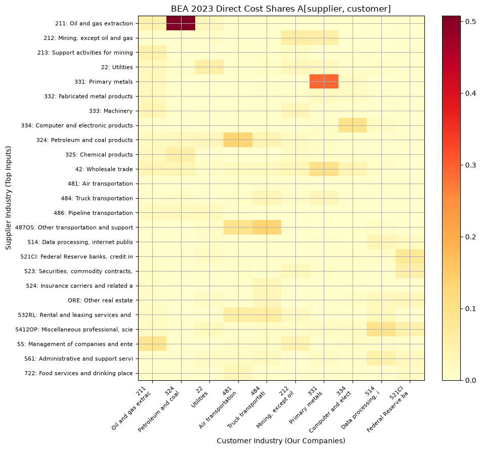

**Co przedstawia.** Fragment tabeli przepływów międzygałęziowych BEA za 2023 r. Kolumny to branże naszych spółek (odbiorcy), wiersze to branże-dostawcy. Kratka $A[\text{dostawca}, \text{odbiorca}]$ mówi, **jaką część wartości swojej produkcji odbiorca wydaje na produkty dostawcy**. Im ciemniej, tym silniejsze powiązanie.

**Co widać.**
- Najciemniejsza kratka: **wydobycie ropy (211) → rafinacja (324) = 0,508**. Rafinerie wydają ponad połowę wartości produkcji na ropę i gaz.
- **Hutnictwo (331) → hutnictwo (331) = 0,293**: huty kupują półprodukty od innych hut.
- **Produkty naftowe (324) → transport lotniczy (481) = 0,129**: linie lotnicze wydają 12,9% na paliwo.
- Wiersze bez naszych spółek (handel hurtowy, wynajem, usługi) też są ważnymi dostawcami, ale nie mamy w nich spółek, więc nie tworzą krawędzi między spółkami.

**Jak z tego powstaje graf.** Krawędź „spółka A → spółka B” dopuszczamy, jeśli branża B wydaje na produkty branży A **co najmniej 2%** swojej produkcji. Dla 18 spółek daje to 54 krawędzie-kandydatów; każdą przejrzeliśmy ręcznie (rozdz. 4.2, krok 5). Promień spektralny całej macierzy wynosi 0,463 < 1, czyli powiązania nie „rozkręcają się” w nieskończoność.

#### Wartości odstające

Znaleźliśmy **80 obserwacji** (para: data, szereg), w których dzienna zmiana logarytmu ceny przekroczyła co do wartości bezwzględnej 0,15. **Żadnego nie usuwamy** — to prawdziwe zdarzenia rynkowe, np.:

| Data | Szereg | Zmiana | Przyczyna |
|---|---|---|---|
| 2022-02-03 | META (media społecznościowe) | −26% | słabe wyniki kwartalne |
| 2025-01-27 | NVDA (chipy do AI) | −17% | premiera chińskiego modelu DeepSeek R1: obawa, że AI będzie potrzebować mniej chipów |
| 2025-04-09 | UAL, DAL (linie lotnicze), AMD, NVDA (chipy) | +18…+26% | zawieszenie ceł na 90 dni |
| 2025-07-31 | miedź | −22% | zmiana decyzji o cłach na miedź |
| luty 2021 | gaz | wielokrotnie | burza zimowa Uri w Teksasie |

61 z 80 obserwacji (57 różnych dat) ma źródło opisujące zdarzenie lub jego kontekst (link w [`data/mapping/outlier_explanations.csv`](../data/mapping/outlier_explanations.csv)). Pozostałe 19 obserwacji to wahania ceny spot gazu, których pojedynczych przyczyn nie udało się jednoznacznie ustalić — są uczciwie oznaczone jako `unexplained`.

#### Wykres 5. Miedź: cena amerykańska (COMEX) a światowa (LME)

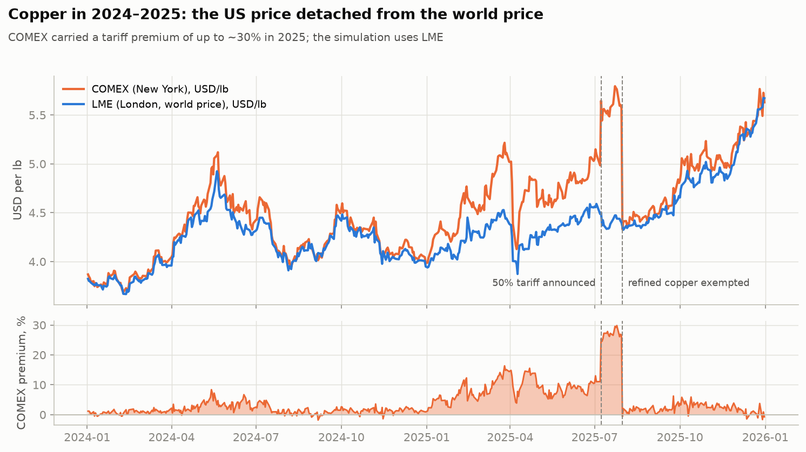

**Co przedstawia.** U góry dzienna cena miedzi na dwóch giełdach: COMEX w Nowym Jorku (pomarańczowa) i LME w Londynie, czyli cena światowa (niebieska). Na dole różnica między nimi w procentach („premia COMEX”).

**Po co.** Miedź jest sygnałem zewnętrznym dla FCX (kopalnie miedzi), NUE (stal) i AA (aluminium). Trzeba było zdecydować, którą cenę podawać agentom.

**Co widać.**
- Do końca 2024 r. obie ceny idą razem (premia 0–5%).
- W 2025 r. COMEX oddziela się od LME: najpierw z powodu oczekiwanych ceł (premia ok. 10–15%), a 8 lipca, po zapowiedzi 50% cła, premia skacze do ok. 30%. 31 lipca rafinowaną miedź zwolniono z cła i premia w jeden dzień spada prawie do zera (COMEX −22% w jeden dzień).
- To zmiany **ceny w USA**, a nie światowego popytu na miedź. W te dni FCX zmienił się o +2,5% i +2,8%, czyli zupełnie inaczej niż COMEX (+12,4% i −25,2%), a podobnie jak LME (+0,3% i −1,0%).

**Decyzja.** Agenci w scenariuszu 2024–2025 dostają cenę **LME**. Wagi grafu nadal szacujemy na COMEX z lat 2021–2023, gdy obie ceny były praktycznie równe. Scenariusz z COMEX zostaje jako wariant porównawczy (`real_2024_2025_comex`). Znane ograniczenie: cena LME jest ustalana w Londynie przed zamknięciem giełdy w Nowym Jorku, więc część ruchu miedzi trafia do symulacji z opóźnieniem do jednego dnia.

---

### 4.2 F2 — graf zależności

**Cel:** dla każdej pary „rodzic → dziecko” ustalić, czy krawędź istnieje i jak silna jest zależność.

**Struktura** (czy krawędź w ogóle istnieje) pochodzi z tabel BEA (rozdz. 4.1, wykres 4). **Wagi** (jak silna jest krawędź) szacujemy z historii cen. Poniżej krok po kroku, jak.

#### Krok 1. Stopa zwrotu — o ile procent zmieniła się cena

Nie porównujemy samych cen (COP po 110 USD, VLO po 130 USD — te liczby nic o sobie nie mówią), tylko to, **o ile procent zmieniła się cena z dnia na dzień**. To jest **dzienna stopa zwrotu**:

$$
\text{prosta stopa zwrotu} = \frac{P_t - P_{t-1}}{P_{t-1}}, \qquad \text{logarytmiczna stopa zwrotu } r_t = \ln\frac{P_t}{P_{t-1}}
$$

gdzie $P_t$ to cena zamknięcia w dniu $t$, a $P_{t-1}$ — dzień wcześniej. Przykład: akcja kosztowała wczoraj 100 USD, dziś 102 USD → prosta stopa zwrotu $= +2\%$, logarytmiczna $= \ln(1{,}02) = +1{,}98\%$. Dla codziennych zmian obie są prawie równe, więc $r_t$ można czytać po prostu jako „zmianę ceny w procentach”.

Używamy wersji logarytmicznej, bo dobrze się sumuje. Przykład: cena 100 → 110 → 100. Proste stopy zwrotu: $+10\%$, potem $-9{,}09\%$ — suma nie wynosi zero, choć cena wróciła do punktu wyjścia. Logarytmiczne: $+9{,}53\%$, potem $-9{,}53\%$ — suma wynosi dokładnie zero. Dzięki temu zmiana ceny na przestrzeni wielu dni to po prostu suma dziennych stóp zwrotu. Z tego korzystają też agenci, aktualizując wyceny.

Dlaczego stopy zwrotu, a nie ceny: ceny prawie wszystkich spółek rosną w długim okresie, więc wykresy cen „wyglądają podobnie” nawet bez żadnego związku między spółkami (wykres 2). Stopy zwrotu odpowiadają na właściwe pytanie: **czy w dniu, w którym ropa podrożała, COP (wydobycie) też podrożał, i o ile?**

#### Krok 2. Równanie, które dopasowujemy

Dla każdej spółki $i$ zapisujemy, że jej dzienna stopa zwrotu składa się z kilku części:

$$
r_{i,t} = \alpha_i + \sum_{j \in \text{rodzice}(i)} w_{ij}\, r_{j,t} + \beta_i\, r^{\text{S\&P500}}_t + u_{i,t}
$$

| Symbol | Co oznacza | Przykład dla VLO (rafineria) |
|---|---|---|
| $i$ | spółka, którą wyjaśniamy („dziecko”) | VLO |
| $t$ | dzień; bierzemy 752 dni sesyjne z lat 2021–2023 | np. 17.03.2022 |
| $r_{i,t}$ | stopa zwrotu spółki $i$ w dniu $t$ — to chcemy wyjaśnić | o ile % zmienił się VLO tego dnia |
| $\text{rodzice}(i)$ | węzły, z których w grafie prowadzą krawędzie do $i$: spółki-dostawcy (z BEA) i surowce | COP (wydobycie) i ropa WTI |
| $r_{j,t}$ | stopa zwrotu rodzica $j$ **tego samego dnia** | o ile % zmienił się COP i ropa |
| $w_{ij}$ | **waga krawędzi — to, czego szukamy.** O ile % średnio zmienia się $i$, gdy rodzic $j$ zmieni się o 1%, a pozostałe składniki stoją w miejscu | $w_{\text{COP} \to \text{VLO}} = 0{,}701$ |
| $r^{\text{S\&P500}}_t$ | stopa zwrotu całego rynku (indeksu S&P 500) tego dnia | — |
| $\beta_i$ | wrażliwość spółki na ogólny nastrój rynku | 0,169 |
| $\alpha_i$ | stała: średnia dzienna zmiana, której nic nie wyjaśnia; zwykle prawie zero | 0,008% dziennie |
| $u_{i,t}$ | **reszta**: wszystko, czego model nie wyjaśnia — wiadomości o samej spółce, wyniki kwartalne, przypadek | różni się każdego dnia |

**Po co składnik z S&P 500.** W dobre dni rośnie prawie cała giełda: COP, VLO i wszystko inne. Bez tego składnika regresja mogłaby uznać, że VLO rośnie „przez COP”, podczas gdy oba rosną po prostu z całym rynkiem. Indeks zbiera ten wspólny ruch, a waga $w_{ij}$ mierzy już tylko związek ponad nim. To dlatego mówimy o „zmiennej kontrolnej”.

#### Krok 3. Skąd biorą się liczby

Parametry $\alpha_i$, $w_{ij}$, $\beta_i$ dobiera **metoda najmniejszych kwadratów** (regresja liniowa, OLS): spośród wszystkich możliwych wartości wybiera te, przy których reszty $u_{i,t}$ są łącznie najmniejsze, czyli suma $u_{i,t}^2$ po wszystkich 752 dniach jest minimalna. Intuicja: przy jednym rodzicu to dopasowanie prostej do chmury 752 punktów (oś X — zmiana COP, oś Y — zmiana VLO), a waga to nachylenie tej prostej. Przy kilku rodzicach zasada jest ta sama, tylko wymiarów jest więcej.

Wynik dla VLO (rafineria):

$$
r_{\text{VLO},t} = 0{,}00008 + 0{,}701 \cdot r_{\text{COP},t} + 0{,}069 \cdot r_{\text{WTI},t} + 0{,}169 \cdot r^{\text{S\&P500}}_t + u_t
$$

**Sprawdzenie na prawdziwym dniu — 17 marca 2022 r.:** ropa WTI $+8{,}21\%$, COP (wydobycie) $+4{,}14\%$, S&P 500 $+1{,}23\%$. Równanie przewiduje dla VLO (rafineria): $0{,}701 \cdot 4{,}14 + 0{,}069 \cdot 8{,}21 + 0{,}169 \cdot 1{,}23 \approx 2{,}90 + 0{,}57 + 0{,}21 = +3{,}68\%$. Faktycznie VLO zmienił się o $+4{,}77\%$, więc reszta $u = +1{,}09\%$ to część ruchu, której zależności nie wyjaśniają.

**Jak pewne są te liczby.**
- **Statystyka $t$** = waga podzielona przez jej niepewność. Dla COP → VLO $t = 19{,}6$: waga jest wyznaczona bardzo pewnie. Przyjmuje się, że $|t| > 2$ oznacza wagę istotnie różną od zera. Dla ropy → DAL (linia lotnicza) $t = -1{,}5$, więc tej wagi nie odróżniamy od zera.
- **$R^2$** — jaka część dziennych wahań spółki jest wyjaśniona. Dla VLO $R^2 = 0{,}53$: połowę ruchów VLO wyjaśniają COP, ropa i rynek, druga połowa to sprawy samej spółki.

#### Krok 4. Jak agenci używają wag

Waga przekłada się wprost na zachowanie agenta. Jeśli na naszej giełdzie COP (wydobycie) zdrożał o 3%, agent wyceniający VLO (rafineria) podnosi swoją wycenę VLO o $0{,}701 \cdot 3\% \approx 2{,}1\%$. Jeśli VLO kosztuje mniej niż nowa wycena, agent kupuje. Pełny wzór aktualizacji wyceny: [propozycja, rozdz. 5.4](research_proposal.md#54-agenci).

**Zastrzeżenie.** Wagi to statystyczne związki z lat 2021–2023, a nie „prawa gospodarki”. Traktujemy je jako **przekonania agentów** o tym, jak spółki od siebie zależą. Każdy agent dostaje wagę z małym indywidualnym błędem, bo w rzeczywistości inwestorzy też nie znają tych zależności dokładnie.

**Dlaczego dwa zestawy wag.** Wynik zależy od tego, co wstawimy do regresji:

| Krawędź | Wagi bezpośrednie (tylko surowce + indeks) | Wagi pełne (także spółki-rodzice) |
|---|---|---|
| ropa → COP (wydobycie) | 0,516 (t = 20,4) | 0,516 |
| ropa → VLO (rafineria) | 0,430 (t = 14,1) | 0,069 |
| **COP (wydobycie) → VLO (rafineria)** | — | **0,701** (t = 19,6) |
| ropa → DAL (linia lotnicza) | −0,043 (nieistotne) | −0,139 |
| **VLO (rafineria) → DAL (linia lotnicza)** | — | **0,222** (t = 6,5) |

Skąd ta różnica: COP (wydobycie) i ropa poruszają się razem (korelacja 0,59). Jeśli w równaniu jest tylko ropa, „przypisuje” ona sobie także ten wpływ, który w rzeczywistości przechodzi przez COP. Gdy dodamy COP, regresja rozdziela te dwie drogi.

Widać tu sens całego projektu. Patrząc tylko na ropę, VLO (rafineria) zależy od niej mocno (0,43), ale gdy dodamy COP (wydobycie), prawie cały wpływ ropy idzie **przez COP** (0,70), a bezpośrednio zostaje tylko 0,07. Dla DAL (linia lotnicza) bezpośredni wpływ ropy jest nieistotny, ale istnieje wyraźna ścieżka przez rafinerię. Dlatego:

- **wyceniający krótkowzroczni** używają wag bezpośrednich (patrzą tylko na surowce),
- **wyceniający sieciowi** używają wag pełnych (patrzą na ceny rodziców na naszej giełdzie).

#### Krok 5. Przegląd krawędzi i gotowy graf `real_v1`

Z tabel BEA wyszły 54 krawędzie-kandydaci między spółkami (branża B wydaje na produkty branży A co najmniej 2% wartości produkcji). Każdą przejrzeliśmy ręcznie i zapisaliśmy uzasadnienie ([`bea_candidates_review.csv`](../data/graph/real_v1/bea_candidates_review.csv)):

| Decyzja | Ile | Przykład i powód |
|---|---|---|
| **zostawić** | 10 | wydobycie → rafinacja (rafinerie kupują ropę: 50,8% kosztów), rafinacja → linie lotnicze i transport drogowy (paliwo) |
| **wątpliwe → nie włączać** | 12 | energetyka → hutnictwo (szczegóły niżej), wydobycie gazu → elektrownie |
| **usunąć** | 32 | pary w tej samej branży (COP ↔ EOG, NVDA ↔ AMD): to konkurenci, a nie dostawca i odbiorca; powiązania „przez agregację” (BEA 212 łączy kopalnie miedzi i złota, które nic od siebie nie kupują) |

Do tego dochodzą:
- **15 krawędzi surowiec → spółka:** ropa → wydobycie, rafinacja, linie lotnicze i transport drogowy; gaz → wydobycie i energetyka; miedź → FCX, NUE i AA; złoto → NEM;
- **4 krawędzie dodane ręcznie** (chipy NVDA i AMD → usługi chmurowe GOOGL i META). Tego powiązania nie widać w tabelach BEA, bo zakup serwerów to inwestycja, a nie bieżący koszt;
- **18 krawędzi od S&P 500** do każdej spółki (czynnik rynkowy).

Razem **47 krawędzi**.

**Dlaczego wyrzuciliśmy krawędzie „energetyka → hutnictwo”.** Huty kupują prąd (2,1% kosztów), więc z BEA krawędź wychodziła. Oszacowane wagi były jednak **ujemne** (NEE → NUE −0,18, $t = -3{,}05$): agent wyceniający stal sprzedawałby ją za każdym razem, gdy drożeje akcja elektrowni. Przyczyna: kurs akcji spółki energetycznej to nie cena prądu, tylko głównie odbicie stóp procentowych. Krawędź bez sensu ekonomicznego zaszkodziłaby agentom, więc ją usunęliśmy.

**Dwóch prawie identycznych rodziców.** COP i EOG (oba: wydobycie) oraz VLO i MPC (obie: rafinerie) poruszają się razem (korelacja 0,88). Regresja dzieli wtedy wspólny efekt między nich: COP → VLO = 0,54 i EOG → VLO = 0,18, razem 0,72, czyli prawie tyle samo, co 0,70 przy jednym rodzicu. Pojedyncza waga z $|t| < 2$ nie oznacza więc słabej zależności: wagi obu rodziców trzeba czytać razem.

#### Wykres 6. Graf `real_v1`

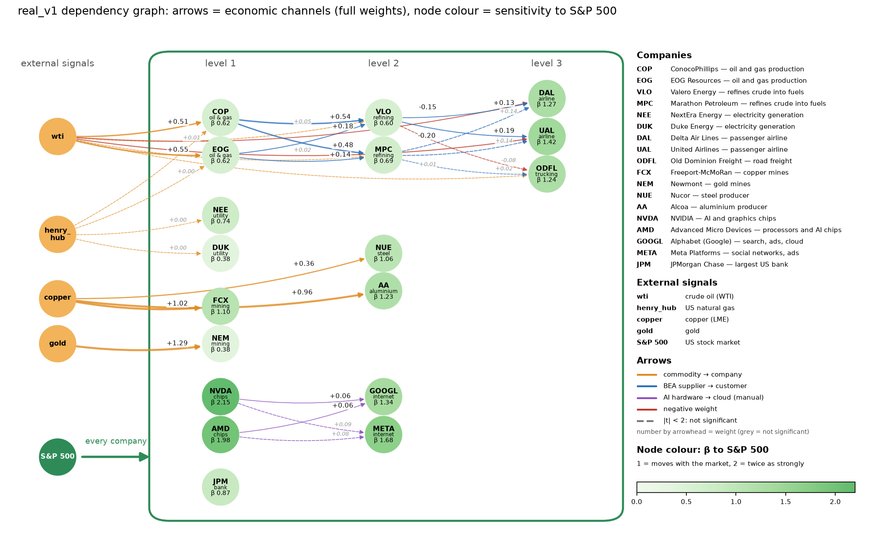

**Co przedstawia.** Wszystkie węzły i krawędzie grafu, z którego korzystają agenci.
- **Po lewej sygnały zewnętrzne:** ropa (`wti`), gaz (`henry_hub`), miedź, złoto. S&P 500 jest rodzicem każdej spółki, dlatego zamiast 18 strzałek rysujemy jedną strzałkę do zielonej ramki.
- **W ramce spółki,** ułożone według odległości od surowca: poziom 1 to spółki zależne bezpośrednio od surowca, poziom 2 ich odbiorcy, poziom 3 odbiorcy odbiorców.
- **Strzałka:** liczba przy grocie to waga pełna. Kolor mówi, skąd pochodzi krawędź: pomarańczowy = surowiec, niebieski = BEA, fioletowy = dodana ręcznie, czerwony = waga ujemna. Linia przerywana i szara liczba oznaczają, że wagi statystycznie nie odróżnimy od zera ($|t| < 2$).
- **Kolor węzła:** wrażliwość spółki na cały rynek ($\beta$ do S&P 500). Ciemniejszy oznacza mocniejszą reakcję na ruch indeksu.

**Jak czytać na przykładzie.** Ropa → COP +0,51: gdy ropa drożeje o 1%, wycena COP rośnie średnio o 0,51%. COP → VLO +0,54 i dalej VLO → UAL +0,19: część tej zmiany dociera do linii lotniczej przez rafinerię. Bezpośrednio ropa → UAL waga jest ujemna (droższe paliwo to wyższe koszty). Dla linii lotniczych oba kanały prawie się znoszą: łącznie przy ropie +20% wycena DAL spada tylko o ok. 1%.

**Co widać.**
- **Łańcuch naftowy** (górna część) jest najgęstszy: tu fala ma najwięcej dróg.
- **Metale** to krótkie łańcuchy: miedź → FCX, NUE, AA; złoto → NEM.
- **Energetyka** (NEE, DUK) jest połączona tylko z gazem, i to z wagą bliską zeru. W praktyce reaguje tylko na indeks.
- **Chipy → internet:** wagi małe (0,06–0,09), bo większość wspólnego ruchu tych spółek tłumaczy już indeks.
- **JPM** (bank) nie ma rodziców poza indeksem. To nasza „spółka kontrolna”: jeśli po szoku ropy JPM się ruszy, to znaczy, że szok przeskoczył kanałem, którego nie ma w grafie (pytanie P6).

#### Trajektoria referencyjna $R$ i scenariusze

**Trajektoria referencyjna** to ceny, jakie byłyby, gdyby wszyscy natychmiast i dokładnie zastosowali wagi pełne do ruchów surowców i indeksu. Liczymy ją z tego samego grafu ([`graph/reference.py`](../src/marketsim/graph/reference.py)), zaczynając od prawdziwych cen z 2 stycznia 2024 r. Agenci jej nie znają; służy tylko do pomiaru.

**Scenariusze sygnałów zewnętrznych:**

| Scenariusz | Co zawiera | Do czego |
|---|---|---|
| `real_2024_2025` | prawdziwe ceny surowców (miedź z LME) i S&P 500, 502 dni sesyjne | pełna sieć (F6), eksperyment E5, walidacja |
| `real_2024_2025_comex` | to samo, ale miedź z COMEX | porównanie (wykres 5) |
| `f6_oil_up`, `f6_oil_down` | wszystko zamrożone na 2 stycznia 2024 r., w 10. sesji ropa +20% lub −20% | „czysta” fala na prawdziwym grafie (wykres 12) |
| `oil_shock`, `oil_shock_down`, `flat` | syntetyczne: ropa 100 → 120 lub 80, albo brak zmian | łańcuch (F5), testy |

---

### 4.3 F3 — silnik giełdowy

**Cel:** szybka i na pewno poprawna giełda, bo każdy późniejszy wynik od niej zależy.

**Co robi.** Dla każdej spółki prowadzi arkusz zleceń (*limit order book*):
- zlecenia z limitem ceny: GTC (ważne do odwołania), IOC (wykonaj natychmiast, resztę anuluj), GTD (ważne do określonej chwili);
- dopasowanie według ceny, potem według kolejności; transakcja po cenie zlecenia oczekującego;
- zlecenie, które dopasowałoby się z własnym zleceniem tego samego agenta, jest odrzucane (*self-trade prevention*);
- ceny w tickach, pieniądze w centach — tylko liczby całkowite.

**Dwie implementacje.**
- [`PyExchange`](../src/marketsim/market/) w Pythonie — wersja wzorcowa, prosta do sprawdzenia;
- [`lob_core`](../cpp/) w C++20 — wersja szybka, dostępna z Pythona przez nanobind. Wyniki przekazywane są jako bloki pamięci bez kopiowania (tablice NumPy).

**Skąd wiemy, że jest poprawny.**
- Te same **testy kontraktowe** przechodzą obie implementacje.
- **Test różnicowy** ([`test_differential.py`](../tests/market/test_differential.py)): biblioteka hypothesis generuje setki losowych sekwencji zleceń i anulowań, w tym błędnych; po każdym kroku obie implementacje muszą dać identyczny stan arkusza i identyczne transakcje.
- Testy C++ (Catch2) uruchamiane z sanitizerami pamięci (ASan/UBSan).

#### Wykres 7. Szybkość giełdy i całego przepływu zleceń

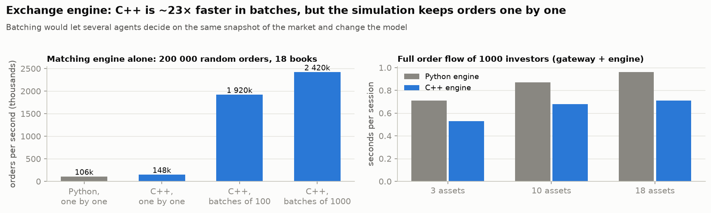

**Lewy panel: sam silnik dopasowujący**, 200 000 losowych zleceń w 18 arkuszach ([`benchmarks/bench_exchange.py`](../benchmarks/bench_exchange.py)).
- Python obsługuje ok. 106 tys. zleceń na sekundę, C++ przy pojedynczych wywołaniach 148 tys.
- C++ w paczkach po 100–1000 zleceń: 1,9–2,4 mln na sekundę, czyli ok. 23 razy szybciej niż Python.
- Wyniki z C++ trafiają do Pythona jako jeden blok pamięci, bez kopiowania.

**Prawy panel: przepływ zleceń 1000 inwestorów** (bramka + silnik, z kontrolą niezmienników po każdej sesji, [`benchmarks/bench_scale.py`](../benchmarks/bench_scale.py)).
- Czas na sesję prawie nie zależy od liczby spółek (3, 10, 18): pracy jest tyle, ile decyzji agentów, a nie ile arkuszy.
- Dlatego zostaliśmy przy 18 spółkach, a nie przy 10.

**Decyzja: zlecenia jedno po drugim, bez paczek.** Paczki są kilkanaście razy szybsze, ale w paczce kilku agentów decyduje na podstawie tego samego stanu rynku, a w rzeczywistości drugi agent widzi już skutek transakcji pierwszego. Nawet zlecenia jednego agenta na kilka spółek w paczce „nie widzą” zmian w portfelu po wcześniejszych transakcjach. Szybkość zyskujemy inaczej: przebiegi są niezależne, więc liczymy je równolegle (10 procesów). Pełny przebieg F6 (525 inwestorów, 18 spółek, 502 sesje) trwa 6–10 minut.

---

### 4.4 F4 — rynek jednego aktywa

#### Po co ten etap

Docelowo symulacja ma 18 spółek, graf i prawdziwe ceny surowców. Zanim to połączymy, trzeba sprawdzić, że sama „maszyneria” działa: agenci podejmują sensowne decyzje, giełda poprawnie łączy zlecenia, pieniądze się nie gubią, a wyniki da się zmierzyć i powtórzyć. Robimy to na **najprostszym możliwym rynku: jedna akcja, bez grafu, bez surowców.** Przy okazji odpowiadamy na dwa pierwsze pytania badawcze:

- **P1:** czy naśladowanie innych (zachowania stadne) destabilizuje rynek?
- **P2:** czy skupienie kapitału w kilku dużych funduszach destabilizuje rynek?

#### Jak wygląda ten rynek

- Jedna fikcyjna akcja („SYNTH”), cena startowa **100 USD**.
- **30 sesji** handlowych (sesja = „dzień”). Pierwsze 5 sesji to **rozgrzewka**: arkusz zleceń dopiero się zapełnia, więc tego okresu nie mierzymy.
- **80 inwestorów** i **1 animator rynku** (*market maker*).
- Inwestorzy mają razem **800 000 USD gotówki i 8 000 akcji** (warte kolejne 800 000 USD). Animator ma osobno 200 000 USD i 2 000 akcji.
- Każdy inwestor „budzi się” w losowych momentach, średnio **2 razy na sesję**, i wtedy podejmuje decyzję. W 25 mierzonych sesjach daje to ok. 4 000 decyzji na przebieg.
- Nie ma żadnych wiadomości z zewnątrz. Rynek nie ma powodu, by się ruszać, więc **każdy ruch ceny bierze się z samych interakcji agentów**. To właśnie chcemy zmierzyć.

#### Kim są agenci i jak decydują

Każda decyzja przebiega tak samo: agent anuluje swoje stare zlecenia, liczy **sygnał** od −1 (mocno sprzedaj) do +1 (mocno kupuj) i zamienia go na zlecenie. Różnią się tylko sposobem liczenia sygnału.

| Typ (ilu) | Jak liczy sygnał | Przykład |
|---|---|---|
| **Wyceniający** (40) | Ma własną, stałą opinię o „uczciwej cenie” $V$, losowaną wokół 100 USD (większość między 96 a 104). Kupuje, gdy cena jest poniżej jego wyceny, sprzedaje, gdy powyżej: sygnał $= (V - P)/(0{,}05 \cdot P)$, obcięty do $[-1, 1]$. | $V = 102$, cena 100 → sygnał 0,4 (kupuj, średnio mocno) |
| **Trendowy** (20) | Patrzy, jak zmieniła się cena w ciągu ostatniej sesji: rosła → kupuje, spadała → sprzedaje. Sygnał $=$ zmiana ceny / 2%. | cena wzrosła o 1% → sygnał 0,5 |
| **Szumowy** (20) | Losuje sygnał z przedziału $[-1, 1]$. Reprezentuje inwestorów działających z powodów, których model nie opisuje. | — |
| **Animator rynku** (1) | Nie ma sygnału. Ok. 20 razy na sesję wystawia ofertę kupna 20 akcji o 5 centów poniżej ceny i ofertę sprzedaży 20 akcji o 5 centów powyżej. Dzięki niemu w arkuszu prawie zawsze ktoś kupuje i ktoś sprzedaje. | cena 100,00 → kupi po 99,95, sprzeda po 100,05 |

**Od sygnału do zlecenia:**
- jeśli sygnał jest bardzo słaby (|sygnał| ≤ 0,05), agent nic nie robi;
- **wielkość zlecenia** = 2% majątku agenta × siła sygnału, zaokrąglone w dół do pełnych akcji, ale **co najmniej 1 akcja**, jeśli agenta na nią stać (to poprawka; pierwsza wersja jej nie miała, patrz niżej);
- z prawdopodobieństwem 50% zlecenie jest **agresywne**: „kup teraz po najlepszej dostępnej cenie, ale nie drożej niż 1% powyżej obecnej” (zlecenie IOC — niewykonana reszta przepada);
- w przeciwnym razie jest **pasywne**: agent ustawia się w kolejce po najlepszej cenie kupna lub sprzedaży i czeka pół sesji, aż ktoś przyjdzie.

#### Zachowania stadne (parametr $h$)

Każdy inwestor ma **5 losowo wybranych „znajomych”**. Gdy ktoś złoży zlecenie, jego znajomi widzą tylko kierunek: kupił (+1), sprzedał (−1) albo nic nie zrobił (0). Informacja jest „świeża” przez pół sesji. Ostateczny sygnał agenta to mieszanka:

$$
\text{sygnał} = (1 - h)\cdot \text{własny sygnał} + h \cdot \text{średnia kierunków znajomych}
$$

- $h = 0$: każdy decyduje sam.
- $h = 0{,}6$: 60% decyzji to naśladowanie znajomych.

**Przykład** przy $h = 0{,}6$: cena wynosi 101,2 USD, a wyceniający uważa, że akcja jest warta 100 USD. Sam z siebie powinien sprzedawać: własny sygnał $= (100 - 101{,}2)/5{,}06 = -0{,}24$. Ale 3 z 5 jego znajomych właśnie kupiło, więc średnia znajomych $= 0{,}6$. Sygnał końcowy: $0{,}4 \cdot (-0{,}24) + 0{,}6 \cdot 0{,}6 = +0{,}26$. **Agent kupuje akcję, którą sam uważa za przewartościowaną**, bo robią to inni. Tak stado może utrzymać cenę z dala od wycen.

#### Koncentracja kapitału (parametr $C$)

8 z 80 inwestorów to **fundusze** (proporcjonalnie: 4 wyceniających, 2 trendowych, 2 szumowych). Parametr $C$ mówi, jaka część całego kapitału inwestorów należy do tych 8 funduszy. Reszta jest dzielona po równo między 72 inwestorów indywidualnych. Łączny kapitał jest zawsze ten sam; zmienia się tylko jego podział:

| $C$ | Majątek 1 funduszu | Majątek 1 inwestora indywidualnego | Fundusz bogatszy o | Maks. zlecenie funduszu | Maks. zlecenie inwestora indywidualnego |
|---|---|---|---|---|---|
| 0,2 | 40 000 USD | 17 800 USD | 2,25× | 8 akcji | 3 akcje |
| 0,5 | 100 000 USD | 11 100 USD | 9× | 20 akcji | 2 akcje |
| 0,8 | 160 000 USD | 4 400 USD | 36× | 32 akcje | **0 akcji** |

Ostatnia kolumna pokazuje problem pierwszej wersji modelu: przy $C = 0{,}8$ 2% majątku inwestora indywidualnego to mniej niż jedna akcja, więc po zaokrągleniu w dół nie mógł on handlować. Po poprawce składa zlecenia na 1 akcję.

#### Co mierzymy

- **Maksymalne obsunięcie (*maximum drawdown*)** — główna miara. Śledzimy cenę (środek między najlepszą ofertą kupna i sprzedaży) po rozgrzewce i szukamy największego spadku od dotychczasowego szczytu. Przykład: cena wzrosła do 101,20 USD, potem spadła do 100,40 USD → obsunięcie $= 0{,}80 / 101{,}20 = 0{,}79\%$. Im większe, tym bardziej rynek „rzuca” ceną bez żadnego powodu zewnętrznego.
- **Udział czasu z pustą stroną arkusza** — jaki procent czasu nie było nikogo, kto chce kupić, albo nikogo, kto chce sprzedać. Mierzy płynność.

**Dlaczego 30 przebiegów, a nie jeden.** Wyniki zależą od losowania (wyceny, znajomi, momenty decyzji). Jeden przebieg może przypadkiem wyjść spokojny albo burzliwy. Dlatego każde ustawienie uruchamiamy 30 razy z różnymi **ziarnami** losowania i patrzymy na **medianę** (wynik środkowy) oraz rozrzut.

**Porównanie w parach.** Ustawienia $h = 0$ i $h = 0{,}6$ uruchamiamy z tymi samymi 30 ziarnami, więc różnią się tylko wartością $h$. Dla każdego ziarna liczymy różnicę wyników, a potem metodą **bootstrap** (wielokrotne losowanie ze zwracaniem z tych 30 różnic) wyznaczamy **przedział ufności 95%**. Jeśli przedział nie zawiera zera, efekt uznajemy za rzeczywisty, a nie przypadkowy.

#### Trzy eksperymenty

| Kod | Pytanie | Co zmieniamy | Przebiegi |
|---|---|---|---|
| **E1** | Jak $h$ i $C$ wpływają na stabilność? (P1, P2) | każda kombinacja $h \in \{0;\ 0{,}3;\ 0{,}6\}$ i $C \in \{0{,}2;\ 0{,}5;\ 0{,}8\}$ — 9 ustawień × 30 ziaren | 270 |
| **E2** | Co jest przyczyną niestabilności? | przy $h = 0{,}6$, $C = 0{,}5$ wyłączamy po jednym elemencie: zachowania stadne ($h = 0$) albo strategię trendową (trendowi decydują losowo) | 90 |
| **E3** | Czy liczy się animator rynku? | odległość między ofertami animatora: 4, 10 lub 30 centów | 90 |

Razem 450 przebiegów głównych i 3 pilotażowe. **Zasady pomiaru zapisaliśmy przed uruchomieniem przebiegów głównych**, a przebiegi główne używają innych ziaren niż pilotaż — żeby nie dopasowywać metody pod wynik. We wszystkich 453 przebiegach suma pieniędzy i akcji na końcu jest równa początkowej, a silnik w Pythonie i w C++ daje identyczne logi.

Notatnik: [`03_experiments.ipynb`](../notebooks/03_experiments.ipynb), opis techniczny: [przewodnik F4](guides/f4_simulation.md) (po rosyjsku).

#### Najpierw: błąd, który znaleźliśmy i naprawiliśmy

Pierwsza wersja wyników (pokazana w poprzednim przeglądzie) miała wadę. Wielkość zlecenia liczyliśmy jako 2% majątku × siła sygnału, **zaokrąglone w dół** do pełnych akcji. Inwestor indywidualny, który mógł kupić najwyżej 2 akcje, przy słabszym sygnale dostawał 0. Skutki:
- przy $C = 0{,}8$ drobni inwestorzy w ogóle nie handlowali;
- przy $C = 0{,}5$ i $h = 0{,}6$ złożyli 8 zleceń zamiast ok. 1 000.

Zmierzone „efekty” naśladowania i koncentracji były więc w dużej części efektem **wyłączenia drobnych inwestorów z rynku** przez zaokrąglenie, a nie samym zachowaniem.

**Poprawka:** jeśli agent ma pieniądze (lub akcje) na co najmniej jedną akcję, a sygnał przekracza próg, składa zlecenie na co najmniej 1 akcję. Wszystkie 453 przebiegi policzyliśmy ponownie z tymi samymi ziarnami. Teraz we wszystkich 270 przebiegach E1 handlują drobni inwestorzy: przy $h = 0{,}3$ i $0{,}6$ zlecenia składa każdy z 72. Stare wyniki zachowaliśmy osobno i nie mieszamy ich z nowymi.

#### Wykres 8. Wyniki — panel po panelu

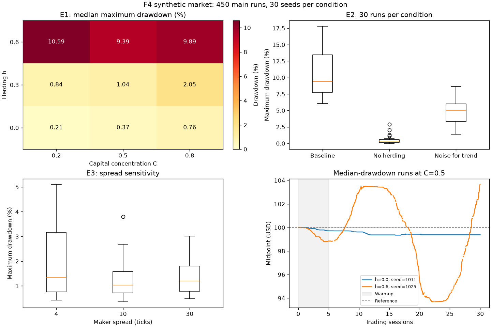

**Lewy górny panel — E1: mapa obsunięć.**

*Jak czytać:* tabela 3 × 3. Wiersze to siła zachowań stadnych $h$ (od dołu: 0, 0,3, 0,6), kolumny to koncentracja kapitału $C$ (od lewej: 0,2, 0,5, 0,8). Liczba w kratce to mediana maksymalnego obsunięcia z 30 przebiegów, w procentach. Ciemniejszy kolor oznacza bardziej niespokojny rynek.

*Co widać:*
- **Naśladowanie jest głównym źródłem niestabilności.** Przy $C = 0{,}5$ mediana obsunięcia wynosi 0,37% → 1,04% → 9,39% dla $h$ = 0 / 0,3 / 0,6. Przy $h = 0{,}6$ rynek bez żadnej wiadomości z zewnątrz potrafi spaść o ok. 10%.
- **Koncentracja kapitału pogarsza sytuację przy słabym naśladowaniu:** przy $h = 0$ obsunięcie rośnie z 0,21% do 0,76%, gdy $C$ rośnie od 0,2 do 0,8; przy $h = 0{,}3$ z 0,84% do 2,05%.
- **Przy silnym naśladowaniu koncentracja już niewiele zmienia** (10,6%, 9,4%, 9,9%): dominuje stado.

Test w parach ($h = 0{,}6$ minus $h = 0$, te same 30 ziaren, przedział ufności 95% metodą bootstrap):

| $C$ | Przedział 95% dla różnicy obsunięcia | Wniosek |
|---|---|---|
| 0,2 | [+10,17; +12,97] p.p. | naśladowanie zwiększa obsunięcia |
| 0,5 | [+8,94; +11,42] p.p. (średnio +10,17) | naśladowanie zwiększa obsunięcia |
| 0,8 | [+8,54; +9,92] p.p. | naśladowanie zwiększa obsunięcia |

Żaden przedział nie zawiera zera, więc efekt jest rzeczywisty, a nie przypadkowy.

**Prawy górny panel — E2: co jest przyczyną.**

*Jak czytać:* wykres pudełkowy. Każde pudełko to 30 przebiegów jednego wariantu: pudełko obejmuje środkowe 50% wyników, pomarańczowa kreska to mediana, „wąsy” sięgają do najmniejszego i największego typowego wyniku.

*Co widać* (wszystko przy $h = 0{,}6$, $C = 0{,}5$):
- **wariant bazowy:** mediana 9,4%;
- **bez naśladowania:** 0,37%, czyli **niestabilność prawie znika**;
- **trendowi zamienieni na losowych:** 4,9%. Strategia „kupuj, gdy rośnie” odpowiada za mniej więcej połowę efektu: stado podąża za trendem, a trendowi wzmacniają ruch stada.

**Lewy dolny panel — E3: animator rynku.** Odległość między ofertami animatora 4, 10 lub 30 centów daje mediany 1,34%, 1,04% i 1,19%, a przedziały się pokrywają. Szerokość kwotowań animatora ma tu niewielkie znaczenie, bo większość ofert w arkuszu pochodzi od inwestorów. Na pełnej sieci animator okazał się ważniejszy (rozdz. 4.6).

**Prawy dolny panel — jak wygląda typowy przebieg.** Cena w czasie w dwóch przebiegach przy $C = 0{,}5$. Przebiegi wybrane według reguły: obsunięcie najbliższe medianie grupy, a nie „najładniejszy” wykres.
- **Niebieski ($h = 0$):** cena prawie stoi (99,4–100 USD). Wyceniający kupują, gdy jest tanio, i sprzedają, gdy drogo.
- **Pomarańczowy ($h = 0{,}6$):**
  - cena rośnie do 103,5 USD i kilka sesji stoi wyżej, choć nikt nie ma powodu uważać, że akcja jest warta więcej;
  - potem stado się odwraca: spadek do 93,7 USD, potem znów wzrost.
  - To są „bańki” i „krachy” wytworzone wyłącznie przez naśladowanie, bez żadnej informacji z zewnątrz.

#### Co z tego wynika

- **Odpowiedź na P1:** naśladowanie wyraźnie destabilizuje rynek. Po usunięciu błędu zaokrąglania efekt jest większy, a nie mniejszy: obsunięcie rośnie ok. 25 razy (0,37% → 9,39%).
- **Odpowiedź na P2:** koncentracja kapitału pogarsza stabilność przy słabym naśladowaniu, ale przy silnym jej efekt ginie w efekcie stada.
- **Zmiana wniosku względem poprzedniej wersji:** przy silnym naśladowaniu arkusz jest teraz **częściej** jednostronny (mediana 9,5% czasu przy $h = 0{,}6$ wobec 0,3% przy $h = 0$), czyli zgodnie z hipotezą H1. Wcześniejszy wynik odwrotny był skutkiem błędu zaokrąglania.
- **Ograniczenia:**
  - rynek jest krótki (30 sesji), syntetyczny i bez wiadomości z zewnątrz;
  - wzór mieszania sygnałów jednocześnie osłabia własny sygnał i dodaje sygnał znajomych, a E1 tych dwóch kanałów nie rozdziela;
  - **F4 liczyliśmy jeszcze ze starą regułą wielkości zlecenia** („kupuj przy każdej decyzji”). Na łańcuchu ta reguła mocno zawyżała niestabilność (rozdz. 4.5), więc E1–E2 trzeba powtórzyć z pozycją docelową. Dopiero wtedy będzie wiadomo, ile z efektu 9,4% zostaje.

---

### 4.5 F5 — wyceniający według grafu na łańcuchu

#### Po co ten etap

F4 sprawdził maszynerię na jednej akcji. W F5 pojawia się to, co jest sednem projektu: **kilka spółek połączonych grafem i agenci, którzy wyceniają spółkę na podstawie cen jej rodziców**. Testujemy to na krótkim łańcuchu **ropa → COP (wydobycie) → VLO (rafineria) → DAL (linia lotnicza)**: w 5. sesji ropa skacze o +20% lub −20% i patrzymy, jak szok przechodzi przez kolejne ogniwa.

#### Jak wycenia agent

Wycena agenta $a$ dla spółki $i$ zmienia się o ważoną sumę zmian cen rodziców:

$$
\ln V_{a,i}(t) = \ln V_{a,i}(0) + \sum_{j \in \text{rodzice}(i)} \hat w_{a,ij}\,\big[\ln P^{\text{obs}}_{a,j}(t) - \ln P^{\text{obs}}_{a,j}(0)\big]
$$

| Element | Znaczenie | Przykład |
|---|---|---|
| $\hat w_{a,ij}$ | waga z grafu, ale **z osobistym błędem agenta**: $\hat w = w\,(1+\eta)$, $\eta \sim N(0;\ 0{,}1)$ | prawdziwa waga 0,54, agent „wierzy” w 0,49 |
| $P^{\text{obs}}_{a,j}(t)$ | cena rodzica, **jaką agent widzi**: dla surowca z danych, dla spółki z **naszej** giełdy (środek między najlepszą ofertą kupna i sprzedaży), z losowym opóźnieniem | agent wyceniający VLO widzi cenę COP sprzed 0,05 sesji |
| krótkowzroczny | bierze wagi bezpośrednie (tylko surowce i indeks) | VLO: ropa 0,43 |
| sieciowy | bierze wagi pełne (także spółki-rodzice) | VLO: COP 0,54 + EOG 0,18 + ropa 0,05 |

Ze wzoru wynika, że **każdy błąd rynku przechodzi dalej**. Jeśli cena COP na naszej giełdzie przestrzeliła, wyceniający sieciowi VLO uwzględnią to przestrzelenie w swojej wycenie VLO.

**Zachowania stadne, różne dla różnych agentów.** Na życzenie zespołu dodaliśmy dwa parametry: jaka część inwestorów w ogóle naśladuje innych (`followers`) i jak bardzo różni się siła naśladowania między nimi (`h_std`). Przy wartościach domyślnych wszyscy mają to samo $h$, jak w F4, a logi F4 są bit w bit takie same jak wcześniej.

#### Kalibracja: co musieliśmy ustawić i dlaczego

| Problem na pilotażu | Przyczyna | Rozwiązanie |
|---|---|---|
| jedna strona arkusza była pusta przez ~20% czasu | jeden animator z ofertą 20 akcji nie nadążał za 120 inwestorami | **2 animatorów po 50 akcji** na spółkę: pusta strona 2,6% czasu |
| fala szła ok. 1% na sesję niezależnie od agentów | animator przesuwał cenę bardzo powoli, więc to on, a nie agenci, wyznaczał tempo | silniejsze przesuwanie ceny przez animatora (`inventory_skew` 0,02 → 0,1) |
| przy składzie „trendowym” wszystkie przebiegi się załamywały | 45% trendowych to za dużo | 30% trendowych |

**Sprawdzenie mechanizmu na syntetycznym łańcuchu** x → A → B → C (wagi 0,8). Gdy są tylko wyceniający krótkowzroczni, B i C prawie się nie ruszają (−4% i −10% ruchu referencyjnego). Z wyceniającymi sieciowymi dochodzą do 76% i 81%. **Bez agentów „znających graf” fala nie przechodzi dalej niż o jedno ogniwo** — to wstępna odpowiedź na P7.

#### Wykres 9. Fala na łańcuchu, jeden przebieg

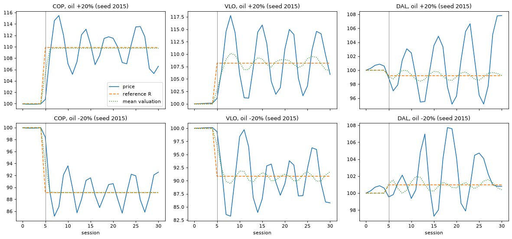

**Co przedstawia.**
- Sześć paneli: górny wiersz to ropa +20%, dolny ropa −20%; kolumny to COP, VLO i DAL.
- Niebieska linia to cena na naszej giełdzie, pomarańczowa przerywana to cena referencyjna $R$, zielona kropkowana to średnia wycena agentów.
- Pionowa kreska to moment szoku.

**Co widać.**
- Cena podąża za wyceną, ale **z przestrzeleniem i oscylacjami**: COP po szoku +20% skacze do 115 USD przy $R$ = 110 USD, potem spada poniżej 106 USD i tak w kółko z okresem ok. 5 sesji.
- Sprawdziliśmy, skąd te oscylacje: po zamianie trendowych na losowych odchylenie od $R$ spada z 2,6% do 0,4% (COP). To **trendowi** kupują, bo cena rośnie, i rozpędzają ją ponad wycenę.
- DAL: ruch referencyjny wynosi tylko ±0,8%, bo droższa ropa jednocześnie szkodzi linii lotniczej bezpośrednio i pomaga jej przez akcje rafinerii. Wahania ceny DAL są więc większe niż sam szok.

To jest stan z F5, z regułą zleceń „kupuj, dopóki sygnał dodatni”. W F6 zmieniliśmy ją na pozycję docelową i oscylacje znacznie zmalały (wykresy 11–12).

#### Wykres 10. Eksperyment E4: kiedy rynek się załamuje

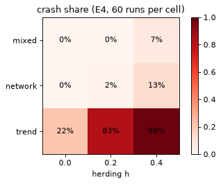

**Co przedstawia.** Eksperyment E4: 3 składy inwestorów × 3 wartości $h$ × 30 ziaren × szok w górę i w dół, razem 540 przebiegów. Kratka podaje, w jakiej części przebiegów jakaś spółka spadła o ponad 25% od szczytu. Wiersze to skład:
- `mixed`: po 30% krótkowzrocznych i sieciowych;
- `network`: przewaga sieciowych;
- `trend`: 30% trendowych.

**Co widać.**
- Skład z wyceniającymi jest stabilny do $h = 0{,}2$ i prawie stabilny przy $h = 0{,}4$ (7–13% załamań).
- Skład trendowy załamuje się już przy $h = 0{,}2$ w 83% przebiegów, a przy $h = 0{,}4$ prawie zawsze.
- Na pilotażu przy $h \ge 0{,}5$ załamywały się prawie wszystkie przebiegi, dlatego siatka $h$ w F5 to {0; 0,2; 0,4}, a nie {0; 0,3; 0,6} jak w F4.
- **Uwaga:** to wyniki ze starą regułą wielkości zlecenia. Po jej zmianie obraz jest inny (wykres 10b niżej).

**Różne zachowania stadne** (180 dodatkowych przebiegów, wszyscy naśladujący mają $h = 0{,}6$):

| Kto naśladuje | Średnie $h$ | Załamania |
|---|---|---|
| 25% inwestorów | 0,15 | 0% |
| 50% inwestorów | 0,30 | 0% |
| wszyscy | 0,60 | 98% |

**W tym eksperymencie (skład `mixed`, łańcuch, ze starą regułą zleceń) rynek, na którym połowa inwestorów silnie naśladuje innych, zachował się jak rynek o tej samej średniej sile naśladowania.** Załamania dała dopiero sytuacja, w której naśladowali wszyscy. Nie uogólniamy tego na inne składy ani inne wartości $h$.

Wszystkie 738 przebiegów F5 zachowują pieniądze i akcje. Notatnik: [`05_chain_wave.ipynb`](../notebooks/05_chain_wave.ipynb), opis: [przewodnik F5](guides/f5_graph_valuers.md) (po rosyjsku).

#### Wykres 10b. E4 ponownie, z pozycją docelową

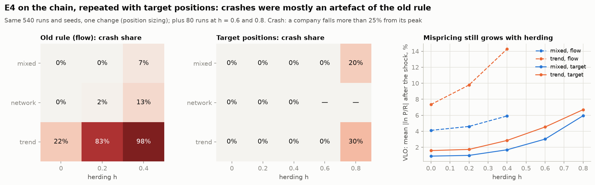

**Po co.** W F6 okazało się, że reguła „kupuj przy każdej decyzji, dopóki sygnał dodatni” daje inercję cen i wyczerpuje gotówkę agentów (rozdz. 4.6, wykres 11). Cały E4 był policzony z tą regułą. Powtórzyliśmy więc **te same 540 przebiegów** z tymi samymi ziarnami i jedną zmianą: inwestorzy mają pozycję docelową. Każdy nowy przebieg ma swoją parę w starym E4. Dodatkowo puściliśmy 80 przebiegów z silniejszym naśladowaniem ($h$ = 0,6 i 0,8).

**Co przedstawia.**
- Lewa mapa: udział załamań ze starą regułą (to samo, co wykres 10).
- Środkowa: udział załamań z pozycją docelową, także dla $h$ = 0,6 i 0,8.
- Prawy panel: mediana średniego odchylenia ceny VLO od $R$ po szoku, w zależności od $h$. Linie przerywane to stara reguła, ciągłe to nowa; niebieskie to skład `mixed`, pomarańczowe `trend`.

**Co widać.**
- **Załamań nie ma do $h = 0{,}4$ we wszystkich trzech składach i przy $h = 0{,}6$ w składach `mixed` i `trend`.** Przy $h = 0{,}8$ pojawiają się w 20% przebiegów (`mixed`) i 30% (`trend`). Skład sieciowy przy $h \ge 0{,}6$ nie był liczony. Ze starą regułą skład trendowy załamywał się w 98% przebiegów już przy $h = 0{,}4$.
- **Odchylenie od $R$ jest 3–5 razy mniejsze**, a oscylacje po szoku 5–20 razy mniejsze. Para to dwa przebiegi z tym samym ziarnem i kierunkiem szoku; różnice obu kierunków uśredniamy dla każdego z 30 ziaren i liczymy przedział bootstrap po ziarnach. Dla odchylenia i oscylacji COP i VLO przedział 95% leży całkowicie poniżej zera we wszystkich 36 kombinacjach miary i komórki. Autokorelacja zmian VLO spada w 7 z 9 komórek, a przy $h = 0$ w składach `mixed` i `network` rośnie. Granice przedziałów: [przewodnik F5](guides/f5_graph_valuers.md).
- **Naśladowanie nadal szkodzi i to monotonicznie:** odchylenie VLO dla `mixed` wynosi 0,9% → 1,7% → 3,0% → 5,9% przy $h$ = 0 → 0,4 → 0,6 → 0,8.
- **Trendowi nadal dają przestrzelenie,** choć mniejsze (COP w sesjach 7–9: 1,36 ruchu referencyjnego wobec 1,11 przy składzie `mixed`).
- **Fala nadal przechodzi przez transakcje:** COP w sesjach 5–6 pokonuje ok. połowy drogi, VLO przestrzela mocniej niż COP, czyli błąd rynku przechodzi dalej po łańcuchu.

**Wniosek.** Większość załamań z wykresu 10 była skutkiem starej reguły zleceń, a nie samego naśladowania: agent kupował lub sprzedawał przy każdym przebudzeniu, aż skończyły mu się pieniądze lub akcje. W sprawdzonych komórkach (łańcuch, składy `mixed` i `trend` do $h = 0{,}8$, sieciowy do $h = 0{,}4$) model załamywał się dopiero przy $h = 0{,}8$. Nie jest to ogólny próg rynku ani reguła dla dowolnej stadnej większości. Wcześniejszy wniosek „przy $h \ge 0{,}5$ łańcuch prawie zawsze się załamuje” **wycofujemy**. Szczegóły: [przewodnik F5](guides/f5_graph_valuers.md), rozdział o E4 z pozycją docelową (PR #20).

---

### 4.6 F6 — pełna sieć na danych rzeczywistych

#### Co się zmienia względem F5

- **Wszystkie 18 spółek i cały graf `real_v1`**, prawdziwe sygnały z lat 2024–2025 (502 sesje = 502 dni sesyjne).
- **525 inwestorów:** 500 w czterech grupach i 25 rebalansujących. Każdy handluje 4 spółkami, więc na jedną spółkę przypada ok. 110 inwestorów.
- **Ceny startowe to prawdziwe ceny z 2 stycznia 2024 r.**, od 33 do 346 USD. Parametry (liczba akcji, kwotowania animatora) przeliczamy dla każdej spółki według jej ceny. Inaczej tania akcja miałaby mało wartości w obrocie: nie byłoby czym jej sprzedawać, a kupować można by za wszystkie pieniądze.
- **Nowe zachowania:** fundusze rebalansujące i limit ryzyka (rozdz. 2).

Przejście 3 → 10 → 18 spółek przebiegło bez problemów. Na 18 spółkach przebieg trwa 6,6 minuty, każda spółka ma co najmniej 40 tys. transakcji, a pusta strona arkusza najgorszej spółki trwa 1,0–1,4% czasu.

#### Wykres 11. Najważniejsza poprawka: pozycja docelowa zamiast „kupuj przy każdej decyzji”

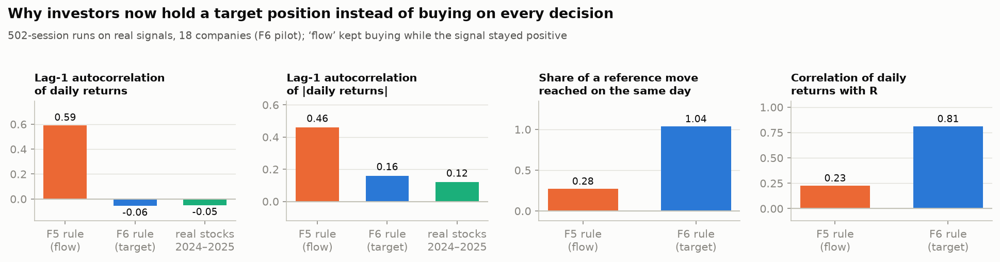

**Problem.** W F4–F5 każda decyzja oznaczała zlecenie na $\rho \times |\text{sygnał}| \times \text{majątek}$. Dopóki sygnał był dodatni, agent kupował przy każdym przebudzeniu, aż skończyły mu się pieniądze. Na 30 sesjach tego nie widać, ale na 502 sesjach rynek wyglądał nienaturalnie:
- popyt napływał małymi porcjami, więc cena szła w tym samym kierunku przez kilka dni z rzędu;
- w kwietniu 2025 r. wyceniającym kończyły się pieniądze i ceny przez wiele dni stały ok. 40% poniżej ich własnych wycen.

**Rozwiązanie.** Każdy inwestor chce mieć konkretną liczbę akcji: tyle, ile miał na początku, razy $(1 + 0{,}5 \cdot \text{sygnał})$. Zlecenie zamyka różnicę między celem a obecną pozycją (najwyżej 5% majątku naraz). Gdy cel jest osiągnięty, agent przestaje kupować. Przy zerowym sygnale każdy chce mieć dokładnie to, co ma, więc przy cenie „sprawiedliwej” popyt równa się podaży.

**Co przedstawia wykres.** Cztery miary dla reguły z F5 (pomarańczowa), nowej reguły (niebieska) i prawdziwych akcji 2024–2025 (zielona), tam gdzie da się je porównać:
- **Autokorelacja dziennych stóp zwrotu** (czy wczorajszy ruch przewiduje dzisiejszy). Było +0,59, czyli silna inercja; jest −0,06, prawie tyle co na prawdziwym rynku (−0,05).
- **Autokorelacja wartości bezwzględnych stóp zwrotu** (czy po burzliwym dniu przychodzi burzliwy). Było 0,46, czyli za dużo; jest 0,16, blisko rzeczywistości (0,12).
- **Jaka część ruchu referencyjnego dochodzi tego samego dnia:** 0,28 → 1,04.
- **Korelacja dziennych zmian ceny z $R$:** 0,23 → 0,81.

Sprawdziliśmy też wariant, w którym cel jest udziałem wartości portfela, a nie liczbą akcji. Był gorszy: gdy NVDA potroiła się, wszyscy naraz chcieli sprzedać dwie trzecie akcji i cena odstawała od $R$ o −49%.

**Konsekwencja:** E4 z F5 był policzony ze starą regułą, więc powtórzyliśmy go z pozycją docelową (wykres 10b). Załamania na łańcuchu w większości zniknęły.

#### Pozostała kalibracja (pilotaż, ziarna 1–3)

| Parametr | Wybrane | Dlaczego |
|---|---|---|
| maks. zlecenie | 5% majątku | przy 2% duża zmiana wyceny wymagała kilku decyzji; powyżej 5% bez poprawy |
| animatorzy | 2 × 100 akcji | z 50 akcjami arkusz pusty 1,9% czasu, ze 100 — 1,1%; trzeci animator spowalniał rynek |
| przesuwanie ceny przez animatora | 0,3 | przy 0,2 rynek „lepki” (autokorelacja +0,18), przy 0,5 przestrzela i wraca (−0,13); rzeczywistość: −0,05 |
| limit ryzyka | u 25% inwestorów, próg 20%, sprzedaż połowy | **limit u wszystkich wywołuje spiralę i krach do zera**: sprzedaż jednego obniża cenę, co uruchamia limit u kolejnych, a ci przez 5 sesji nie kupują; przy limicie u wszystkich (próg 20%, sprzedaż połowy) ziarno 1 pozostało stabilne, a ziarna 2 i 3 się załamały; granica stabilności leży między 25% a 100% inwestorów; samą spiralę zbadamy w E6 |
| trendowi | okno 5 sesji, skala 10% | przy skali 2% sygnał nasycał się prawie codziennie (dzienna zmienność to 1–3%), a skupiska zmienności znikały |
| gotówka | 20 000 USD na inwestora | przy 10 000 USD limit ryzyka uruchamiał się kilka razy częściej |

#### Wykres 12. Fala ropy na prawdziwym grafie

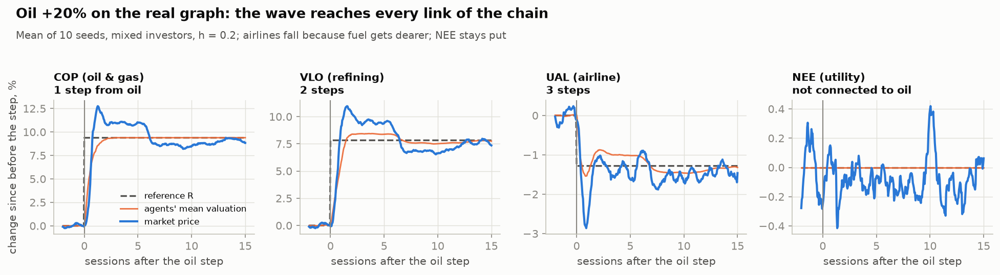

**Co przedstawia.** Wszystkie sygnały zamrożone na poziomie z 2 stycznia 2024 r.; w 10. sesji ropa rośnie o 20%. Średnia z 10 ziaren. Cztery spółki w różnej odległości od ropy:
- niebieska linia: cena na naszej giełdzie;
- czarna przerywana: $R$;
- pomarańczowa: średnia wycena agentów.

**Co widać.**
- **COP (1 krok od ropy):** dochodzi do $R$ (+9,4%) w 0,85 sesji (czas liczony dla obu kierunków szoku, ±20%, razem; wykres pokazuje +20%), przestrzela do ok. +12,5% i po ok. 5 sesjach wraca.
- **VLO (2 kroki):** dochodzi 0,1 sesji później i **przestrzela mocniej**. Wyceniający VLO patrzą na ceny COP i EOG, które same już przestrzeliły, więc błąd rynku przechodzi dalej.
- **UAL (3 kroki), linia lotnicza:** **tanieje** o ok. 1,3%, zgodnie z $R$ (droższe paliwo). Przed ustaleniem ceny chwilowo spada do −2,8%.
- **NEE (energetyka, bez połączenia z ropą):** stoi w miejscu, wahania ±0,4% to szum. Spółki spoza łańcucha naftowego przesunęły się średnio o 0,00%.
- **Skąd przestrzelenie:** bez trendowych łączna reakcja wynosi 0,96 ruchu referencyjnego, z nimi ok. 1,2.

Miary fali policzone funkcjami Marty (`marketsim.metrics.wave_metrics`, mediana z 20 przebiegów): kompletność 0,94–0,98, opóźnienie 0,75–1,0 sesji, połowa błędu wyceny znika po 0,6 sesji.

#### Wykres 13. Skrócony E5: skład inwestorów × zachowania stadne

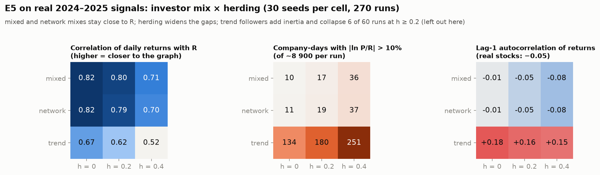

**Co przedstawia.** 9 kombinacji (skład `mixed` / `network` / `trend` × $h$ = 0 / 0,2 / 0,4), w każdej 10 przebiegów po 502 sesje na prawdziwych sygnałach 2024–2025, razem 90 przebiegów. Wartości to średnie z 10 przebiegów.
- **Lewy panel:** jak dobrze dzienne zmiany ceny zgadzają się z $R$ (1 = idealnie).
- **Środkowy:** w ilu dniach × spółkach cena odstawała od $R$ o ponad 10% (na ok. 8 900 w przebiegu).
- **Prawy:** autokorelacja dziennych zmian (na prawdziwym rynku −0,05).

**Co widać.**
- **Skład z wyceniającymi** (`mixed`, `network`) trzyma się blisko $R$ (korelacja 0,80–0,83 przy $h \le 0{,}2$), autokorelacja jest bliska zera, jak na prawdziwym rynku.
- **Naśladowanie** obniża zgodność z $R$ (0,82 → 0,71) i 2–4 razy zwiększa liczbę dni z dużym odchyleniem, ale rynku nie załamuje.
- **Skład trendowy** wyraźnie odstaje:
  - inercja cen (+0,14…+0,18);
  - 143–268 dni z odchyleniem powyżej 10%;
  - jedna strona arkusza najgorszej spółki pusta przez 4–6% czasu.

  To oczekiwany wynik dla hipotezy H3, a nie błąd modelu.
- We wszystkich 90 przebiegach pieniądze i akcje są zachowane i żaden przebieg nie zakończył się krachem do zera.

#### Wykres 14. Cały przebieg 2024–2025 obok rzeczywistości

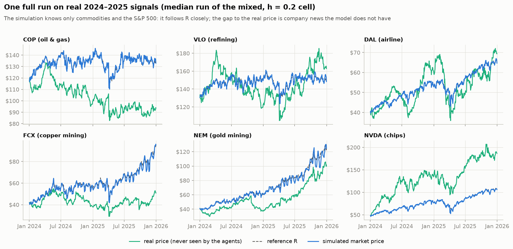

**Co przedstawia.** Jeden przebieg (mediana komórki `mixed`, $h = 0{,}2$, wybrany regułą, a nie „na oko”) dla 6 spółek:
- niebieska linia: cena symulowana;
- czarna przerywana: $R$;
- zielona: **prawdziwa cena, której agenci nigdy nie widzą**.

**Jak czytać.** Symulacja zna tylko ropę, gaz, miedź, złoto i S&P 500. Różnica między zieloną a niebieską linią to wszystko, czego graf nie wie: wyniki spółek, decyzje zarządów, moda na AI.

**Co widać.**
- Cena symulowana trzyma się blisko $R$: rynek agentów poprawnie „przetwarza” to, co wie.
- **DAL** (linia lotnicza) i **VLO** (rafineria) dość dobrze odtwarzają prawdziwą ścieżkę, łącznie ze spadkiem w kwietniu 2025 r. (cła): duża część ich ruchu to rynek i ropa.
- **NVDA** w rzeczywistości wzrosła prawie czterokrotnie, a w symulacji około dwukrotnie. Nadwyżka to wiadomości o sztucznej inteligencji, których model nie ma.
- **COP i FCX** w symulacji rosną razem z rynkiem (przez wagę do S&P 500), a w rzeczywistości zostały daleko w tyle. Część tej różnicy to zdarzenia dotyczące samych spółek, np. FCX stracił 18% w jeden dzień (24.09.2025) po wypadku w kopalni Grasberg. Takich zdarzeń nie ma w żadnym sygnale.

Ten wykres pokazuje **czego nie należy oczekiwać** od modelu: nie odtwarza on ścieżek cen pojedynczych spółek i nie ma tego robić (rozdz. 1). Co odtwarza, mierzymy w rozdz. 4.7.

Opis techniczny: [przewodnik F6](guides/f6_full_network.md) (po rosyjsku, w PR #15).

---

### 4.7 Czy to przypomina prawdziwy rynek? Pierwsza walidacja

**Zasada** (rozdz. 1): symulacja nie widzi żadnej prawdziwej ceny akcji z lat 2024–2025, tylko surowce i S&P 500. Porównujemy wzorce, a nie ścieżki. **Każdą miarę liczymy też dla 200 grafów losowych**, w których krawędzie między spółkami i surowcami zostały losowo przestawione (każdy węzeł ma tyle samo krawędzi co w `real_v1`, a wagi są oszacowane tą samą regresją). Dla dwóch takich grafów puściliśmy pełne symulacje (po 5 przebiegów). Jeśli losowy graf przechodzi test tak samo dobrze, test nie mówi nic o naszym grafie.

Notatnik: [`06_real_checks.ipynb`](../notebooks/06_real_checks.ipynb) (w PR #15).

#### Wykres 15. Graf poza próbą

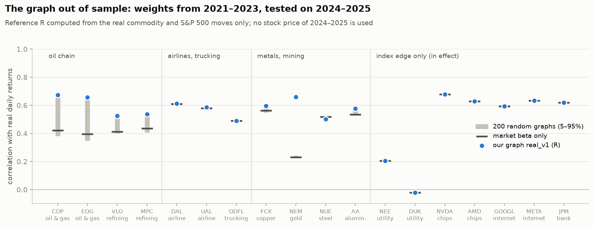

**Co przedstawia.** Dla każdej spółki: jak dobrze ruch przewidziany przez graf zgadza się z prawdziwym dziennym ruchem w latach 2024–2025 (korelacja; 1 = idealnie). Wagi oszacowane na latach 2021–2023, niczego nie dopasowujemy na nowo.
- **niebieska kropka:** nasz graf ($R$);
- **czarna kreska:** najprostszy model „spółka = $\beta$ × rynek”;
- **szary słupek:** zakres, w którym mieści się 90% z 200 losowych grafów.

**Co widać.**
- **Łańcuch naftowy i metale:** nasz graf jest wyraźnie lepszy od samej bety i od wszystkich losowych grafów. Najwyraźniej widać to na NEM (kopalnie złota): korelacja 0,66 wobec 0,23 dla bety, bo NEM zależy od złota, a nie od rynku. Tak samo COP i EOG: 0,66–0,67 wobec ok. 0,40.
- **Linie lotnicze i transport:** graf nic nie dodaje do bety. Wpływ ropy na linie lotnicze jest w rzeczywistości słaby i niestabilny.
- **Siedem spółek po prawej** ma w praktyce tylko krawędź od indeksu, więc graf = beta z definicji. NEE i DUK (energetyka) prawie nie reagują na rynek w tym okresie (0,20 i −0,02), bo ich kursy zależą głównie od stóp procentowych.
- **Mediana dla 18 spółek:**
  - nasz graf 0,595;
  - sama beta 0,526;
  - średni losowy graf 0,563;
  - **żaden z 200 losowych grafów nie jest lepszy od `real_v1`**.

  Przyrost nad betą to 0,068, z przedziałem 95% [0,042; 0,108] (bootstrap po dniach).

#### Wykres 16. Reakcja na duże ruchy ropy (*event study*)

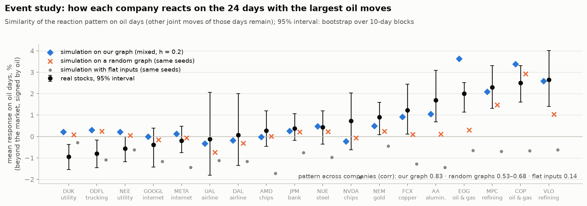

**Co przedstawia.**
- Bierzemy 24 dni z lat 2024–2025 z największymi ruchami ropy i liczymy średnią reakcję każdej spółki ponad to, co wynika z ruchu całego rynku, ze znakiem ruchu ropy (dodatnia = spółka idzie razem z ropą).
- Czarne kropki z wąsami: prawdziwe akcje z przedziałem ufności 95%.
- Niebieskie romby: symulacja na naszym grafie.
- Pomarańczowe krzyżyki: symulacja na losowym grafie.

**Dlaczego to uczciwy test.** W pojedynczym dniu prawdziwa cena to reakcja na ropę plus wiadomości o spółce. Wiadomości są w różne dni różne, więc **uśredniając po wielu dniach, wzajemnie się znoszą**. Zostaje czysta średnia reakcja na ropę. Symulacja dostaje tylko cenę ropy, a reakcję spółek wytwarza sama.

**Co widać.**
- **Wzorzec się zgadza:** producenci ropy i rafinerie (prawa strona) reagują najmocniej, metale umiarkowanie, technologia i bank prawie wcale. Korelacja wzorca symulacji z rzeczywistym to **0,83**, a dla symulacji na losowych grafach 0,53–0,66.
- **Wielkość też się zgadza:** średnio 0,99 prawdziwej reakcji (losowe grafy: 0,45–0,47).
- **Czego nie ma:**
  - w rzeczywistości DUK, ODFL i NEE lekko tanieją, gdy drożeje ropa (droższe paliwo i energia), a w symulacji prawie się nie ruszają;
  - symulacja przesadza z EOG.
- Testy, które **nic nie dowodzą**, bo losowe grafy przechodzą je równie dobrze: odsetek spółek z poprawnym znakiem reakcji i odsetek spółek wewnątrz przedziału ufności. Nie używamy ich jako argumentu.

#### Wykres 17. Szybkość reakcji

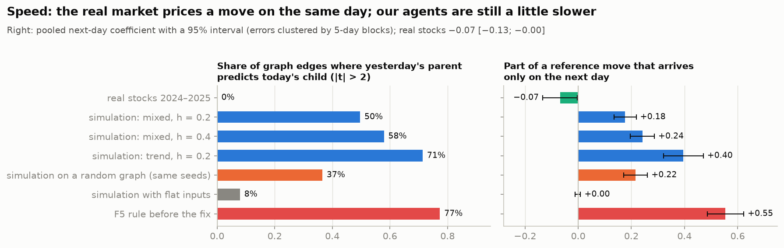

**Co przedstawia.**
- **Lewy panel:** dla każdej krawędzi grafu sprawdzamy, czy wczorajszy ruch rodzica przewiduje dzisiejszy ruch dziecka. W prawdziwym rynku powinno to nie działać: informacja jest w cenie tego samego dnia.
- **Prawy panel:** jaka część ruchu referencyjnego dochodzi dopiero następnego dnia.

**Co widać.**
- **Prawdziwy rynek:** 0% krawędzi z opóźnieniem, następnego dnia nic nie dochodzi (−0,07).
- **Nasza symulacja:** ok. połowa krawędzi wykazuje opóźnienie, a następnego dnia dochodzi ok. 0,18 ruchu. Jest lepiej niż przed poprawką (0,55), ale **agenci wciąż są wolniejsi od prawdziwego rynku**. Opóźnienie rośnie ze stadnością (0,24) i przy trendowych (0,40).
- **Losowy graf daje to samo opóźnienie**, więc test mierzy szybkość agentów, a nie jakość grafu.
- **Skąd opóźnienie:** inwestor decyduje średnio dwa razy na sesję, więc informacja z końca dnia trafia do ceny następnego dnia. Próbowaliśmy to usunąć (więcej decyzji, większe pozycje), ale wtedy cena przestrzela i wraca, a autokorelacja robi się ujemna (−0,14…−0,18), czego na prawdziwym rynku też nie ma. Zostawiliśmy wariant z autokorelacją jak w rzeczywistości i **uczciwie zapisujemy tę różnicę jako ograniczenie modelu**.

#### Wykres 18. Fakty stylizowane

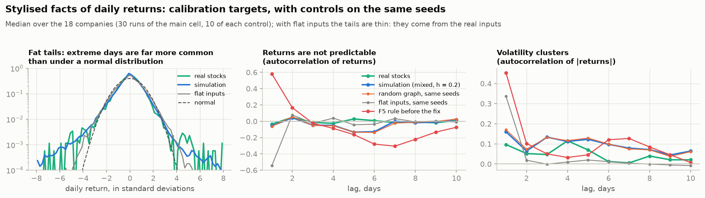

**Co przedstawia.** Trzy własności, które ma praktycznie każdy prawdziwy rynek akcji, policzone tak samo dla prawdziwych akcji 2024–2025 (zielony) i dla symulacji (niebieski).

- **Lewy panel — grube ogony.** Rozkład dziennych zmian w jednostkach odchylenia standardowego, oś pionowa w skali logarytmicznej. Szara przerywana linia to rozkład normalny. Dni z ruchem powyżej 4 odchyleń są i na prawdziwym rynku, i w symulacji wielokrotnie częstsze, niż przewiduje rozkład normalny (kurtoza: symulacja 7–9,5, rzeczywistość 9,9).
- **Środkowy panel — brak przewidywalności.** Korelacja dzisiejszej zmiany ze zmianą sprzed 1–10 dni jest w rzeczywistości i w symulacji bliska zera. Czerwona linia to reguła z F5 przed poprawką: wyraźna inercja (+0,58 przy opóźnieniu 1 dnia), której na prawdziwym rynku nie ma.
- **Prawy panel — skupiska zmienności.** Po dniu z dużym ruchem częściej przychodzi dzień z dużym ruchem (dodatnia korelacja wartości bezwzględnych). Symulacja to odtwarza: 0,16 wobec 0,10–0,12 w rzeczywistości.

**Zastrzeżenie.** Część grubych ogonów może pochodzić z prawdziwych sygnałów (ropa, S&P 500), a nie od agentów. W F8 te same miary policzymy dla przebiegów bez sygnałów zewnętrznych, żeby rozdzielić te dwa źródła.

#### Podsumowanie walidacji

| Test | Wynik | Czy losowy graf przechodzi? | Wniosek |
|---|---|---|---|
| graf poza próbą (wykres 15) | 0,595 wobec 0,526 dla bety | nie (0 z 200) | ✅ graf niesie wiedzę |
| reakcja na ropę (wykres 16) | wzorzec 0,83, wielkość 0,99 | nie (0,53–0,66) | ✅ fala przechodzi właściwymi drogami |
| reakcja na miedź (dni i tygodnie) | zgodna | nie (0–3% losowych grafów dorównuje) | ✅ |
| szybkość (wykres 17) | 0,18 ruchu następnego dnia, w rzeczywistości 0 | tak (to test agentów) | ❌ agenci wolniejsi niż rynek |
| fakty stylizowane (wykres 18) | grube ogony, brak autokorelacji, skupiska zmienności | — | ✅, do sprawdzenia bez sygnałów |
| zgodność dzień po dniu | 0,45 | prawie tak (0,43) | nie używamy jako argumentu |

---

### 4.8 F9 — wizualizacja przebiegu

Każdy zapisany przebieg można zamienić jednym poleceniem na stronę HTML, która działa w przeglądarce bez serwera i bez internetu:

```bash
python -m marketsim.viz.replay runs/<eksperyment>/<przebieg> -o replay.html
```

Strona czyta **tylko** log przebiegu i graf; nie importuje kodu symulacji. Można ją odtwarzać, zatrzymywać, przewijać o chwilę lub o sesję, zmieniać szybkość, wybierać spółkę kliknięciem w graf. Kod: [`viz/replay.py`](../src/marketsim/viz/replay.py) (PR #18), opis: [przewodnik F9](guides/f9_visualization.md).

#### Wykres 19. Fala w chwili jej przejścia (ropa +20%, 0,4 sesji po szoku)

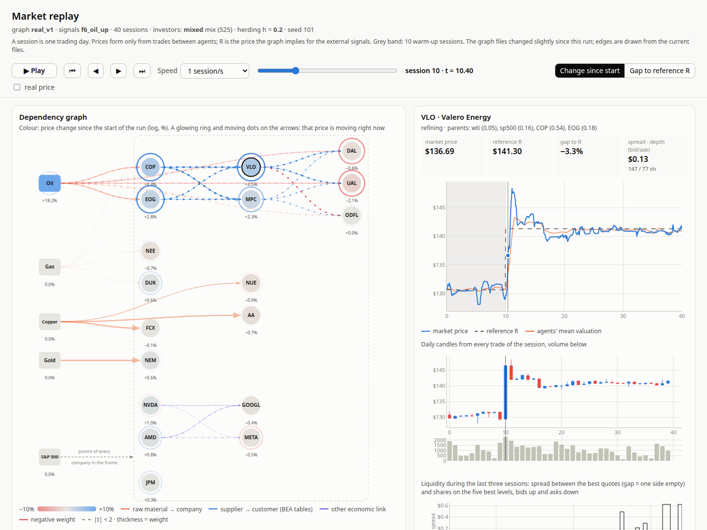

**Jak czytać.**
- **Graf (lewa strona).** Kolor węzła to zmiana ceny od początku przebiegu (niebieski = wzrost, czerwony = spadek). **Świecący pierścień i kropki płynące po strzałkach** oznaczają, że cena tego węzła zmienia się właśnie teraz (w ostatnich pół sesji). Na zrzucie widać, że ropa (+18%) „pcha” COP i EOG (o 2–4%), ci przekazują ruch dalej do VLO i MPC, a linie lotnicze DAL i UAL świecą na czerwono (tanieją).
- **Prawa strona:**
  - cena wybranej spółki (VLO) na tle $R$ i średniej wyceny agentów;
  - świece dzienne z wolumenem;
  - płynność arkusza: spread i liczba akcji na pięciu najlepszych poziomach (oferty kupna w górę, sprzedaży w dół).
- **Na dole (niewidoczne na zrzucie):** sygnały zewnętrzne i małe wykresy wszystkich 18 spółek.

#### Wykres 20. Chwilę wcześniej, w trybie „odstęp od ceny referencyjnej”

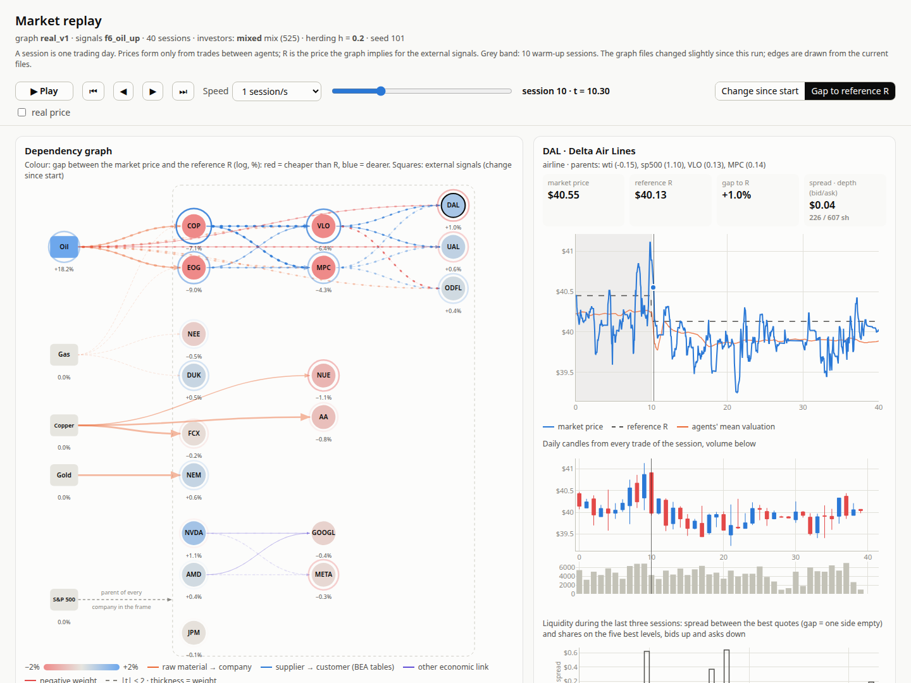

**Jak czytać.** Kolor węzła to teraz różnica między ceną rynkową a $R$: czerwony = rynek jeszcze nie dogonił wyceny. 0,3 sesji po szoku COP jest 7% poniżej swojej $R$, VLO 6% poniżej. To jest właśnie **opóźnienie fali**, które mierzymy liczbowo w rozdz. 4.6. Wybrana spółka to DAL (linia lotnicza): jej $R$ prawie się nie zmienia, ale cena chwilowo skacze.

#### Wykres 21. Prawdziwe sygnały 2024–2025, 9 kwietnia 2025 r.

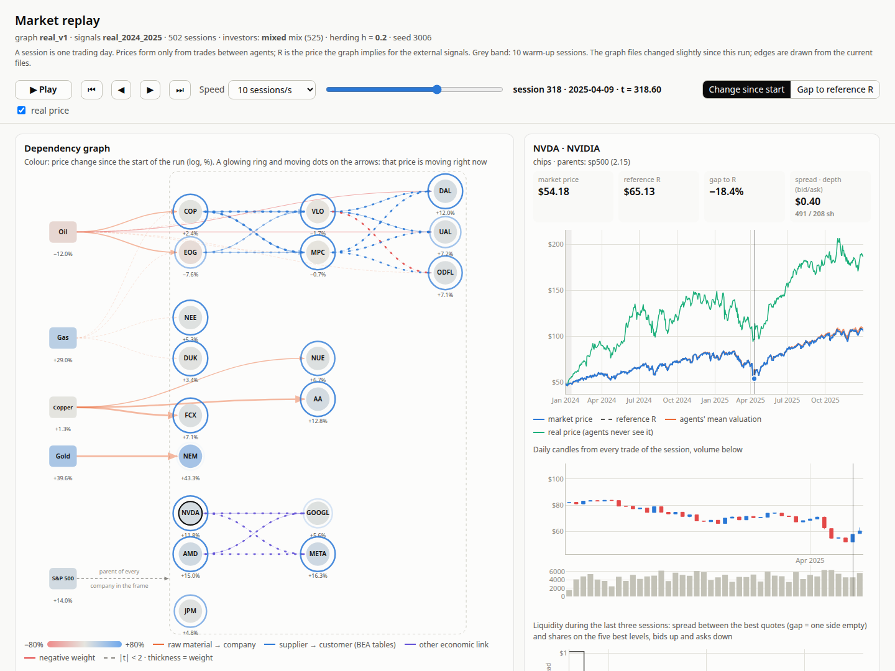

**Jak czytać.** Dzień, w którym ogłoszono zawieszenie ceł i S&P 500 wzrósł o 9,5%: **świeci cały graf**, bo indeks jest rodzicem każdej spółki. Wybrana NVDA: cena symulowana (niebieska) jest tego dnia 18% poniżej swojej $R$ i dogania ją następnego dnia. To najgorszy pojedynczy dzień całego przebiegu: przy tak dużym ruchu limit wielkości zlecenia (5% majątku) i dwie decyzje na sesję nie wystarczają, by dojść do celu w jeden dzień. Zielona linia to prawdziwa cena NVDA. Pokazujemy ją tylko do porównania; agenci jej nie widzą.

---

## 5. Najważniejsze decyzje i ich uzasadnienie

| # | Decyzja | Dlaczego | Co odrzuciliśmy |
|---|---|---|---|
| 1 | **Cena powstaje wyłącznie z transakcji agentów**; prawdziwe ceny akcji służą tylko do oszacowania wag (2021–2023), jako cena startowa i do porównania (2024–2025) | tylko wtedy propagacja szoku jest zjawiskiem emergentnym, które można badać | „wymuszanie” ceny historycznej przez specjalnego inwestora (Skrzyński 2025) |
| 2 | **Strukturę grafu bierzemy z gospodarki (BEA), a wagi z regresji** | korelacja to nie zależność; z samych korelacji wyszłyby fałszywe krawędzie (np. wszystko połączone przez rynek) | graf z samych korelacji |
| 3 | **Dwa zestawy wag:** bezpośrednie (krótkowzroczni) i pełne (sieciowi) | pozwala zmierzyć, ile daje „znajomość grafu” (P7) | jeden zestaw dla wszystkich |
| 4 | **S&P 500 jako zmienna kontrolna i rodzic każdej spółki** | bez niego każda para spółek wyglądałaby na powiązaną | regresja bez indeksu |
| 5 | **Usunięcie krawędzi energetyka → hutnictwo** | ujemne wagi bez sensu ekonomicznego: kurs elektrowni to nie cena prądu | zostawienie wszystkich krawędzi z BEA |
| 6 | **Miedź z LME w scenariuszu 2024–2025** | COMEX w 2025 r. niósł do 30% premii celnej; FCX reagował jak LME | COMEX, bo „spółki są amerykańskie” |
| 7 | **Ceny w tickach, pieniądze w centach, tylko liczby całkowite** | żadnych błędów zaokrągleń; suma pieniędzy i akcji sprawdzana w każdym przebiegu | liczby zmiennoprzecinkowe |
| 8 | **Determinizm:** cała losowość z jednego ziarna przebiegu | ta sama konfiguracja i ziarno = identyczny log; wyniki da się odtworzyć i porównywać parami | — |
| 9 | **Silnik w C++ z wersją wzorcową w Pythonie** i testem różnicowym | szybkość bez utraty pewności, że giełda działa poprawnie | tylko Python (za wolno) albo tylko C++ (trudno sprawdzić) |
| 10 | **Zlecenia agentów po kolei, bez paczek** | w paczce kilku agentów decydowałoby na podstawie tego samego, nieaktualnego stanu rynku; to zmienia model | paczki (kilkanaście razy szybsze); szybkość zyskujemy przez równoległe przebiegi |
| 11 | **Minimalne zlecenie 1 akcja** (F4) | zaokrąglanie w dół wyłączało drobnych inwestorów i fałszowało efekt naśladowania | stara reguła; jej wyniki zachowane osobno, niemieszane |
| 12 | **Pozycja docelowa zamiast „kupuj przy każdej decyzji”** (F6) | stara reguła dawała inercję cen (+0,59) i wyczerpanie gotówki na długich przebiegach | cel jako udział wartości portfela (odchylenia do −49%) |
| 13 | **Limit ryzyka tylko u 25% inwestorów** | limit u wszystkich wywołuje spiralę i krach do zera; samą spiralę zbadamy w E6 | limit u wszystkich |
| 14 | **18 spółek, a nie 10** | czas przebiegu prawie nie zależy od liczby spółek; płynność wystarcza | redukcja do 10 |
| 15 | **Siatka $h$ = {0; 0,2; 0,4} w E4, potem rozszerzona do 0,8** | ze starą regułą zleceń przy $h \ge 0{,}5$ łańcuch prawie zawsze się załamywał; z pozycją docelową w składach `mixed` i `trend` załamania pojawiły się dopiero przy $h = 0{,}8$ (wykres 10b), więc w F7 siatkę można rozszerzyć | siatka z F4 {0; 0,3; 0,6} |
| 16 | **Bez „odtwarzania wiadomości”** jako dowodu zgodności z rzeczywistością | podanie agentom różnicy między ceną prawdziwą a grafem dałoby zgodność z definicji, nawet przy błędnym grafie | porównywanie ścieżek cen po podaniu wiadomości |
| 17 | **Kontrola na losowych grafach dla każdej miary walidacji** | odróżnia miary, które coś mówią o grafie, od takich, które przechodzi każdy model | raportowanie samych liczb bez punktu odniesienia |
| 18 | **Przebiegi do wykresów wybierane regułą** (mediana, 90. percentyl), nie „na oko” | żeby nie pokazywać wybranych, najładniejszych przypadków | — |
| 19 | **Zasady pomiaru zapisane przed przebiegami głównymi**, nowe ziarna w badaniu głównym | żeby nie dopasowywać metody do wyniku | — |

---

## 6. Co dalej

| Kolejność | Faza | Co konkretnie | Efekt |
|---|---|---|---|
| 1 | F6 | przegląd i scalenie PR #15 | pełna sieć w gałęzi głównej (kamień milowy M3) |
| 2 | F7 | **E1–E2 (F4) ponownie z pozycją docelową** (E4 już powtórzony, wykres 10b); pełny E5 (270 przebiegów, ok. 4,5 h na 10 procesach); E6: czy szok ropy „przeskakuje” na JPM i spółki spoza łańcucha i którym kanałem (wspólny portfel, rebalansowanie, limity ryzyka, naśladowanie); E7: udział wyceniających sieciowych {0; 25%; 50%}; ablacje | odpowiedzi na P5, P6, P7 z przedziałami ufności |
| 3 | F8 | przeniesienie testów z notatnika do modułu `validation/`; fakty stylizowane **bez sygnałów zewnętrznych**; odtworzenie grafu z cen symulowanych; pasma 90% z wielu przebiegów | rozdział „Walidacja” raportu |
| 4 | F9 | tryb **na żywo**: przyciski „ropa ±30%”, „krach spółki X”, suwak $h$ w trakcie przebiegu; porównanie eksperymentów (mapy cieplne, wykresy pudełkowe) | demonstracja na obronie |
| 5 | F10 | raport końcowy po polsku, prezentacja | — |

**Kierunek, który chcemy zbadać w F7 (pytanie o ograniczoną uwagę).** W literaturze finansowej (Cohen i Frazzini, 2008) opisano, że cena odbiorcy reaguje na wiadomości o dostawcy z opóźnieniem, a wyjaśnia się to ograniczoną uwagą inwestorów. Na prawdziwym rynku nie da się sprawdzić tego mechanizmu, bo nie można „włączyć” inwestorom uwagi. W naszym modelu można: uwaga, opóźnienie, krótkowzroczność i błąd wiedzy to parametry. Zmierzymy, jak każdy z nich zmienia kompletność, opóźnienie i przestrzelenie fali. Ograniczenie, które już wiemy: w dziennych danych 2024–2025 opóźnienia między dostawcą a odbiorcą nie widać (wykres 17), więc model nie może być wolniejszy od rynku.

**Ryzyka i co robimy, jeśli zabraknie czasu** (w tej kolejności): rezygnujemy z E7, z trybu na żywo (zostaje odtwarzanie), upraszczamy walidację. Rdzenia (graf + propagacja + P5/P6) nie ruszamy.

---

## 7. Gdzie zajrzeć głębiej

| Temat | Plik |
|---|---|
| Propozycja projektu (pełny opis naukowy) | [`docs/research_proposal.md`](research_proposal.md) |
| Opis modelu | [`docs/model/model_description.md`](model/model_description.md), prostszy: [`docs/model/explainer.md`](model/explainer.md) |
| Plan całości i fazy F0–F10 | [`docs/plans/overall_plan.md`](plans/overall_plan.md), [`docs/plans/phases/`](plans/phases/) |
| Dane: pliki, jednostki, decyzje | [`data/README.md`](../data/README.md) |
| Graf `real_v1`: krawędzie, przegląd kandydatów | [`data/graph/real_v1/`](../data/graph/real_v1/) |
| Przewodniki techniczne (po rosyjsku) | [F4](guides/f4_simulation.md), [F5](guides/f5_graph_valuers.md), F6 (PR #15), [F9](guides/f9_visualization.md) |
| Notatniki | [`01_data_overview`](../notebooks/01_data_overview.ipynb) (wykresy 1–4), [`02_graph`](../notebooks/02_graph.ipynb), [`03_experiments`](../notebooks/03_experiments.ipynb) (wykres 8), [`05_chain_wave`](../notebooks/05_chain_wave.ipynb) (wykresy 9–10), `06_full_network_wave` i `06_real_checks` (PR #15, wykresy 12, 15–18) |
| Kod | dane [`src/marketsim/data/`](../src/marketsim/data/), graf [`graph/`](../src/marketsim/graph/), giełda [`cpp/`](../cpp/) i [`market/`](../src/marketsim/market/), symulacja [`sim/`](../src/marketsim/sim/) i [`agents/`](../src/marketsim/agents/), metryki [`metrics/`](../src/marketsim/metrics/), wizualizacja [`viz/`](../src/marketsim/viz/) |
| Testy | [`tests/`](../tests/) — ponad 240 testów, w tym testy kontraktów i porównanie Python = C++ |

**Jak odtworzyć wyniki:**

```bash
pip install -e ".[dev,data,notebooks,viz]"
python -m marketsim.data.fetch
python -m marketsim.data.clean
python -m marketsim.data.check --strict
python -m marketsim.experiments.run configs/f4_e1.yaml --out runs/f4/e1 --workers 8
python -m marketsim.experiments.run configs/f5_e4.yaml --out runs/f5/e4 --workers 8
python -m marketsim.viz.replay runs/f5/e4/<przebieg> -o replay.html
```

(Pobieranie danych z SEC EDGAR wymaga ustawienia zmiennej środowiskowej `SEC_USER_AGENT` z adresem kontaktowym.)

---

## 8. Słowniczek

| Pojęcie | Znaczenie |
|---|---|
| Arkusz zleceń (*order book*) | lista wszystkich oczekujących ofert kupna i sprzedaży danej akcji |
| *Price-time priority* | najpierw wykonuje się lepsza cena, przy równej cenie — zlecenie złożone wcześniej |
| Tick | najmniejsza zmiana ceny (u nas 1 cent) |
| Spread | różnica między najlepszą ceną sprzedaży a najlepszą ceną kupna |
| Głębokość arkusza | ile akcji czeka na kilku najlepszych poziomach cen |
| Animator rynku (*market maker*) | uczestnik stale oferujący kupno i sprzedaż, zapewnia płynność |
| Logarytmiczna stopa zwrotu | $\ln(P_t / P_{t-1})$; dla małych zmian ≈ zmiana procentowa |
| Waga krawędzi $w_{ij}$ | o ile % zmienia się wycena $i$, gdy cena $j$ zmienia się o 1% |
| Waga bezpośrednia / pełna | oszacowana tylko z surowców i indeksu / także ze spółek-rodziców |
| Wyceniający krótkowzroczny / sieciowy | agent używający wag bezpośrednich / pełnych |
| Trajektoria referencyjna $R$ | ceny przy natychmiastowej i dokładnej reakcji wszystkich na graf; miara „idealnej” propagacji |
| Kompletność, opóźnienie, przestrzelenie | jaka część ruchu $R$ dotarła do ceny, po jakim czasie, o ile cena wyskoczyła ponad $R$ |
| Pozycja docelowa | liczba akcji, jaką inwestor chce mieć: początkowa × (1 + 0,5 × sygnał) |
| Rebalansowanie | przywracanie stałych udziałów wartościowych w portfelu (sprzedaż tego, co podrożało) |
| Limit ryzyka (*stop-loss*) | sprzedaż części portfela po spadku jego wartości o ponad 20% od szczytu |
| Maksymalne obsunięcie (*drawdown*) | największy spadek ceny od szczytu do późniejszego dołka |
| Autokorelacja | korelacja szeregu z nim samym przesuniętym o $k$ dni; dla stóp zwrotu prawdziwych akcji bliska zera |
| Kurtoza, grube ogony | miara częstości skrajnych zmian; rozkład normalny ma 3, akcje zwykle znacznie więcej |
| Skupiska zmienności | po dniu z dużym ruchem częściej przychodzi dzień z dużym ruchem |
| *Event study* | średnia reakcja na wiele podobnych zdarzeń; wiadomości z różnych dni wzajemnie się znoszą |
| Graf losowy (kontrolny) | graf z losowo przestawionymi krawędziami i tą samą liczbą krawędzi przy każdym węźle |
| Poza próbą (*out of sample*) | sprawdzenie na danych, których nie użyto do oszacowania (wagi: 2021–2023, test: 2024–2025) |
| Mediana | wartość środkowa; połowa przebiegów ma wynik niższy, połowa wyższy |
| Bootstrap | wielokrotne losowanie ze zwracaniem z naszych wyników, by oszacować niepewność |
| Przedział ufności 95% | zakres, w którym z dużym prawdopodobieństwem leży prawdziwa wartość; jeśli zawiera 0 — efektu nie stwierdzono |
| Ziarno (*seed*) | liczba inicjalizująca generator losowy; to samo ziarno = ten sam przebieg |
| LME, COMEX | giełdy metali w Londynie (cena światowa) i w Nowym Jorku (cena w USA) |
