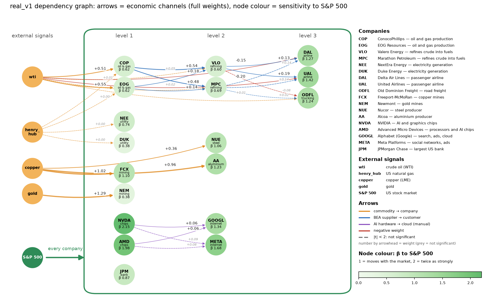

# Propagacja szoków surowcowych w agentowym rynku giełdowym z grafem zależności aktywów

**Raport z etapu: badanie główne (F7–F8)** — przedmiot „Symulacja systemów dyskretnych”, AGH
**Zespół:** _(imiona i nazwiska — 4 osoby)_
**Wersja:** 26 listopada 2026 r.

> Raport przedstawia cel projektu, model, zamrożony protokół badania głównego i jego wyniki. Szczegółowy dziennik prac (etapy F1–F9, pilotaż, poprawki modelu) znajduje się w [`progress_overview.md`](../progress_overview.md); tutaj przytaczamy z niego tylko to, co jest potrzebne do zrozumienia wyników. Każda liczba w rozdziałach 6–7 pochodzi z tabel badania głównego (`runs/main/**.csv`); polecenia, które je tworzą, podaje rozdział 10.

---

## Streszczenie

<!-- STRESZCZENIE: po badaniu głównym -->

**Słowa kluczowe:** symulacja agentowa, symulacja zdarzeń dyskretnych, arkusz zleceń, graf zależności, propagacja szoków, zachowania stadne, współruch, rejestracja protokołu.

---

## 1. Wprowadzenie

### 1.1 Problem

Gdy drożeje ropa, zmienia się nie tylko jej cena. Wydobywcy zarabiają więcej, rafinerie płacą więcej za surowiec, linie lotnicze — za paliwo. Na giełdzie taki szok rozchodzi się po łańcuchu zależności między spółkami, ale nie idealnie: inwestorzy reagują z opóźnieniem, mają niepełną wiedzę i naśladują innych. Reakcja cen może więc być niepełna, spóźniona albo przesadzona, a szok może „przeskoczyć” na spółki, które z pierwotnym zdarzeniem nic nie łączy.

Na prawdziwym rynku nie da się sprawdzić, który z tych mechanizmów za co odpowiada: nie można „wyłączyć” inwestorom naśladowania ani zmienić ich strategii. W symulacji można.

### 1.2 Cel

**Zbadać, jak skład strategii inwestorów, zachowania stadne i kanały wspólnego portfela wpływają na przenoszenie rzeczywistych szoków surowcowych wzdłuż grafu zależności 18 spółek amerykańskich i na powstawanie współruchu spółek, których graf nie łączy.**

### 1.3 Wkład

1. **Model, w którym graf zależności jest wiedzą agentów, a nie formułą cen.** Ceny 18 spółek nie są wczytywane z danych: powstają z transakcji ok. 525 agentów w arkuszach zleceń. Wyceniający aktualizują wycenę spółki, obserwując ceny jej „rodziców” w grafie **na symulowanej giełdzie**, więc szok przechodzi od spółki do spółki przez rzeczywiście zawierane transakcje, razem z błędami rynku. W pracy, od której zaczynamy (Skrzyński, 2025), cenę wymusza „wyimaginowany inwestor” podążający za danymi historycznymi.
2. **Graf oparty na danych:** struktura z tabel przepływów międzygałęziowych BEA, wagi z regresji dziennych stóp zwrotu 2021–2023, sprawdzony poza próbą na latach 2024–2025.
3. **Badanie z zamrożonym protokołem:** pilotaż, potem protokół (pytania, hipotezy, miary, reguły rozstrzygania) zapisany i zamrożony **przed** badaniem głównym na nowych ziarnach losowych; porównania parami na tych samych ziarnach z przedziałami bootstrap.

### 1.4 Pytania badawcze i hipotezy

| Kod | Pytanie | Hipoteza (propozycja) | Eksperyment |
|---|---|---|---|
| P1 | Jak zachowania stadne wpływają na obsunięcia cen i płynność? | H1: silniejsze naśladowanie zwiększa obsunięcia i wydłuża okresy jednostronnego arkusza | E1 (etap wstępny, 1 aktywo) |
| P2 | Jak koncentracja kapitału wpływa na stabilność? | H2: większa koncentracja zwiększa wpływ pojedynczych uczestników na cenę | E1 (etap wstępny) |
| **P5** | Jak skład strategii i naśladowanie zmieniają propagację szoku wzdłuż grafu? | H3: więcej strategii trendowych i silniejsze naśladowanie zwiększają przestrzelenie i wzmacniają falę | **E5** |
| **P6** | Czy powstaje współruch spółek niepowiązanych w grafie i który kanał za niego odpowiada? | H4: wspólny portfel i rebalansowanie generują nadmiarowy współruch; efekt znika bez tych kanałów | **E6** |
| P7 | Ilu inwestorów musi znać zależności, aby fala przechodziła, i czy powodują przestrzelenie? | H5: większy udział agentów sieciowych skraca opóźnienie | **E7** |

P5 i P6 są pytaniami głównymi. Brak efektu w badanym zakresie też jest wynikiem: hipotezy rozstrzygamy regułami zapisanymi przed badaniem (rozdz. 5.5).

---

## 2. Kontekst badawczy

- **Modele agentowe rynku.** Lux i Marchesi (1999) pokazali, że interakcja fundamentalistów i chartystów generuje grube ogony i grupowanie zmienności; Chiarella i Iori (2002) badali agentów o różnych strategiach w arkuszu zleceń; ABIDES (Byrd i in., 2019) łączy symulację zdarzeń dyskretnych z modelem giełdy.
- **Wiele aktywów i zarażanie.** Westerhoff (2004) oraz Chiarella, Dieci i He (2007) rozszerzają modele heterogenicznych agentów na wiele rynków; Kyle i Xiong (2001) opisują zarażanie przez efekt majątkowy wspólnych inwestorów, a Barberis, Shleifer i Wurgler (2005) — współruch przekraczający powiązania fundamentalne.
- **Sieci gospodarcze.** Acemoglu i in. (2012) pokazują, że szoki rozchodzą się przez sieć powiązań międzygałęziowych; tabele przepływów (Miller i Blair, 2009) opisują, ile każda branża kupuje od innych.
- **Punkt wyjścia.** Skrzyński (2025) — wieloagentowe środowisko giełdy w JADE; cena jednego aktywa podąża za danymi historycznymi dzięki inwestorowi o nieograniczonych zasobach.

| | Skrzyński (2025) | Ten projekt |
|---|---|---|
| Skąd bierze się cena | wymuszona przez dane historyczne | powstaje z transakcji agentów |
| Aktywa | 1 | 18 spółek + 4 surowce + indeks |
| Zależności między aktywami | brak | graf: struktura z BEA, wagi z regresji |
| Agenci | 1–2 | 525 inwestorów, 36 animatorów rynku |
| Metodyka | pojedynczy przebieg | zamrożony protokół, 30 ziaren na komórkę, porównania parami |

---

## 3. Model

### 3.1 Architektura i czas

Symulacja zdarzeń dyskretnych: kolejka zdarzeń uporządkowana według czasu i numeru kolejnego (decyzje agentów, wygasanie zleceń, migawki arkusza co 0,05 sesji, początek sesji, zdarzenia sterujące). Jedna sesja symulacji odpowiada jednemu dniowi sesyjnemu danych; agenci budzą się w losowych chwilach (proces Poissona: inwestor średnio 2 razy na sesję, animator rynku 20 razy). Agent decyduje o swoich spółkach po kolei i widzi rynek po transakcjach poprzednich decyzji; zleceń różnych agentów nie łączymy w paczki. Wszystkie losowania pochodzą z generatorów zainicjowanych ziarnem przebiegu: **ta sama konfiguracja i ziarno dają identyczny log** (sprawdzane testami).

### 3.2 Giełda i bramka

Każda spółka ma własny arkusz zleceń z regułą *price-time priority*; transakcja zawierana jest po cenie zlecenia oczekującego. Zlecenia z limitem: GTC, IOC, GTD (ważne 0,5 sesji); zlecenie „rynkowe” to IOC z ceną ochronną 1% od ceny i co najmniej jeden tik. Zlecenie, które dopasowałoby się z własnym zleceniem agenta, jest odrzucane. Ceny są liczbami całkowitymi tików (1 tik = 1 cent), środki — całkowitymi centami. Bramka rezerwuje pieniądze lub akcje przed wysłaniem zlecenia i rozlicza obie strony; łączna ilość pieniędzy i akcji jest stała w każdym przebiegu. Silnik ma dwie implementacje: wzorcową w Pythonie i szybką w C++20 (`lob_core`); test różnicowy z losowymi sekwencjami zleceń (hypothesis) wymaga identycznych arkuszy i transakcji obu implementacji.

### 3.3 Graf zależności

Węzły: sygnały zewnętrzne (ropa WTI, gaz Henry Hub, miedź, złoto, S&P 500) i 18 spółek. Krawędź $j \to i$ z wagą $w_{ij}$ oznacza: zmiana ceny $j$ o 1% zmienia uczciwą wycenę $i$ o $w_{ij}$%. Wagi szacujemy regresją dziennych logarytmicznych stóp zwrotu z lat 2021–2023 (752 dni) z indeksem jako zmienną kontrolną:

$$
r_{i,t} = \alpha_i + \sum_{j \in \text{rodzice}(i)} w_{ij}\, r_{j,t} + \beta_i\, r^{\text{S\&P500}}_t + u_{i,t}.
$$

Dwa zestawy wag: **bezpośrednie** (tylko sygnały zewnętrzne i indeks) i **pełne** (także spółki-rodzice). Przykład: ropa → VLO ma wagę bezpośrednią 0,43, ale po dodaniu COP jako rodzica wpływ ropy przechodzi prawie w całości przez COP (COP → VLO 0,70, ropa → VLO 0,07).

### 3.4 Agenci

| Typ | Liczba (skład `mixed`) | Reguła |
|---|---|---|
| Wyceniający krótkowzroczny | 150 | wycena z sygnałów zewnętrznych, wagi bezpośrednie |
| Wyceniający sieciowy | 150 | wycena także z cen spółek-rodziców **na symulowanej giełdzie**, wagi pełne |
| Trendowy | 100 | ekstrapoluje zmianę ceny z ostatnich 5 sesji |
| Szumowy | 100 | sygnał losowy |
| Fundusz rebalansujący | 25 | utrzymuje początkowe udziały wartościowe spółek w portfelu |
| Animator rynku | 2 na spółkę | kwotuje obie strony przy ograniczonych zasobach; przesuwa kwotowania przeciwnie do nadmiaru zapasu |

Składy w E5 (udziały wyceniających krótkowzrocznych / sieciowych / trendowych / szumowych): `mixed` 30/30/20/20, `network` 15/45/20/20, `trend` 35/15/30/20%.

**Wycena.** Wyceniający $a$ ocenia spółkę $i$ jako

$$
\ln V_{a,i}(t) = \ln V_{a,i}(0) + \sum_{j} \hat w_{a,ij}\,\big[\ln P^{\text{obs}}_{a,j}(t) - \ln P^{\text{obs}}_{a,j}(0)\big],
$$

gdzie $P^{\text{obs}}_{a,j}(t) = P_j(t - d_a)$ to cena obserwowana z opóźnieniem $d_a$ (średnio 0,05 sesji), a $\hat w_{a,ij} = w_{ij}(1 + \eta_{a,ij})$ — waga z osobistym błędem ($\sigma_\eta = 0{,}1$). Sygnał $b = \operatorname{clip}\big((V - P)/(\gamma P), -1, 1\big)$, $\gamma = 0{,}05$.

**Naśladowanie.** Każdy inwestor ma 5 „znajomych”; ostateczny sygnał to $s = (1-h)\, b + h\, \bar d$, gdzie $\bar d$ to średni kierunek ostatnich zleceń znajomych w tej spółce (ważny 0,5 sesji), a $h$ — siła zachowań stadnych.

**Pozycja docelowa.** Inwestor chce mieć tyle akcji, ile miał na początku, razy $(1 + 0{,}5\, s)$; zlecenie zamyka różnicę, najwyżej 5% majątku na decyzję. Każdy inwestor handluje 4 z 18 spółek i ma akcje tylko tych spółek; portfel (pieniądze i akcje) jest wspólny dla wszystkich jego spółek.

**Limit ryzyka.** Co czwarty inwestor, gdy jego majątek spadnie o ponad 20% od szczytu, sprzedaje połowę każdej pozycji i przez 5 sesji nie kupuje.

**Animator rynku.** Centrum kwotowań to midpoint arkusza **bez własnych kwotowań animatora**, przesunięty o $k \cdot (\text{zapas} - \text{zapas początkowy})$; $k$, wielkość kwotowań i spread są przeliczane dla każdej spółki według jej ceny startowej (rozdz. 5.6).

### 3.5 Trajektoria referencyjna R

Miarą „poprawnej” reakcji jest trajektoria $R$: ceny, jakie byłyby, gdyby wszyscy natychmiast i dokładnie stosowali pełne wagi grafu do ruchów sygnałów zewnętrznych:

$$
\ln R_i(t) - \ln R_i(0) = \sum_{j} w_{ij}\,\big[\ln R_j(t) - \ln R_j(0)\big], \qquad R_k = X_k \text{ dla sygnałów zewnętrznych}.
$$

Agenci jej nie znają; służy wyłącznie do pomiarów.

### 3.6 Weryfikacja implementacji

Ponad 380 testów automatycznych uruchamianych przy każdej zmianie (GitHub Actions), m.in.: testy kontraktowe silnika (priorytet ceny i czasu, częściowe wykonania, anulowanie, samohandel), test różnicowy Python ↔ C++, stałość łącznej ilości pieniędzy i akcji w każdym przebiegu, determinizm (ten sam log dla tej samej konfiguracji i ziarna, także przy uruchomieniu równoległym i wznowionym).

---

## 4. Dane i graf `real_v1`

| Dane | Źródło | Rola |
|---|---|---|
| Ropa WTI, gaz Henry Hub, S&P 500 (dzienne) | FRED | sygnały zewnętrzne, zmienna kontrolna |
| Miedź (LME), złoto (dzienne) | Yahoo Finance | sygnały zewnętrzne |
| Ceny i wolumeny 18 spółek | Yahoo Finance | wagi grafu (2021–2023), ceny startowe (2.01.2024), walidacja (2024–2025) |
| Tabele przepływów międzygałęziowych (71 branż) | BEA | struktura grafu |
| Kody SIC | SEC EDGAR | przypisanie spółek do branż |
| 49 portfeli branżowych | Kenneth French Data Library | walidacja |

Okres: 1255 dni sesyjnych 2021–2025 (rok 2020 pominięty). **Prawdziwe ceny akcji wchodzą do symulacji tylko jako stan początkowy** z 2 stycznia 2024 r.; w trakcie przebiegu agenci widzą wyłącznie pięć szeregów zewnętrznych.

**Spółki (kod BEA):** wydobycie ropy i gazu (211) COP, EOG; rafinacja (324) VLO, MPC; energetyka (22) NEE, DUK; transport lotniczy (481) DAL, UAL; transport drogowy (484) ODFL; górnictwo metali (212) FCX, NEM; hutnictwo (331) NUE, AA; półprzewodniki (334) NVDA, AMD; usługi internetowe (514) GOOGL, META; bankowość JPM.

**Graf `real_v1` (47 krawędzi):** 15 krawędzi surowiec → spółka, 10 krawędzi spółka → spółka z tabel BEA (z 54 kandydatów przy progu 2% kosztów; każdą przejrzeliśmy ręcznie i zapisaliśmy uzasadnienie), 4 krawędzie dodane ręcznie (chipy NVDA, AMD → GOOGL, META: zakup serwerów to inwestycja, niewidoczna w tabelach kosztów bieżących) i 18 krawędzi od S&P 500. Graf między spółkami jest acykliczny.



*Rysunek 1. Graf `real_v1`. Liczba przy grocie: waga pełna; linia przerywana: $|t| < 2$. Źródło: `data/graph/real_v1`, notatnik `02_graph.ipynb`.*

---

## 5. Plan badania

### 5.1 Pilotaż i badanie główne

Wszystko, co policzyliśmy przed zamrożeniem protokołu (E1–E7 na ziarnach z `configs/*.yaml`), traktujemy jako **pilotaż**: na nim kalibrowaliśmy model, znaleźliśmy i poprawiliśmy błędy oraz wybraliśmy miary. Protokół badania głównego ([`docs/plans/main_study_protocol.md`](../plans/main_study_protocol.md)) zamroziliśmy scaleniem PR #32 (commit `99c62a7`) **przed** uruchomieniem badania głównego na **nowych ziarnach 5001–5030** (kontrole: 5001–5010), których test automatyczny nie znajduje w żadnej konfiguracji pilotażu.

Ograniczenie, którego nowe ziarna nie usuwają: parametry rynku kalibrowaliśmy na tych samych 502 sesjach 2024–2025, na których porównujemy model z rzeczywistością. Miary zgodności z rynkiem (rozdz. 7) są więc wynikami kalibracji; nowe ziarna chronią **porównania między komórkami** (rozdz. 6).

### 5.2 Rynek bazowy

Graf `real_v1`, prawdziwe sygnały 2024–2025 (502 sesje), rozgrzewka 10 sesji, 525 inwestorów (rozdz. 3.4), 2 animatorów na spółkę, silnik C++. Konfiguracja: [`configs/main/e5.yaml`](../../configs/main/e5.yaml).

### 5.3 Eksperymenty

| Kod | Co | Siatka | Przebiegi |
|---|---|---|---|
| E5 | skład inwestorów × naśladowanie | {network, mixed, trend} × $h$ {0; 0,2; 0,4} × 30 | 270 |
| E6a | kanały wspólnego portfela, prawdziwe sygnały | {wszystkie; bez limitu ryzyka; bez rebalansowania; bez obu} × $h$ {0; 0,4} × 30 | 180 + 60 z E5 |
| E6b | wiadomość o spółce, sygnały zamrożone na 2.01.2024 | wycena NVDA {bez zmian; −50%} w sesji 20 × $h$ {0; 0,6} × 30, 50 sesji | 120 |
| E7 | udział wyceniających sieciowych wśród 300 wyceniających | {0; 25; 50}% × 30, $h$ = 0,2 | 90 + 30 z E5 |
| kontrole F8 | komórka główna (mixed, $h$ = 0,2) na dwóch losowych grafach i na płaskich wejściach | 3 × 10 | 30 |

Komórki wspólne liczymy raz: mixed $h$ = 0,2 z E5 jest kolumną 30% w E7, a mixed $h$ = 0 i 0,4 — komórkami „wszystkie kanały” w E6a.

**Dlaczego E6 wygląda inaczej niż w propozycji.** Propozycja przewidywała szok jednej spółki przy portfelu wspólnym i rozdzielonym. Pilotaż (18 przebiegów) pokazał, że przy portfelach z czterech spółek nawet spadek NVDA o 50% obniża majątek posiadacza najwyżej o 12%, a limit ryzyka działa od 20%: żaden kanał portfela się nie włącza. Dlatego kanały sprawdzamy na prawdziwych sygnałach (w kwietniu 2025 r. spada cały rynek i limit ryzyka działa), a „portfel rozdzielony” zastępujemy wyłącznikami kanałów, przez które portfel łączy spółki: limitu ryzyka i rebalansowania (fundusze zachowują kapitał, ale nie handlują). Szok spółki zostaje jako E6b.

### 5.4 Miary

Wszystkie miary liczymy z cen na koniec sesji po rozgrzewce: $P$ (midpoint, przy pustej stronie — ostatnia transakcja) i $R$.

- **Załamanie przebiegu:** $\max |\ln(P/R)| > \ln 2$. Przebieg załamany pomijamy w średnich i w parach; udział załamań jest osobnym wynikiem.
- **Propagacja (P5, P7):** udział ruchu $R$, który dochodzi do ceny tego samego dnia (`day0`) i następnego dnia (`day1`) — regresja łączna dziennych stóp zwrotu $P$ na dzisiejszą i wczorajszą zmianę $R$; to samo dla grup spółek w odległości 1, 2 i 3 kroków od ropy; opóźnienie (przesunięcie maksymalnej korelacji wzajemnej zmian $\ln R$ i $\ln P$); wzmocnienie zmienności $\sigma(\Delta \ln P)/\sigma(\Delta \ln R)$; korelacja dziennych stóp zwrotu $P$ i $R$; liczba spółko-dni z $|\ln P/R| > 10\%$.
- **Współruch (P6):** średnia korelacja **reszt** stóp zwrotu (stopa zwrotu $P$ minus część wyjaśniona przez własne $R$ spółki dziś i wczoraj) w parach, których graf nie łączy (poza indeksem); to samo w 10% dni o największych ruchach indeksu. Definicja z propozycji, $\operatorname{corr}(r^P) - \operatorname{corr}(r^R)$, jest liczona pomocniczo: w pilotażu była ujemna we wszystkich komórkach, bo własny szum ceny rozmywa wspólny czynnik $R$.
- **Wiadomość o spółce (E6b):** różnica $\ln P$ z wiadomością i bez niej na tym samym ziarnie po 1, 5 i 20 sesjach — dla NVDA, dla spółek połączonych z nią w grafie (GOOGL, META) i średnio dla 15 spółek niepowiązanych.

### 5.5 Statystyka i reguły rozstrzygania

Jednostką jest przebieg. **Kontrast parowy:** średnia po ziarnach różnicy dwóch komórek, przedział 95% z bootstrapu po ziarnach (5000 losowań); efekt „wyraźny”, gdy przedział nie zawiera zera. Poprawka Bonferroniego na rodzinę kontrastów jednej miary w jednym eksperymencie (E5: 12, E7: 3, E6a: 10). Interakcja: różnica różnic. Załamania: przedział Wilsona i jednostronny test dokładny Fishera. Moc: na pilotażu przy 30 ziarnach i poprawce Bonferroniego wykrywamy różnice od 0,008 w korelacji reszt, 0,012 w `day1` i 0,03 we wzmocnieniu zmienności.

| Hipoteza | Miary główne | Potwierdzona, gdy | Odrzucona, gdy |
|---|---|---|---|
| H3 | wzmocnienie zmienności, spółko-dni poza $R$, `day1` | trend − mixed **i** $h$ = 0,4 − $h$ = 0 wyraźnie dodatnie (z Bonferronim) w co najmniej dwóch z trzech miar | któryś czynnik wyraźnie zmniejsza dwie z trzech |
| H4 | korelacja reszt par niepowiązanych (wszystkie dni, dni stresu); E6b po 5 sesjach | „bez obu” − „wszystkie” wyraźnie ujemne co najmniej przy jednym $h$ | wszystkie kontrasty kanałów niewyraźne lub dodatnie |
| H5 | `day1` i przejście w 2 dni u rafinerii | 50% − 0% wyraźnie zmniejsza `day1` rafinerii | 50% − 0% wyraźnie je zwiększa |

### 5.6 Odstępstwa od propozycji

| Propozycja | Badanie główne | Dlaczego |
|---|---|---|
| ok. 1000 agentów | 525 inwestorów + 36 animatorów | czas przebiegu; na spółkę przypada ok. 110 inwestorów |
| „kupuj, dopóki sygnał dodatni” | pozycja docelowa | stara reguła dawała autokorelację +0,59 |
| limit ryzyka u wszystkich | u 25% inwestorów | limit u wszystkich wywoływał spiralę sprzedaży i krach |
| animator centruje kwotowania na midpoincie z własnymi kwotowaniami | na midpoincie bez własnych kwotowań | dawny przesuw za zapas sumował się przy każdym przebudzeniu; w pilotażu na ziarnach E5 usuwa 4 z 6 załamań, nie zmieniając kalibracji komórki głównej |
| E6: portfel wspólny / rozdzielony | E6a (wyłączniki kanałów) + E6b (wiadomość o spółce) | rozdz. 5.3 |
| miara współruchu $\operatorname{corr}(r^P) - \operatorname{corr}(r^R)$ | korelacja reszt | rozdz. 5.4 |
| E1–E4 w badaniu głównym | etapy wstępne, nie powtarzane | uproszczone rynki (1 aktywo, łańcuch 3 spółek); E4 sprawdzony z nową regułą animatora: wnioski bez zmian |

---

## 6. Wyniki

<!-- WYNIKI: po badaniu głównym -->

---

## 7. Walidacja: co model odtwarza, a czego nie

<!-- WALIDACJA: po badaniu głównym -->

---

## 8. Dyskusja i ograniczenia

<!-- DYSKUSJA: po badaniu głównym -->

**Ograniczenia znane przed badaniem głównym:**

- **Brak wiadomości o samych spółkach.** Ok. 60% dziennego ruchu prawdziwej akcji to wiadomości o spółce (wyniki, decyzje zarządu); model ich nie ma i nie powinien mieć. Nie prognozujemy więc ścieżek konkretnych spółek, porównujemy wzorce.
- **Kalibracja na okresie porównania** (rozdz. 5.1).
- **Opóźnienie o dzień.** Inwestor decyduje średnio dwa razy na sesję, więc część ruchu $R$ dochodzi do ceny dopiero następnego dnia; w prawdziwych danych 2024–2025 opóźnienia między dostawcą a odbiorcą nie widać.
- **Dwóch animatorów jednej spółki** nadal przesuwa kwotowania względem siebie nawzajem; w pilotażu po poprawce zostały 2 załamania z 12 wybranych przebiegów trendowych, oba na tym samym ziarnie w kwietniu 2025 r.
- **Stałe wagi grafu** z lat 2021–2023, jedna spółka = jedna branża, tylko dane z USA, bez krótkiej sprzedaży i kredytu.

---

## 9. Wnioski

<!-- WNIOSKI: po badaniu głównym -->

---

## 10. Odtwarzalność

Kod: [github.com/dmitrykitty/stock-exchange-simulation](https://github.com/dmitrykitty/stock-exchange-simulation), commit badania głównego `99c62a7`. Każdy przebieg zapisuje w `meta.json` konfigurację, ziarno, commit i sumy kontrolne grafu i danych.

```bash
pip install -e ".[dev,data,notebooks,viz]" && pip install -e cpp/
python -m marketsim.data.fetch && python -m marketsim.data.clean && python -m marketsim.data.check
scripts/run_main_study.sh        # wszystkie przebiegi, tabele, kontrole F8, rysunki (~6 h na 10 procesach)
```

Tabele: `runs/main/e5/p5_*.csv`, `runs/main/e6/p6_*.csv`, `runs/main/e7/p7_*.csv`, `runs/main/validation/*.csv`. Rysunki: `python -m marketsim.analysis.figures`.

---

## Bibliografia

1. Skrzyński, J. (2025). Multi-Agent Simulation of Financial Markets: Micro and Macro Approach. W: R. Doroz, B. Zielosko (red.), *Progress in Polish Artificial Intelligence Research 6*, s. 335–341. Wydawnictwo Uniwersytetu Śląskiego. https://badap.agh.edu.pl/publikacja/165799
2. Lux, T., Marchesi, M. (1999). Scaling and criticality in a stochastic multi-agent model of a financial market. *Nature*, 397, 498–500. https://doi.org/10.1038/17290
3. Chiarella, C., Iori, G. (2002). A simulation analysis of the microstructure of double auction markets. *Quantitative Finance*, 2(5), 346–353. https://doi.org/10.1088/1469-7688/2/5/303
4. Byrd, D., Hybinette, M., Balch, T. H. (2019). ABIDES: Towards High-Fidelity Market Simulation for AI Research. https://arxiv.org/abs/1904.12066
5. Westerhoff, F. (2004). Multiasset market dynamics. *Macroeconomic Dynamics*, 8(5), 596–616. https://doi.org/10.1017/S1365100504040040
6. Chiarella, C., Dieci, R., He, X.-Z. (2007). Heterogeneous expectations and speculative behavior in a dynamic multi-asset framework. *Journal of Economic Behavior & Organization*, 62(3), 408–427. https://doi.org/10.1016/j.jebo.2005.08.005
7. Kyle, A. S., Xiong, W. (2001). Contagion as a Wealth Effect. *Journal of Finance*, 56(4), 1401–1440. https://doi.org/10.1111/0022-1082.00373
8. Barberis, N., Shleifer, A., Wurgler, J. (2005). Comovement. *Journal of Financial Economics*, 75(2), 283–317. https://doi.org/10.1016/j.jfineco.2004.04.003
9. Acemoglu, D., Carvalho, V. M., Ozdaglar, A., Tahbaz-Salehi, A. (2012). The Network Origins of Aggregate Fluctuations. *Econometrica*, 80(5), 1977–2016. https://doi.org/10.3982/ECTA9623
10. Miller, R. E., Blair, P. D. (2009). *Input-Output Analysis: Foundations and Extensions* (2nd ed.). Cambridge University Press. https://doi.org/10.1017/CBO9780511626982
11. Źródła danych: FRED https://fred.stlouisfed.org/ · BEA Input-Output Accounts https://www.bea.gov/industry/input-output-accounts-data · SEC EDGAR https://www.sec.gov/search-filings/edgar-application-programming-interfaces · Kenneth French Data Library https://mba.tuck.dartmouth.edu/pages/faculty/ken.french/data_library.html · Yahoo Finance https://finance.yahoo.com/
