# Propagacja szoków surowcowych w agentowym rynku giełdowym z grafem zależności aktywów

**Raport z etapu: badanie główne (F7–F8)** — przedmiot „Symulacja systemów dyskretnych”, AGH
**Zespół:** _(imiona i nazwiska — 4 osoby)_
**Wersja:** 25 listopada 2026 r.

> Raport przedstawia cel projektu, model, zamrożony protokół badania głównego i jego wyniki. Szczegółowy dziennik prac (etapy F1–F9, pilotaż, poprawki modelu) znajduje się w [`progress_overview.md`](../progress_overview.md); tutaj przytaczamy z niego tylko to, co jest potrzebne do zrozumienia wyników. Każda liczba w rozdziałach 6–7 pochodzi z tabel badania głównego (`runs/main/**.csv`); polecenia, które je tworzą, podaje rozdział 10.

---

## Streszczenie

Badamy, jak skład strategii inwestorów, zachowania stadne i kanały wspólnego portfela wpływają na przenoszenie rzeczywistych szoków surowcowych z lat 2024–2025 w agentowym rynku 18 spółek amerykańskich. Ceny powstają w nim z transakcji w arkuszach zleceń, a graf zależności (struktura z tabel przepływów BEA, wagi z regresji 2021–2023) jest wiedzą agentów, a nie formułą cen. Protokół zamroziliśmy przed badaniem głównym: 690 przebiegów na nowych ziarnach, porównania parami na tych samych ziarnach z przedziałami bootstrap i poprawką Bonferroniego.

- **H3 potwierdzona.** Więcej strategii trendowych i silniejsze naśladowanie zwiększają wzmocnienie zmienności (z 1,27 do 1,65), liczbę spółko-dni z ceną odległą o ponad 10% od trajektorii referencyjnej (z 14 do 240) i część reakcji spóźnioną o dzień (z 0,24 do 0,44). W dwóch z trzech miar oba czynniki wzmacniają się nawzajem.
- **H4 odrzucona.** Symulowany rynek wytwarza współruch spółek, których graf nie łączy (średnia korelacja reszt 0,12 wobec 0,00 na prawdziwym rynku), ale wyłączenie limitu ryzyka i rebalansowania go nie zmienia (różnice ≤ 0,001). Współruch znika na płaskich wejściach i rośnie z udziałem strategii trendowych: bierze się ze wspólnych błędów reakcji na ruchy sygnałów, a nie z kanałów portfela.
- **H5 odrzucona, efekt przeciwny.** Agenci znający pośrednie zależności nie przyspieszają fali, lecz przesuwają reakcję rafinerii na następny dzień (udział następnego dnia z −0,03 do 0,49 przy 50% takich agentów) i zwiększają przestrzelenie.

Graf przewiduje prawdziwe dzienne ruchy 2024–2025 poza próbą lepiej niż każdy z 200 grafów losowych, a model odtwarza przekrój reakcji spółek na duże ruchy ropy i miedzi (korelacja 0,82 i 0,75; na grafach losowych 0,61 / 0,48 i wartości ujemne). Nie odtwarza braku przewidywalnych opóźnień między spółkami ani poziomu korelacji akcji (0,53 wobec 0,27).

**Słowa kluczowe:** symulacja agentowa, symulacja zdarzeń dyskretnych, arkusz zleceń, graf zależności, propagacja szoków, zachowania stadne, współruch, rejestracja protokołu.

---

## 1. Wprowadzenie

### 1.1 Problem

Gdy drożeje ropa, zmienia się nie tylko jej cena. Wydobywcy zarabiają więcej, rafinerie płacą więcej za surowiec, linie lotnicze — za paliwo. Na giełdzie taki szok rozchodzi się po łańcuchu zależności między spółkami, ale nie idealnie: inwestorzy reagują z opóźnieniem, mają niepełną wiedzę i naśladują innych. Reakcja cen może więc być niepełna, spóźniona albo przesadzona, a szok może „przeskoczyć” na spółki, które z pierwotnym zdarzeniem nic nie łączy.

Na prawdziwym rynku nie da się sprawdzić, który z tych mechanizmów za co odpowiada: nie można „wyłączyć” inwestorom naśladowania ani zmienić ich strategii. W symulacji można.

### 1.2 Cel

**Zbadać, jak skład strategii inwestorów, zachowania stadne i kanały wspólnego portfela wpływają na przenoszenie rzeczywistych szoków surowcowych wzdłuż grafu zależności 18 spółek amerykańskich i na powstawanie współruchu spółek, których graf nie łączy.**

### 1.3 Wkład

1. **Model, w którym graf zależności jest wiedzą agentów, a nie formułą cen.** Ceny 18 spółek nie są wczytywane z danych: powstają z transakcji ok. 525 agentów w arkuszach zleceń. Wyceniający aktualizują wycenę spółki, obserwując ceny jej „rodziców” w grafie **na symulowanej giełdzie**, więc szok przechodzi od spółki do spółki przez rzeczywiście zawierane transakcje, razem z błędami rynku. W pracy, od której zaczynamy (Skrzyński, 2025), cenę wymusza „wyimaginowany inwestor” podążający za danymi historycznymi.
2. **Graf oparty na danych:** struktura z tabel przepływów międzygałęziowych BEA, wagi z regresji dziennych stóp zwrotu 2021–2023, sprawdzony poza próbą na latach 2024–2025.
3. **Badanie z zamrożonym protokołem:** pilotaż, potem protokół (pytania, hipotezy, miary, reguły rozstrzygania) zapisany i zamrożony **przed** badaniem głównym na nowych ziarnach losowych; porównania parami na tych samych ziarnach z przedziałami bootstrap.

### 1.4 Pytania badawcze i hipotezy

| Kod | Pytanie | Hipoteza (propozycja) | Eksperyment |
|---|---|---|---|
| P1 | Jak zachowania stadne wpływają na obsunięcia cen i płynność? | H1: silniejsze naśladowanie zwiększa obsunięcia i wydłuża okresy jednostronnego arkusza | E1 (etap wstępny, 1 aktywo) |
| P2 | Jak koncentracja kapitału wpływa na stabilność? | H2: większa koncentracja zwiększa wpływ pojedynczych uczestników na cenę | E1 (etap wstępny) |
| **P5** | Jak skład strategii i naśladowanie zmieniają propagację szoku wzdłuż grafu? | H3: więcej strategii trendowych i silniejsze naśladowanie zwiększają przestrzelenie i wzmacniają falę | **E5** |
| **P6** | Czy powstaje współruch spółek niepowiązanych w grafie i który kanał za niego odpowiada? | H4: wspólny portfel i rebalansowanie generują nadmiarowy współruch; efekt znika bez tych kanałów | **E6** |
| P7 | Ilu inwestorów musi znać zależności, aby fala przechodziła, i czy powodują przestrzelenie? | H5: większy udział agentów sieciowych skraca opóźnienie | **E7** |

P5 i P6 są pytaniami głównymi. Brak efektu w badanym zakresie też jest wynikiem: hipotezy rozstrzygamy regułami zapisanymi przed badaniem (rozdz. 5.5).

---

## 2. Kontekst badawczy

- **Modele agentowe rynku.** Lux i Marchesi (1999) pokazali, że interakcja fundamentalistów i chartystów generuje grube ogony i grupowanie zmienności; Chiarella i Iori (2002) badali agentów o różnych strategiach w arkuszu zleceń; ABIDES (Byrd i in., 2019) łączy symulację zdarzeń dyskretnych z modelem giełdy.
- **Wiele aktywów i zarażanie.** Westerhoff (2004) oraz Chiarella, Dieci i He (2007) rozszerzają modele heterogenicznych agentów na wiele rynków; Kyle i Xiong (2001) opisują zarażanie przez efekt majątkowy wspólnych inwestorów, a Barberis, Shleifer i Wurgler (2005) — współruch przekraczający powiązania fundamentalne.
- **Sieci gospodarcze.** Acemoglu i in. (2012) pokazują, że szoki rozchodzą się przez sieć powiązań międzygałęziowych; tabele przepływów (Miller i Blair, 2009) opisują, ile każda branża kupuje od innych. Cohen i Frazzini (2008) pokazują, że ceny akcji reagują z opóźnieniem na wiadomości o powiązanych odbiorcach.
- **Punkt wyjścia.** Skrzyński (2025) — wieloagentowe środowisko giełdy w JADE; cena jednego aktywa podąża za danymi historycznymi dzięki inwestorowi o nieograniczonych zasobach.

| | Skrzyński (2025) | Ten projekt |
|---|---|---|
| Skąd bierze się cena | wymuszona przez dane historyczne | powstaje z transakcji agentów |
| Aktywa | 1 | 18 spółek + 4 surowce + indeks |
| Zależności między aktywami | brak | graf: struktura z BEA, wagi z regresji |
| Agenci | 1–2 | 525 inwestorów, 36 animatorów rynku |
| Metodyka | pojedynczy przebieg | zamrożony protokół, 30 ziaren na komórkę, porównania parami |

---

## 3. Model

### 3.1 Architektura i czas

Symulacja zdarzeń dyskretnych: kolejka zdarzeń uporządkowana według czasu i numeru kolejnego (decyzje agentów, wygasanie zleceń, migawki arkusza co 0,05 sesji, początek sesji, zdarzenia sterujące). Jedna sesja symulacji odpowiada jednemu dniowi sesyjnemu danych; agenci budzą się w losowych chwilach (proces Poissona: inwestor średnio 2 razy na sesję, animator rynku 20 razy). Agent decyduje o swoich spółkach po kolei i widzi rynek po transakcjach poprzednich decyzji; zleceń różnych agentów nie łączymy w paczki. Wszystkie losowania pochodzą z generatorów zainicjowanych ziarnem przebiegu: **ta sama konfiguracja i ziarno dają identyczny log** (sprawdzane testami).

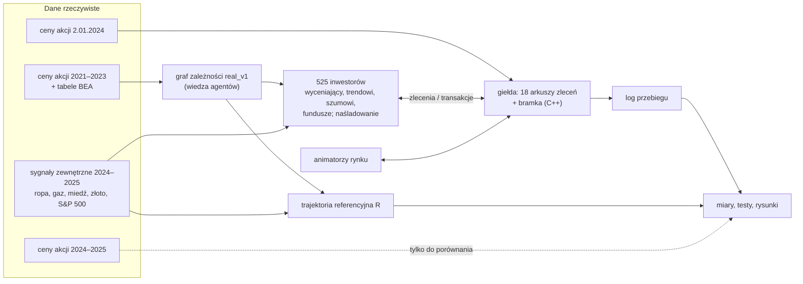

*Rysunek 0. Przepływ danych w modelu. Prawdziwe ceny akcji z lat 2024–2025 nie trafiają do agentów; służą wyłącznie do walidacji.*

### 3.2 Giełda i bramka

Każda spółka ma własny arkusz zleceń z regułą *price-time priority*; transakcja zawierana jest po cenie zlecenia oczekującego. Zlecenia z limitem: GTC, IOC, GTD (ważne 0,5 sesji); zlecenie „rynkowe” to IOC z ceną ochronną 1% od ceny i co najmniej jeden tik. Zlecenie, które dopasowałoby się z własnym zleceniem agenta, jest odrzucane. Ceny są liczbami całkowitymi tików (1 tik = 1 cent), środki — całkowitymi centami. Bramka rezerwuje pieniądze lub akcje przed wysłaniem zlecenia i rozlicza obie strony; łączna ilość pieniędzy i akcji jest stała w każdym przebiegu. Silnik ma dwie implementacje: wzorcową w Pythonie i szybką w C++20 (`lob_core`); test różnicowy z losowymi sekwencjami zleceń (hypothesis) wymaga identycznych arkuszy i transakcji obu implementacji.

### 3.3 Graf zależności

Węzły: sygnały zewnętrzne (ropa WTI, gaz Henry Hub, miedź, złoto, S&P 500) i 18 spółek. Krawędź $j \to i$ z wagą $w_{ij}$ oznacza: zmiana ceny $j$ o 1% zmienia uczciwą wycenę $i$ o $w_{ij}$%. Wagi szacujemy regresją dziennych logarytmicznych stóp zwrotu z lat 2021–2023 (752 dni) z indeksem jako zmienną kontrolną:

$$
r_{i,t} = \alpha_i + \sum_{j \in \text{rodzice}(i)} w_{ij}\, r_{j,t} + \beta_i\, r^{\text{S\&P500}}_t + u_{i,t}.
$$

Dwa zestawy wag: **bezpośrednie** (tylko sygnały zewnętrzne i indeks) i **pełne** (także spółki-rodzice). Przykład: ropa → VLO ma wagę bezpośrednią 0,43, ale po dodaniu COP jako rodzica wpływ ropy przechodzi prawie w całości przez COP (COP → VLO 0,70, ropa → VLO 0,07).

### 3.4 Agenci

| Typ | Liczba (skład `mixed`) | Reguła |
|---|---|---|
| Wyceniający krótkowzroczny | 150 | wycena z sygnałów zewnętrznych, wagi bezpośrednie |
| Wyceniający sieciowy | 150 | wycena także z cen spółek-rodziców **na symulowanej giełdzie**, wagi pełne |
| Trendowy | 100 | ekstrapoluje zmianę ceny z ostatnich 5 sesji |
| Szumowy | 100 | sygnał losowy |
| Fundusz rebalansujący | 25 | utrzymuje początkowe udziały wartościowe spółek w portfelu |
| Animator rynku | 2 na spółkę | kwotuje obie strony przy ograniczonych zasobach; przesuwa kwotowania przeciwnie do nadmiaru zapasu |

Składy w E5 (udziały wyceniających krótkowzrocznych / sieciowych / trendowych / szumowych): `mixed` 30/30/20/20, `network` 15/45/20/20, `trend` 35/15/30/20%.

**Wycena.** Wyceniający $a$ ocenia spółkę $i$ jako

$$
\ln V_{a,i}(t) = \ln V_{a,i}(0) + \sum_{j} \hat w_{a,ij}\,\big[\ln P^{\text{obs}}_{a,j}(t) - \ln P^{\text{obs}}_{a,j}(0)\big],
$$

gdzie $P^{\text{obs}}_{a,j}(t) = P_j(t - d_a)$ to cena obserwowana z opóźnieniem $d_a$ (średnio 0,05 sesji), a $\hat w_{a,ij} = w_{ij}(1 + \eta_{a,ij})$ — waga z osobistym błędem ($\sigma_\eta = 0{,}1$). Sygnał $b = \mathrm{clip}\big((V - P)/(\gamma P), -1, 1\big)$, $\gamma = 0{,}05$.

**Naśladowanie.** Każdy inwestor ma 5 „znajomych”; ostateczny sygnał to $s = (1-h)\, b + h\, \bar d$, gdzie $\bar d$ to średni kierunek ostatnich zleceń znajomych w tej spółce (ważny 0,5 sesji), a $h$ — siła zachowań stadnych.

**Pozycja docelowa.** Inwestor chce mieć tyle akcji, ile miał na początku, razy $(1 + 0{,}5\, s)$; zlecenie zamyka różnicę, najwyżej 5% majątku na decyzję. Każdy inwestor handluje 4 z 18 spółek i ma akcje tylko tych spółek; portfel (pieniądze i akcje) jest wspólny dla wszystkich jego spółek.

**Limit ryzyka.** Co czwarty inwestor, gdy jego majątek spadnie o ponad 20% od szczytu, sprzedaje połowę każdej pozycji i przez 5 sesji nie kupuje.

**Animator rynku.** Centrum kwotowań to midpoint arkusza **bez własnych kwotowań animatora**, przesunięty o $k \cdot (\text{zapas} - \text{zapas początkowy})$; $k$, wielkość kwotowań i spread są przeliczane dla każdej spółki według jej ceny startowej (rozdz. 5.6).

### 3.5 Trajektoria referencyjna R

Miarą „poprawnej” reakcji jest trajektoria $R$: ceny, jakie byłyby, gdyby wszyscy natychmiast i dokładnie stosowali pełne wagi grafu do ruchów sygnałów zewnętrznych:

$$
\ln R_i(t) - \ln R_i(0) = \sum_{j} w_{ij}\,\big[\ln R_j(t) - \ln R_j(0)\big], \qquad R_k = X_k \text{ dla sygnałów zewnętrznych}.
$$

Agenci jej nie znają; służy wyłącznie do pomiarów.

### 3.6 Weryfikacja implementacji

Ponad 380 testów automatycznych uruchamianych przy każdej zmianie (GitHub Actions), m.in.: testy kontraktowe silnika (priorytet ceny i czasu, częściowe wykonania, anulowanie, samohandel), test różnicowy Python ↔ C++, stałość łącznej ilości pieniędzy i akcji w każdym przebiegu, determinizm (ten sam log dla tej samej konfiguracji i ziarna, także przy uruchomieniu równoległym i wznowionym).

---

## 4. Dane i graf `real_v1`

| Dane | Źródło | Rola |
|---|---|---|
| Ropa WTI, gaz Henry Hub, S&P 500 (dzienne) | FRED | sygnały zewnętrzne, zmienna kontrolna |
| Miedź (LME), złoto (dzienne) | Yahoo Finance | sygnały zewnętrzne |
| Ceny i wolumeny 18 spółek | Yahoo Finance | wagi grafu (2021–2023), ceny startowe (2.01.2024), walidacja (2024–2025) |
| Tabele przepływów międzygałęziowych (71 branż) | BEA | struktura grafu |
| Kody SIC | SEC EDGAR | przypisanie spółek do branż |
| 49 portfeli branżowych | Kenneth French Data Library | walidacja |

Okres: 1255 dni sesyjnych 2021–2025 (rok 2020 pominięty). **Prawdziwe ceny akcji wchodzą do symulacji tylko jako stan początkowy** z 2 stycznia 2024 r.; w trakcie przebiegu agenci widzą wyłącznie pięć szeregów zewnętrznych.

**Spółki (kod BEA):** wydobycie ropy i gazu (211) COP, EOG; rafinacja (324) VLO, MPC; energetyka (22) NEE, DUK; transport lotniczy (481) DAL, UAL; transport drogowy (484) ODFL; górnictwo metali (212) FCX, NEM; hutnictwo (331) NUE, AA; półprzewodniki (334) NVDA, AMD; usługi internetowe (514) GOOGL, META; bankowość JPM.

**Graf `real_v1` (47 krawędzi):** 15 krawędzi surowiec → spółka, 10 krawędzi spółka → spółka z tabel BEA (z 54 kandydatów przy progu 2% kosztów; każdą przejrzeliśmy ręcznie i zapisaliśmy uzasadnienie), 4 krawędzie dodane ręcznie (chipy NVDA, AMD → GOOGL, META: zakup serwerów to inwestycja, niewidoczna w tabelach kosztów bieżących) i 18 krawędzi od S&P 500. Graf między spółkami jest acykliczny.


*Rysunek 1. Graf `real_v1`. Liczba przy grocie: waga pełna; linia przerywana: $|t| < 2$. Źródło: `data/graph/real_v1`, notatnik `02_graph.ipynb`.*

---

## 5. Plan badania

### 5.1 Pilotaż i badanie główne

Wszystko, co policzyliśmy przed zamrożeniem protokołu (E1–E7 na ziarnach z `configs/*.yaml`), traktujemy jako **pilotaż**: na nim kalibrowaliśmy model, znaleźliśmy i poprawiliśmy błędy oraz wybraliśmy miary. Protokół badania głównego ([`docs/plans/main_study_protocol.md`](../plans/main_study_protocol.md)) zamroziliśmy scaleniem PR #32 (commit `99c62a7`) **przed** uruchomieniem badania głównego na **nowych ziarnach 5001–5030** (kontrole: 5001–5010), których test automatyczny nie znajduje w żadnej konfiguracji pilotażu.

Ograniczenie, którego nowe ziarna nie usuwają: parametry rynku kalibrowaliśmy na tych samych 502 sesjach 2024–2025, na których porównujemy model z rzeczywistością. Miary zgodności z rynkiem (rozdz. 7) są więc wynikami kalibracji; nowe ziarna chronią **porównania między komórkami** (rozdz. 6).

### 5.2 Rynek bazowy

Graf `real_v1`, prawdziwe sygnały 2024–2025 (502 sesje), rozgrzewka 10 sesji, 525 inwestorów (rozdz. 3.4), 2 animatorów na spółkę, silnik C++. Konfiguracja: [`configs/main/e5.yaml`](../../configs/main/e5.yaml).

### 5.3 Eksperymenty

| Kod | Co | Siatka | Przebiegi |
|---|---|---|---|
| E5 | skład inwestorów × naśladowanie | {network, mixed, trend} × $h$ {0; 0,2; 0,4} × 30 | 270 |
| E6a | kanały wspólnego portfela, prawdziwe sygnały | {wszystkie; bez limitu ryzyka; bez rebalansowania; bez obu} × $h$ {0; 0,4} × 30 | 180 + 60 z E5 |
| E6b | wiadomość o spółce, sygnały zamrożone na 2.01.2024 | wycena NVDA {bez zmian; −50%} w sesji 20 × $h$ {0; 0,6} × 30, 50 sesji | 120 |
| E7 | udział wyceniających sieciowych wśród 300 wyceniających | {0; 25; 50}% × 30, $h$ = 0,2 | 90 + 30 z E5 |
| kontrole F8 | komórka główna (mixed, $h$ = 0,2) na dwóch losowych grafach i na płaskich wejściach | 3 × 10 | 30 |

Komórki wspólne liczymy raz: mixed $h$ = 0,2 z E5 jest kolumną 30% w E7, a mixed $h$ = 0 i 0,4 — komórkami „wszystkie kanały” w E6a.

**Dlaczego E6 wygląda inaczej niż w propozycji.** Propozycja przewidywała szok jednej spółki przy portfelu wspólnym i rozdzielonym. Pilotaż (18 przebiegów) pokazał, że przy portfelach z czterech spółek nawet spadek NVDA o 50% obniża majątek posiadacza najwyżej o 12%, a limit ryzyka działa od 20%: żaden kanał portfela się nie włącza. Dlatego kanały sprawdzamy na prawdziwych sygnałach (w kwietniu 2025 r. spada cały rynek i limit ryzyka działa), a „portfel rozdzielony” zastępujemy wyłącznikami kanałów, przez które portfel łączy spółki: limitu ryzyka i rebalansowania (fundusze zachowują kapitał, ale nie handlują). Szok spółki zostaje jako E6b.

### 5.4 Miary

Wszystkie miary liczymy z cen na koniec sesji po rozgrzewce: $P$ (midpoint, przy pustej stronie — ostatnia transakcja) i $R$.

- **Załamanie przebiegu:** $\max |\ln(P/R)| > \ln 2$. Przebieg załamany pomijamy w średnich i w parach; udział załamań jest osobnym wynikiem.
- **Propagacja (P5, P7):** udział ruchu $R$, który dochodzi do ceny tego samego dnia (`day0`) i następnego dnia (`day1`) — regresja łączna dziennych stóp zwrotu $P$ na dzisiejszą i wczorajszą zmianę $R$; to samo dla grup spółek w odległości 1, 2 i 3 kroków od ropy; opóźnienie (przesunięcie maksymalnej korelacji wzajemnej zmian $\ln R$ i $\ln P$); wzmocnienie zmienności $\sigma(\Delta \ln P)/\sigma(\Delta \ln R)$; korelacja dziennych stóp zwrotu $P$ i $R$; liczba spółko-dni z $|\ln P/R| > 10\%$.
- **Współruch (P6):** średnia korelacja **reszt** stóp zwrotu (stopa zwrotu $P$ minus część wyjaśniona przez własne $R$ spółki dziś i wczoraj) w parach, których graf nie łączy (poza indeksem); to samo w 10% dni o największych ruchach indeksu. Definicja z propozycji, $\mathrm{corr}(r^P) - \mathrm{corr}(r^R)$, jest liczona pomocniczo: w pilotażu była ujemna we wszystkich komórkach, bo własny szum ceny rozmywa wspólny czynnik $R$.
- **Wiadomość o spółce (E6b):** różnica $\ln P$ z wiadomością i bez niej na tym samym ziarnie po 1, 5 i 20 sesjach — dla NVDA, dla spółek połączonych z nią w grafie (GOOGL, META) i średnio dla 15 spółek niepowiązanych.

### 5.5 Statystyka i reguły rozstrzygania

Jednostką jest przebieg. **Kontrast parowy:** średnia po ziarnach różnicy dwóch komórek, przedział 95% z bootstrapu po ziarnach (5000 losowań); efekt „wyraźny”, gdy przedział nie zawiera zera. Poprawka Bonferroniego na rodzinę kontrastów jednej miary w jednym eksperymencie (E5: 12, E7: 3, E6a: 10). Interakcja: różnica różnic. Załamania: przedział Wilsona i jednostronny test dokładny Fishera. Moc: na pilotażu przy 30 ziarnach i poprawce Bonferroniego wykrywamy różnice od 0,008 w korelacji reszt, 0,012 w `day1` i 0,03 we wzmocnieniu zmienności.

| Hipoteza | Miary główne | Potwierdzona, gdy | Odrzucona, gdy |
|---|---|---|---|
| H3 | wzmocnienie zmienności, spółko-dni poza $R$, `day1` | trend − mixed **i** $h$ = 0,4 − $h$ = 0 wyraźnie dodatnie (z Bonferronim) w co najmniej dwóch z trzech miar | któryś czynnik wyraźnie zmniejsza dwie z trzech |
| H4 | korelacja reszt par niepowiązanych (wszystkie dni, dni stresu); E6b po 5 sesjach | „bez obu” − „wszystkie” wyraźnie ujemne co najmniej przy jednym $h$ | wszystkie kontrasty kanałów niewyraźne lub dodatnie |
| H5 | `day1` i przejście w 2 dni u rafinerii | 50% − 0% wyraźnie zmniejsza `day1` rafinerii | 50% − 0% wyraźnie je zwiększa |

### 5.6 Odstępstwa od propozycji

| Propozycja | Badanie główne | Dlaczego |
|---|---|---|
| ok. 1000 agentów | 525 inwestorów + 36 animatorów | czas przebiegu; na spółkę przypada ok. 110 inwestorów |
| „kupuj, dopóki sygnał dodatni” | pozycja docelowa | stara reguła dawała autokorelację +0,59 |
| limit ryzyka u wszystkich | u 25% inwestorów | limit u wszystkich wywoływał spiralę sprzedaży i krach |
| animator centruje kwotowania na midpoincie z własnymi kwotowaniami | na midpoincie bez własnych kwotowań | dawny przesuw za zapas sumował się przy każdym przebudzeniu; w pilotażu na ziarnach E5 usuwa 4 z 6 załamań, nie zmieniając kalibracji komórki głównej |
| E6: portfel wspólny / rozdzielony | E6a (wyłączniki kanałów) + E6b (wiadomość o spółce) | rozdz. 5.3 |
| miara współruchu $\mathrm{corr}(r^P) - \mathrm{corr}(r^R)$ | korelacja reszt | rozdz. 5.4 |
| E1–E4 w badaniu głównym | etapy wstępne, nie powtarzane | uproszczone rynki (1 aktywo, łańcuch 3 spółek); E4 sprawdzony z nową regułą animatora: wnioski bez zmian |

---

## 6. Wyniki

### 6.1 Przebiegi i załamania

Badanie główne objęło 690 przebiegów: E5 — 270, E7 — 90 (+30 wspólnych z E5), E6a — 180 (+60 wspólnych z E5), E6b — 120 (60 par), kontrole F8 — 30. Policzyliśmy je 25 listopada 2026 r. w ok. 6,5 h na 10 procesach (`scripts/run_main_study.sh`, log `runs/main_study.log`).

**Załamania** ($\max|\ln P/R| > \ln 2$) zdarzyły się w 2 z 690 przebiegów, oba w składzie `trend` (przy $h = 0$ i $h = 0{,}4$; w każdej z tych komórek 1/30, przedział Wilsona [0,006; 0,167]). W pozostałych komórkach E5, w całym E6a, E7 i w kontrolach nie było żadnego. Załamania nie wiążą się z naśladowaniem: `trend` z $h > 0$ — 1 z 60, reszta — 1 z 210, jednostronny test Fishera $p = 0{,}40$. W pilotażu, przed poprawką animatora rynku, było ich 6 na 60 przebiegów trendowych z $h \ge 0{,}2$. Oba przebiegi załamane pomijamy w średnich i w parach (rozdz. 5.4).

### 6.2 P5: skład strategii i naśladowanie (E5, H3)

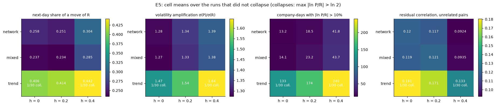

*Rysunek 2. E5: średnie komórek (30 przebiegów, bez załamanych) dla udziału następnego dnia `day1`, wzmocnienia zmienności, liczby spółko-dni z $|\ln P/R| > 10\%$ i korelacji reszt par niepowiązanych. Konfiguracja `configs/main/e5.yaml`, ziarna 5001–5030; tabela `runs/main/e5/p5_metrics.csv`.*

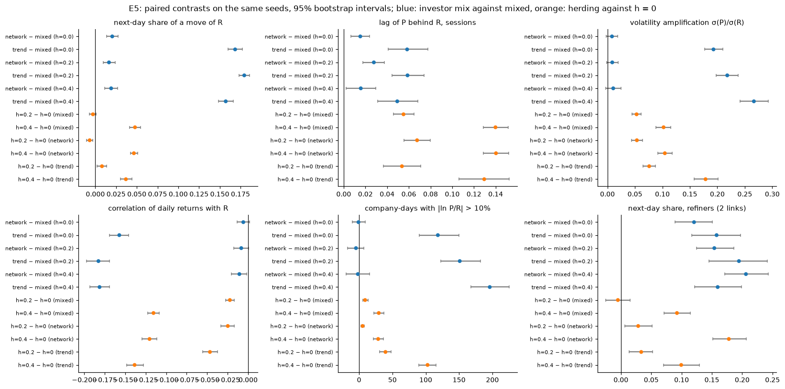

*Rysunek 3. E5: kontrasty parowe na tych samych ziarnach z przedziałami 95% (bootstrap, 5000 losowań); niebieskie — skład względem `mixed`, pomarańczowe — naśladowanie względem $h = 0$. Tabela `runs/main/e5/p5_contrasts.csv`.*

Trzy miary główne H3 (rozdz. 5.5). Wszystkie 18 kontrastów w tabeli jest wyraźnych po poprawce Bonferroniego (rodzina 12 kontrastów na miarę).

| Miara | mixed, $h$ = 0 | trend, $h$ = 0,4 | trend − mixed przy $h$ = 0 / 0,2 / 0,4 | $h$ = 0,4 − $h$ = 0 w mixed / network / trend | najmniejsza dolna granica 95% |
|---|---|---|---|---|---|
| wzmocnienie zmienności $\sigma(\Delta\ln P)/\sigma(\Delta\ln R)$ | 1,27 | 1,65 | +0,19 / +0,22 / +0,27 | +0,10 / +0,10 / +0,18 | +0,089 |
| spółko-dni z $\lvert\ln P/R\rvert > 10\%$ | 14,1 | 240,4 | +118 / +151 / +196 | +30 / +29 / +103 | +21,6 |
| udział ruchu $R$ dochodzący następnego dnia (`day1`) | 0,24 | 0,44 | +0,169 / +0,180 / +0,157 | +0,048 / +0,047 / +0,037 | +0,030 |

**Werdykt H3: potwierdzona.** Oba czynniki wyraźnie zwiększają wszystkie trzy miary przy każdym poziomie drugiego czynnika (reguła wymagała dwóch z trzech).

Co jeszcze pokazuje E5:

- **Skład waży więcej niż naśladowanie.** Przejście z `mixed` do `trend` zwiększa wzmocnienie zmienności o 0,19–0,27, a $h$ = 0,4 zamiast 0 — o 0,10–0,18.
- **Słabe naśladowanie ($h$ = 0,2) najpierw dodaje zmienności, nie opóźnienia.** W `mixed` wzmocnienie rośnie o 0,053 [0,045; 0,062], a `day1` się nie zmienia (−0,003 [−0,007; 0,001]). Spóźniona reakcja pojawia się dopiero przy $h$ = 0,4. Silne naśladowanie zmniejsza też część ruchu wchłoniętą tego samego dnia (`day0` w `mixed` −0,080 [−0,087; −0,073]) i korelację $P$ z $R$ (−0,116 [−0,122; −0,109]) oraz wydłuża opóźnienie o 0,14 sesji.
- **Czynniki wzmacniają się nawzajem.** Różnica różnic (trend wobec mixed, $h$ = 0,4 wobec 0) wynosi +0,076 [0,051; 0,102] dla wzmocnienia zmienności i +72,7 [59,1; 86,3] spółko-dnia dla odchyleń od $R$. Dla `day1` jest lekko ujemna: −0,010 [−0,018; −0,002]. W składzie `network` interakcji nie ma (poza autokorelacją).
- **Więcej wyceniających sieciowych (`network` − `mixed`)** nie zmienia wyraźnie zmienności. Zwiększa za to reakcję rafinerii następnego dnia o 0,12–0,21 — to samo zjawisko mierzy wprost E7 (rozdz. 6.4).
- **Skład `trend` daje dodatnią autokorelację dziennych stóp zwrotu** (0,20–0,23; prawdziwe spółki: −0,035). Najbliżej rzeczywistości jest komórka główna `mixed`, $h$ = 0,2 (0,008).

### 6.3 P6: współruch spółek niepowiązanych (E6a, E6b, H4)

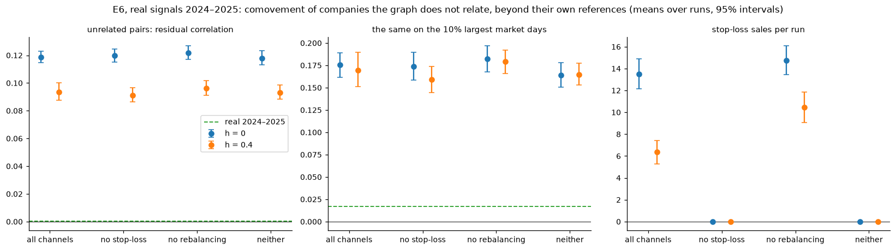

*Rysunek 4. E6a, prawdziwe sygnały 2024–2025: średnia korelacja reszt par, których graf nie łączy (wszystkie dni i 10% dni z największym ruchem indeksu), oraz liczba sprzedaży wywołanych limitem ryzyka na przebieg, dla czterech wariantów kanałów i dwóch wartości $h$. Linia przerywana: ta sama statystyka dla prawdziwych spółek. Konfiguracje `configs/main/e6_*.yaml` i `e5.yaml`; tabele `runs/main/e6/p6_means.csv`, `runs/main/validation/comovement.csv`.*

**Kanały portfela nie zmieniają współruchu.** We wszystkich ośmiu komórkach średnia korelacja reszt par niepowiązanych wynosi 0,091–0,122. Kontrast „bez obu kanałów” − „wszystkie kanały”:

- przy $h$ = 0: −0,0009 [−0,0067; 0,0052];
- przy $h$ = 0,4: −0,0003 [−0,0040; 0,0038];
- w dniach stresu: −0,011 [−0,029; 0,006] i −0,005 [−0,018; 0,009].

Żaden z 10 kontrastów kanałów nie jest wyraźnie ujemny ani dla tej miary, ani dla dni stresu. Wyłączniki przy tym działają:

- limit ryzyka wywołuje średnio 13,5 sprzedaży na przebieg przy $h$ = 0 i 6,4 przy $h$ = 0,4;
- bez limitu — zero;
- bez rebalansowania — 14,7 i 10,5; przy $h$ = 0,4 to wyraźnie więcej niż ze wszystkimi kanałami (+4,1 [3,3; 4,9]).

Kanały zmieniają więc zlecenia, ale nie współruch. Jedyna inna zmiana wyraźna z Bonferronim jest drobna i ma przeciwny znak: miara z propozycji, $\mathrm{corr}(r^P) - \mathrm{corr}(r^R)$, przy $h$ = 0,4 rośnie o 0,007 [0,003; 0,010] po wyłączeniu obu kanałów.

**Współruch jednak jest, tylko skąd indziej.** Tę samą statystykę policzyliśmy dla prawdziwych spółek (reszty względem $R$ grafu `real_v1`, te same 109 par niepowiązanych):

| Seria | Korelacja reszt, pary niepowiązane | To samo w dniach stresu | Pary powiązane |
|---|---|---|---|
| prawdziwe spółki 2024–2025 | 0,000 | 0,017 | 0,191 |
| symulacja, komórka główna (mixed, $h$ = 0,2) | 0,121 | 0,200 | 0,136 |
| symulacja, płaskie wejścia (te same ziarna) | 0,002 | −0,004 | 0,001 |

Na prawdziwym rynku pary, których graf nie łączy, nie poruszają się razem ponad to, co wyjaśnia $R$. W symulacji poruszają się — ale tylko wtedy, gdy sygnały zewnętrzne się ruszają: na płaskich wejściach współruch znika. Silniejszy jest w dniach dużych ruchów indeksu.

Analiza dodatkowa na siatce E5 (poza regułami protokołu, `runs/main/e5/p5_contrasts_extra.csv`):

- **skład `trend` zwiększa współruch:** +0,062 / +0,050 / +0,040 przy $h$ = 0 / 0,2 / 0,4 względem `mixed`, w dniach stresu +0,07–0,11, wszystko wyraźne z Bonferronim;
- **silne naśladowanie zmniejsza współruch:** o 0,025–0,046 przy $h$ = 0,4.

Najprostsze wyjaśnienie: wszystkie spółki mają w grafie krawędź od indeksu, a agenci wchłaniają ten sam ruch indeksu z podobnym, niepełnym i zależnym od wielkości ruchu błędem. Strategie trendowe przenoszą ten błąd na kolejne dni (ekstrapolują pięć ostatnich sesji), więc wspólna część błędu zostaje w resztach wszystkich spółek. To interpretacja, której osobno nie testowaliśmy.

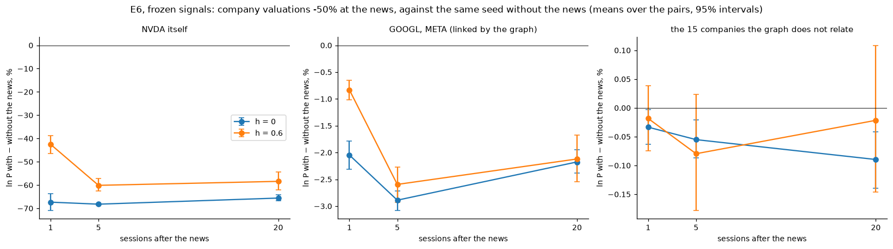

*Rysunek 5. E6b, sygnały zamrożone na 2 stycznia 2024 r.: różnica $\ln P$ z wiadomością (wycena NVDA −50% w sesji 20) i bez niej na tym samym ziarnie, po 1, 5 i 20 sesjach; średnie z 30 par z przedziałami 95%. Konfiguracja `configs/main/e6_shock.yaml`; tabela `runs/main/e6/p6_shock_effects.csv`.*

**Wiadomość o spółce zostaje w swoim sąsiedztwie grafu.**

- **NVDA** przy $h$ = 0 spada już po jednej sesji o 67,3 punktu logarytmicznego [63,6; 70,9] — pełny szok to $\ln 0{,}5 = -69{,}3$.
- **Naśladowanie spowalnia tę reakcję.** Przy $h$ = 0,6 spadek wynosi 42,5 po jednej sesji, 60,1 po pięciu i 58,4 po dwudziestu, czyli cena nie dochodzi do nowej wyceny nawet po 20 sesjach.
- **GOOGL i META**, połączone z NVDA w grafie, tracą 2,0% / 2,9% / 2,2% po 1 / 5 / 20 sesjach. Gdyby wszyscy wyceniający stosowali pełne wagi (NVDA → GOOGL 0,057, NVDA → META 0,086), spadek wyniósłby ok. 4,8%. W składzie `mixed` połowa wyceniających patrzy na cenę NVDA, co daje ok. 2,4% — zgodnie z pomiarem.
- **15 spółek niepowiązanych** zmienia się średnio o −0,03% / −0,06% / −0,09%. Ostatnie dwie wartości są wyraźne z Bonferronim, ale ponad 700 razy mniejsze niż ruch NVDA.
- **Limit ryzyka nie zadziałał** z powodu wiadomości w żadnej z 60 par.

**Werdykt H4: odrzucona w badanym zakresie.** Wszystkie kontrasty kanałów są niewyraźne. **Odpowiedź na P6:** współruch spółek niepowiązanych w symulacji powstaje, i to silniejszy niż w rzeczywistości, ale nie przez wspólny portfel i rebalansowanie. Zastrzeżenie: portfele obejmują 4 spółki, limit ryzyka ma 25% inwestorów, funduszy jest 25, więc kanał majątkowy jest słaby z konstrukcji (rozdz. 5.3, 8).

### 6.4 P7: udział wyceniających sieciowych (E7, H5)

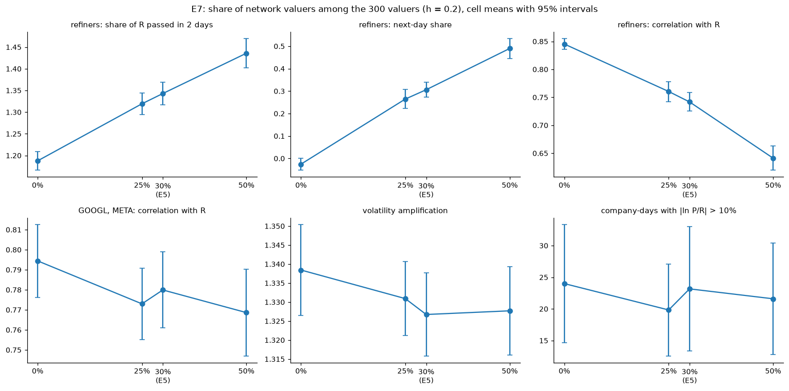

*Rysunek 6. E7: udział wyceniających sieciowych wśród 300 wyceniających ($h$ = 0,2); średnie komórek z przedziałami 95%. Punkt 30% to komórka główna E5. Konfiguracje `configs/main/e7_network{0,25,50}.yaml`; tabele `runs/main/e7/p7_metrics.csv`, `p7_contrasts.csv`.*

| Miara (rafinerie VLO, MPC — 2 kroki od ropy) | 0% | 25% | 30% | 50% | 50% − 0% |
|---|---|---|---|---|---|
| udział ruchu $R$ następnego dnia (`day1_d2`) | −0,03 | 0,27 | 0,31 | 0,49 | **+0,515** [0,480; 0,550] |
| udział ruchu $R$ w dwóch dniach (`pass2_d2`) | 1,19 | 1,32 | 1,34 | 1,44 | +0,248 [0,220; 0,276] |
| korelacja $P$ z $R$ | 0,85 | 0,76 | 0,74 | 0,64 | −0,204 [−0,224; −0,184] |
| *wszystkie spółki:* `day1` | 0,20 | 0,23 | 0,23 | 0,26 | +0,055 [0,047; 0,062] |
| *wszystkie spółki:* wzmocnienie zmienności | 1,34 | 1,33 | 1,33 | 1,33 | −0,011 [−0,024; 0,001] |

Kontrasty 50% − 0% w pierwszych czterech wierszach są wyraźne z Bonferronim, a zależność od udziału jest monotoniczna. **Werdykt H5: odrzucona.** Więcej wyceniających sieciowych wyraźnie **zwiększa** spóźnioną reakcję rafinerii, zamiast ją skracać.

Mechanizm widać w wagach grafu:

- Wyceniający krótkowzroczny wycenia VLO bezpośrednio z ropy (waga bezpośrednia 0,43), więc reaguje tego samego dnia.
- Wyceniający sieciowy wycenia VLO z cen COP i EOG **na symulowanej giełdzie** (COP → VLO 0,54; ropa → VLO tylko 0,05). Czeka więc, aż te ceny się zmienią, i dokłada drugą, spóźnioną falę.
- Obie fale się sumują, więc przestrzelenie w dwóch dniach rośnie z 1,19 do 1,44.

**Odpowiedź na P7:** na grafie `real_v1` fala przechodzi nawet bez wyceniających sieciowych, bo wagi bezpośrednie już zawierają ścieżkę pośrednią. Wiedza o pośrednich zależnościach, czytana z cen innych spółek, dodaje opóźnienie i przestrzelenie zamiast przyspieszenia. Zgadza się to z pilotażem E7.

### 6.5 Werdykty

| Hipoteza | Werdykt | Podstawa |
|---|---|---|
| H1: naśladowanie zwiększa obsunięcia i czas z pustą stroną arkusza | potwierdzona (etap wstępny) | E1, 1 aktywo, pozycja docelowa: $h$ = 0,6 − 0 daje +2,0–3,4 p.p. obsunięcia i +15–19 p.p. czasu z pustą stroną; przedziały powyżej zera ([`progress_overview.md`](../progress_overview.md), rozdz. 4.4) |
| H2: koncentracja kapitału zwiększa wpływ pojedynczych uczestników | częściowo (etap wstępny) | koncentracja zwiększa obsunięcie tylko przy słabym naśladowaniu (stara reguła, $h$ = 0: 0,21% → 0,76%); przy silnym naśladowaniu nie ma efektu przy żadnej regule |
| **H3**: trend i naśladowanie wzmacniają falę i przestrzelenie | **potwierdzona** | rozdz. 6.2: 3 z 3 miar, oba czynniki, wszystkie poziomy |
| **H4**: kanały portfela tworzą nadmiarowy współruch | **odrzucona** (w badanym zakresie) | rozdz. 6.3: kontrasty kanałów niewyraźne; współruch istnieje, ale pochodzi z innego źródła |
| H5: agenci sieciowi skracają opóźnienie | **odrzucona** (efekt przeciwny) | rozdz. 6.4: `day1_d2` 50% − 0% = +0,515 [0,480; 0,550] |

---

## 7. Walidacja: co model odtwarza, a czego nie

Tylko sprawdzian 7.1 jest niezależny od kalibracji: wagi grafu pochodzą z lat 2021–2023, a porównujemy je z latami 2024–2025. Pozostałe porównania z rynkiem są wynikami kalibracji (rozdz. 5.1). Każde porównanie ma kontrolę, bez której nie da się go zinterpretować:

- **dla wartości liczonych z $R$:** $R$ 200 grafów losowych: krawędzie `real_v1` z losowo zamienionymi rodzicami i dziećmi (każda spółka zachowuje liczbę rodziców, każdy rodzic — liczbę dzieci), wagi oszacowane na nowo na latach 2021–2023;
- **dla symulacji:** komórka główna (mixed, $h$ = 0,2) na dwóch grafach losowych i na płaskich wejściach (sygnały zewnętrzne stałe), na ziarnach 5001–5010.

Jeśli kontrola odtwarza statystykę równie dobrze jak model, statystyka nic nie mówi o modelu. Wszystkie liczby: `runs/main/validation/*.csv`, polecenie `python -m marketsim.validation.run checks`.

### 7.1 Graf poza próbą

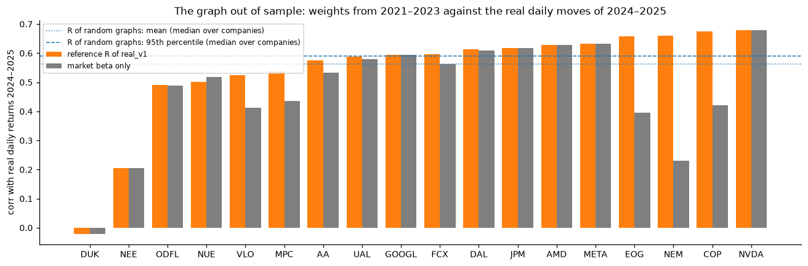

*Rysunek 7. Korelacja dziennej stopy zwrotu $R$ (wagi 2021–2023, prawdziwe sygnały 2024–2025) z prawdziwą stopą zwrotu każdej spółki w latach 2024–2025, obok samej bety rynkowej. Linie: średnia i 95. percentyl dla 200 grafów losowych. Tabele `out_of_sample.csv`, `out_of_sample_by_company.csv`.*

- **Mediana po spółkach:** korelacja $R$ z prawdziwą stopą zwrotu wynosi 0,595, sama beta rynkowa — 0,526.
- **Grafy losowe:** średnio 0,563, 95. percentyl 0,590. Żaden z 200 nie dorównuje `real_v1`.
- **Gdzie graf zyskuje:** na spółkach surowcowych, np. COP 0,67 wobec 0,42 dla bety, EOG 0,66 wobec 0,40, NEM 0,66 wobec 0,23, VLO 0,53 wobec 0,41.
- **Gdzie nie zyskuje:** dla spółek technologicznych i JPM $R$ zawiera tylko ruch indeksu, więc równa się becie.
- **DUK:** korelacja jest bliska zeru dla obu modeli (−0,02), bo w latach 2024–2025 ta spółka energetyczna nie podążała ani za indeksem, ani za gazem.

### 7.2 Reakcja na duże ruchy surowców

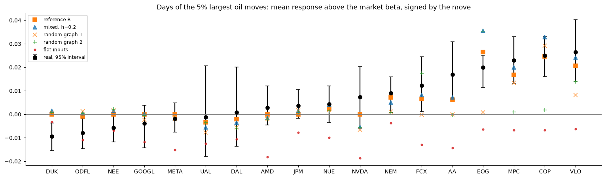

*Rysunek 8. Dni 5% największych ruchów ropy: średnia reakcja każdej spółki ponad betę rynkową, ze znakiem ruchu ropy. Czarne punkty: prawdziwe spółki z przedziałem 95%. Tabele `events_wti_1d.csv`, `events_wti_2d.csv`, `events_copper_2d.csv` i `*_by_company.csv`.*

Statystyka: korelacja między spółkami średniej reakcji modelu i prawdziwej reakcji.

| Zdarzenia | $R$ | symulacja | symulacja, grafy losowe | płaskie wejścia | $R$ grafów losowych: średnia (udział ≥ `real_v1`) |
|---|---|---|---|---|---|
| ropa, 1 dzień | 0,87 | 0,82 | 0,61 / 0,48 | 0,19 | 0,76 (15,5%) |
| ropa, 2 dni | 0,84 | 0,80 | 0,70 / 0,44 | 0,37 | 0,67 (0,5%) |
| miedź, 2 dni | 0,79 | 0,75 | −0,07 / −0,19 | −0,04 | 0,15 (0%) |

**Model odtwarza, które spółki reagują na surowce i jak mocno.** Stosunek wielkości reakcji do prawdziwej wynosi 0,93 dla ropy w 1 dzień i 1,19 w 2 dni. Przewaga nad grafami losowymi jest wyraźna dla miedzi i dla dwudniowej reakcji na ropę. Przy ropie w ciągu 1 dnia 15,5% grafów losowych daje $R$ co najmniej tak dobre jak `real_v1`. Znak reakcji spółek o słabej reakcji symulacja trafia rzadziej niż $R$ (61% wobec 89% spółek).

### 7.3 Własności statystyczne stóp zwrotu

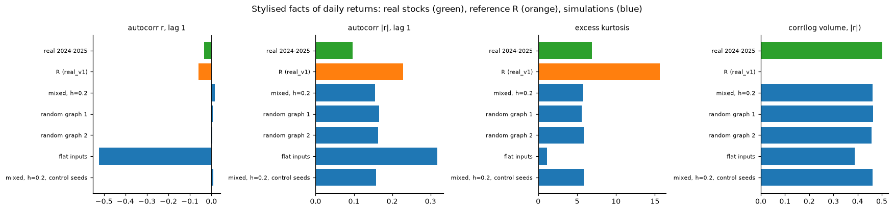

*Rysunek 9. Własności dziennych stóp zwrotu: mediana po spółkach, dla symulacji średnia z przebiegów, po rozgrzewce. Tabela `stylised_facts.csv`.*

| | prawdziwe 2024–2025 | $R$ | symulacja | płaskie wejścia |
|---|---|---|---|---|
| autokorelacja $r$, opóźnienie 1 | −0,035 | −0,060 | 0,016 | −0,524 |
| autokorelacja $\lvert r\rvert$, opóźnienie 1 | 0,097 | 0,228 | 0,156 | 0,317 |
| kurtoza nadwyżkowa | 6,9 | 15,6 | 5,8 | 1,1 |
| odchylenie dzienne, % | 2,27 | 1,29 | 1,72 | 0,63 |
| korelacja $\ln$ wolumenu z $\lvert r\rvert$ | 0,50 | — | 0,46 | 0,39 |
| korelacja z prawdziwą stopą zwrotu | 1 | 0,595 | 0,456 | −0,002 |

Symulacja ma grube ogony, grupowanie zmienności i związek wolumenu z wielkością ruchu bliskie rzeczywistym. Te same własności dają jednak symulacje na grafach losowych (kurtoza 5,6 i 5,8), więc **nie sprawdzają grafu**. Pochodzą z prawdziwych sygnałów i z mechaniki rynku. Na płaskich wejściach kurtoza spada do 1,1, a autokorelacja −0,52 to odbijanie ceny między stronami arkusza.

### 7.4 Graf odbudowany z symulowanych cen

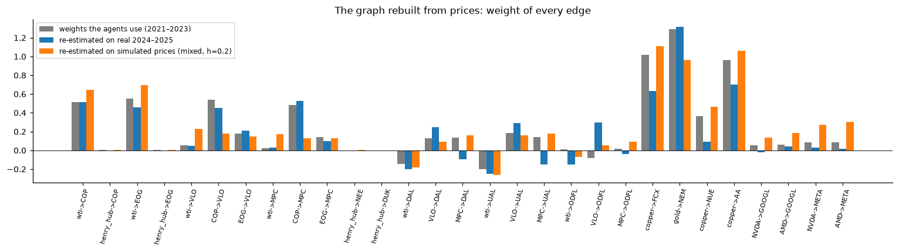

*Rysunek 10. Wagi krawędzi `real_v1` oszacowane na nowo tą samą regresją: z prawdziwych cen 2024–2025 i z cen symulowanych (średnia z przebiegów komórki głównej), obok wag, których używają agenci. Tabele `graph_recovery.csv`, `graph_recovery_by_edge.csv`.*

Korelacja wag odbudowanych z wagami agentów:

- **symulacja:** 0,88;
- **prawdziwe ceny 2024–2025:** 0,91;
- **symulacje na grafach losowych:** 0,23 i 0,31;
- **płaskie wejścia:** −0,04.

Krawędź uznajemy za odzyskaną, gdy ma ten sam znak i $|t| > 2$. Z symulacji odzyskujemy tak 69% krawędzi, z prawdziwych cen 41%: w symulacji nie ma wiadomości o spółkach, które w rzeczywistości zagłuszają zależności. **Rynek przenosi więc strukturę grafu do cen**, a nie tylko do wycen agentów.

### 7.5 Przewidywalne opóźnienia

Test: czy wczorajsza stopa zwrotu rodzica przewiduje dzisiejszą stopę zwrotu dziecka. Udział krawędzi z $|t| > 2$ (tabela `lag_test.csv`):

| | udział krawędzi z $\lvert t\rvert > 2$ | mediana $t$ |
|---|---|---|
| prawdziwe 2024–2025 | 0% | −0,36 |
| symulacja | 62% | 2,93 |
| symulacje na grafach losowych | 49% i 45% | — |
| płaskie wejścia | 10% | — |

To **najwyraźniejsza niezgodność modelu z rynkiem.** W symulacji część fali dochodzi następnego dnia i da się ją przewidzieć, w rzeczywistości nie. Cohen i Frazzini (2008) znajdują takie opóźnienia między dostawcami a odbiorcami w danych miesięcznych, ale w dziennych danych naszych 18 dużych spółek ich nie widać.

### 7.6 Struktura korelacji

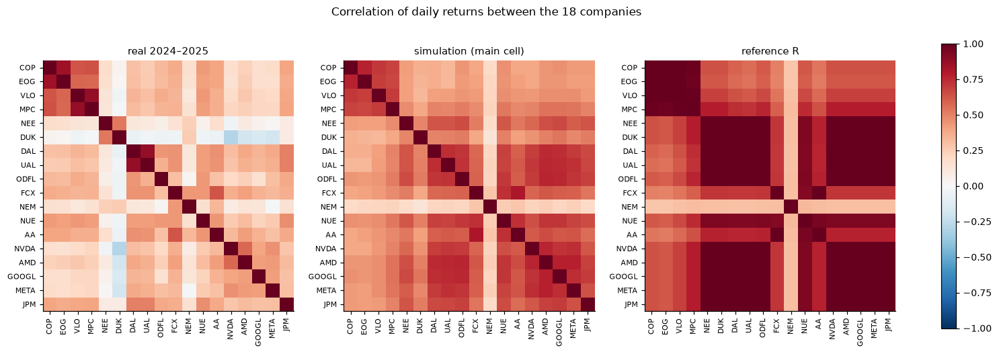

*Rysunek 11. Korelacje dziennych stóp zwrotu 18 spółek: prawdziwe, w symulacji (średnia z przebiegów komórki głównej) i w $R$. Tabele `correlation_structure.csv`, `correlation_pairs.csv`.*

**Wzór korelacji symulacja odtwarza lepiej niż $R$.** Korelacja 153 elementów macierzy symulowanej z prawdziwą wynosi 0,42, dla $R$ — 0,17, dla symulacji na grafach losowych — 0,27 i 0,25.

**Poziom korelacji jest jednak za wysoki:** średnio 0,53 wobec 0,27 w rzeczywistości ($R$: 0,76). Spółki w symulacji poruszają się razem bardziej niż prawdziwe. Ta sama niezgodność widoczna jest w resztach (rozdz. 6.3, tabela `comovement.csv`): pary niepowiązane mają w symulacji korelację reszt 0,12, w rzeczywistości 0,00. Pary powiązane mają odwrotnie: 0,14 w symulacji i 0,19 w rzeczywistości, bo prawdziwe spółki jednej branży łączy więcej niż krawędzie grafu.

### 7.7 Pasma cen

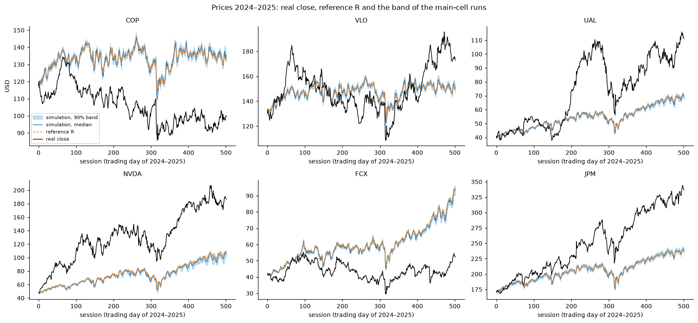

*Rysunek 12. Ceny sześciu spółek w latach 2024–2025: prawdziwe zamknięcie (przeskalowane do ceny startowej symulacji), $R$ oraz mediana i pasmo 90% przebiegów komórki głównej. Tabele `bands.csv`, `band_paths.csv`.*

**Pasmo przebiegów jest wąskie, a prawdziwa cena prawie zawsze leży poza nim.**

- Szerokość pasma to 2–5% (iloraz górnej i dolnej granicy 1,02–1,05).
- Prawdziwa cena mieści się w paśmie w 0–9% sesji i w żadnej spółce na końcu okresu.
- Przebiegi różnią się między sobą niewiele i trzymają się blisko $R$.
- Odległość od rzeczywistości jest więc odległością $R$ od rzeczywistości, wynikającą głównie z braku wiadomości o spółkach (rozdz. 8).

Model nie prognozuje ścieżek konkretnych spółek i nie do tego służy.

### 7.8 Podsumowanie walidacji

| Model odtwarza | Model nie odtwarza |
|---|---|
| zależności grafu poza próbą lepiej niż każdy z 200 grafów losowych (7.1) | ścieżek cen konkretnych spółek (7.7) |
| przekrój reakcji spółek na duże ruchy ropy i miedzi (7.2) | braku przewidywalnych opóźnień między spółkami (7.5) |
| grube ogony, grupowanie zmienności, związek wolumenu z ruchem (7.3; bez wartości dla grafu) | poziomu korelacji akcji i braku współruchu par niepowiązanych (7.6, 6.3) |
| strukturę grafu w cenach (7.4) | autokorelacji stóp zwrotu w składzie `trend` (6.2) |

---

## 8. Dyskusja i ograniczenia

### 8.1 Co wynika z badania

**O tym, jak szok przechodzi przez rynek, decydują przede wszystkim strategie inwestorów, a dopiero potem naśladowanie.** Udział strategii trendowych zmienia wzmocnienie zmienności i odchylenia od $R$ mniej więcej dwa razy mocniej niż naśladowanie na badanym zakresie. Oba czynniki się wzmacniają (rozdz. 6.2). Jakościowo zgadza się to z modelami fundamentalistów i chartystów (Lux i Marchesi, 1999; Chiarella i Iori, 2002). Nowe jest to, że efekt mierzymy na fali rzeczywistego szoku wzdłuż grafu, a nie na jednym aktywie, i parami na tych samych ziarnach.

**Nadmiarowy współruch nie potrzebuje wspólnego portfela.** Kyle i Xiong (2001) wyprowadzają zarażanie z efektu majątkowego wspólnych inwestorów. W naszym rynku ten kanał istnieje (limit ryzyka działa kilkanaście razy na przebieg), ale nie zmienia współruchu. Ten powstaje z tego, jak agenci wchłaniają wspólne ruchy sygnałów, i rośnie z udziałem strategii trendowych (rozdz. 6.3). To wynik dla naszej konstrukcji, w której kanał majątkowy jest słaby (portfele z 4 spółek, limit u 25% inwestorów), a nie ogólne twierdzenie o rynkach. Wynik ma też drugą stronę: współruch, którego prawdziwy rynek nie ma, jest **błędem modelu**. Wyjaśnia go to samo co za wysoki poziom korelacji (rozdz. 7.6).

**Wiedza o sieci, czytana z cen, spowalnia falę.** Wyceniający sieciowy zna pośrednią ścieżkę ropa → COP → VLO, ale poznaje ją przez cenę COP na tym samym, niedoskonałym rynku. Na grafie, w którym wagi bezpośrednie już zawierają tę ścieżkę, dokłada więc spóźnioną drugą falę i przestrzelenie (rozdz. 6.4). Tak samo powstają przewidywalne opóźnienia z rozdz. 7.5, których prawdziwy rynek dzienny nie ma. Mechanizm przypomina opóźnione reakcje na powiązania między dostawcami i odbiorcami opisane przez Cohena i Frazziniego (2008), ale w naszym modelu jest za silny.

### 8.2 Ograniczenia

- **Brak wiadomości o samych spółkach.** Ok. 60% dziennego ruchu prawdziwej akcji to wiadomości o spółce (wyniki, decyzje zarządu). Model ich nie ma i nie powinien mieć. Dlatego pasma przebiegów są wąskie i nie obejmują prawdziwych cen (rozdz. 7.7): nie prognozujemy ścieżek konkretnych spółek, porównujemy wzorce.
- **Rynek reaguje za wolno i zbyt jednolicie.** Inwestor decyduje średnio dwa razy na sesję, więc część ruchu $R$ dochodzi do ceny dopiero następnego dnia. W symulacji 62% krawędzi ma przewidywalne opóźnienie (w rzeczywistości 0%), korelacje akcji są dwa razy wyższe niż prawdziwe, a pary niepowiązane poruszają się razem. Efekty z rozdz. 6 są porównaniami wewnątrz modelu z tą wadą, a nie ilościowymi przewidywaniami dla rynku.
- **Kalibracja na okresie porównania** (rozdz. 5.1). Niezależny jest tylko sprawdzian grafu poza próbą (rozdz. 7.1).
- **Słaby kanał majątkowy z konstrukcji:** 4 spółki w portfelu, limit ryzyka u 25% inwestorów, 25 funduszy, brak kredytu i krótkiej sprzedaży. Odrzucenie H4 dotyczy tego zakresu.
- **H1 i H2 tylko z etapu wstępnego** (1 aktywo, 30 sesji, ziarna pilotażu); w badaniu głównym ich nie powtarzaliśmy.
- **Dwóch animatorów jednej spółki** nadal przesuwa kwotowania względem siebie nawzajem. W badaniu głównym zostały 2 załamania na 690 przebiegów, oba w składzie `trend`.
- **Jedna historia i jeden graf:** lata 2024–2025, stałe wagi grafu z lat 2021–2023, jedna spółka = jedna branża, tylko dane z USA.

---

## 9. Wnioski

1. **P5 / H3 (potwierdzona).** Więcej strategii trendowych i silniejsze naśladowanie wyraźnie zwiększają przestrzelenie, odchylenia od trajektorii referencyjnej i spóźnioną reakcję na rzeczywiste szoki surowcowe. Skład strategii działa mocniej niż naśladowanie, a oba czynniki się wzmacniają.
2. **P6 / H4 (odrzucona).** Symulowany rynek wytwarza współruch spółek niepowiązanych w grafie, ale nie przez wspólny portfel i rebalansowanie: wyłączenie tych kanałów go nie zmienia. Współruch pojawia się tylko przy ruchu sygnałów i rośnie z udziałem strategii trendowych. Prawdziwy rynek tego współruchu nie ma, więc jest to zarazem błąd modelu. Wiadomość o pojedynczej spółce nie wychodzi poza jej sąsiedztwo w grafie.
3. **P7 / H5 (odrzucona, efekt przeciwny).** Fala przechodzi bez agentów znających pośrednie zależności. Ich udział przesuwa reakcję rafinerii na następny dzień i zwiększa przestrzelenie.
4. **Walidacja.** Graf przewiduje prawdziwe ruchy 2024–2025 poza próbą lepiej niż wszystkie 200 grafów losowych, a model odtwarza przekrój reakcji spółek na ropę i miedź. Za wolna i zbyt jednolita reakcja rynku (przewidywalne opóźnienia, za wysokie korelacje) jest główną wadą do usunięcia.

**Dalsze kroki** (wersja angielska, artykuł):

- szybsza i bardziej zróżnicowana reakcja agentów (częstsze decyzje, rozrzut opóźnień) i sprawdzenie, czy wnioski P5–P7 się utrzymują, gdy test opóźnień i poziom korelacji są bliższe rzeczywistym;
- E6 z silniejszym kanałem majątkowym (większe portfele, dźwignia);
- powtórzenie na innym okresie i grafie.

---

## 10. Odtwarzalność

Kod: [github.com/dmitrykitty/stock-exchange-simulation](https://github.com/dmitrykitty/stock-exchange-simulation), commit badania głównego `99c62a7`. Każdy przebieg zapisuje w `meta.json` konfigurację, ziarno, commit i sumy kontrolne grafu i danych.

```bash
pip install -e ".[dev,data,notebooks,viz]" && pip install -e cpp/
python -m marketsim.data.fetch && python -m marketsim.data.clean && python -m marketsim.data.check
scripts/run_main_study.sh        # wszystkie przebiegi, tabele, kontrole F8, rysunki (~6 h na 10 procesach)
```

Tabele: `runs/main/e5/p5_*.csv` (w tym analiza dodatkowa `p5_contrasts_extra.csv`), `runs/main/e6/p6_*.csv`, `runs/main/e7/p7_*.csv`, `runs/main/validation/*.csv` (w tym `comovement.csv`). Tabele i rysunki z gotowych przebiegów:

```bash
python -m marketsim.analysis.study --root runs/main
python -m marketsim.validation.run checks --root runs/main
python -m marketsim.analysis.figures --root runs/main --out docs/figures
```

Tabele `p5_contrasts_extra.csv` i `comovement.csv` dodaliśmy po badaniu głównym (analiza dodatkowa, rozdz. 6.3); kod, który je liczy, nie zmienia żadnej innej tabeli.

---

## Bibliografia

1. Skrzyński, J. (2025). Multi-Agent Simulation of Financial Markets: Micro and Macro Approach. W: R. Doroz, B. Zielosko (red.), *Progress in Polish Artificial Intelligence Research 6*, s. 335–341. Wydawnictwo Uniwersytetu Śląskiego. https://badap.agh.edu.pl/publikacja/165799
2. Lux, T., Marchesi, M. (1999). Scaling and criticality in a stochastic multi-agent model of a financial market. *Nature*, 397, 498–500. https://doi.org/10.1038/17290
3. Chiarella, C., Iori, G. (2002). A simulation analysis of the microstructure of double auction markets. *Quantitative Finance*, 2(5), 346–353. https://doi.org/10.1088/1469-7688/2/5/303
4. Byrd, D., Hybinette, M., Balch, T. H. (2019). ABIDES: Towards High-Fidelity Market Simulation for AI Research. https://arxiv.org/abs/1904.12066
5. Westerhoff, F. (2004). Multiasset market dynamics. *Macroeconomic Dynamics*, 8(5), 596–616. https://doi.org/10.1017/S1365100504040040
6. Chiarella, C., Dieci, R., He, X.-Z. (2007). Heterogeneous expectations and speculative behavior in a dynamic multi-asset framework. *Journal of Economic Behavior & Organization*, 62(3), 408–427. https://doi.org/10.1016/j.jebo.2005.08.005
7. Kyle, A. S., Xiong, W. (2001). Contagion as a Wealth Effect. *Journal of Finance*, 56(4), 1401–1440. https://doi.org/10.1111/0022-1082.00373
8. Barberis, N., Shleifer, A., Wurgler, J. (2005). Comovement. *Journal of Financial Economics*, 75(2), 283–317. https://doi.org/10.1016/j.jfineco.2004.04.003
9. Acemoglu, D., Carvalho, V. M., Ozdaglar, A., Tahbaz-Salehi, A. (2012). The Network Origins of Aggregate Fluctuations. *Econometrica*, 80(5), 1977–2016. https://doi.org/10.3982/ECTA9623
10. Miller, R. E., Blair, P. D. (2009). *Input-Output Analysis: Foundations and Extensions* (2nd ed.). Cambridge University Press. https://doi.org/10.1017/CBO9780511626982
11. Cohen, L., Frazzini, A. (2008). Economic Links and Predictable Returns. *Journal of Finance*, 63(4), 1977–2011. https://doi.org/10.1111/j.1540-6261.2008.01379.x
12. Źródła danych: FRED https://fred.stlouisfed.org/ · BEA Input-Output Accounts https://www.bea.gov/industry/input-output-accounts-data · SEC EDGAR https://www.sec.gov/search-filings/edgar-application-programming-interfaces · Kenneth French Data Library https://mba.tuck.dartmouth.edu/pages/faculty/ken.french/data_library.html · Yahoo Finance https://finance.yahoo.com/
